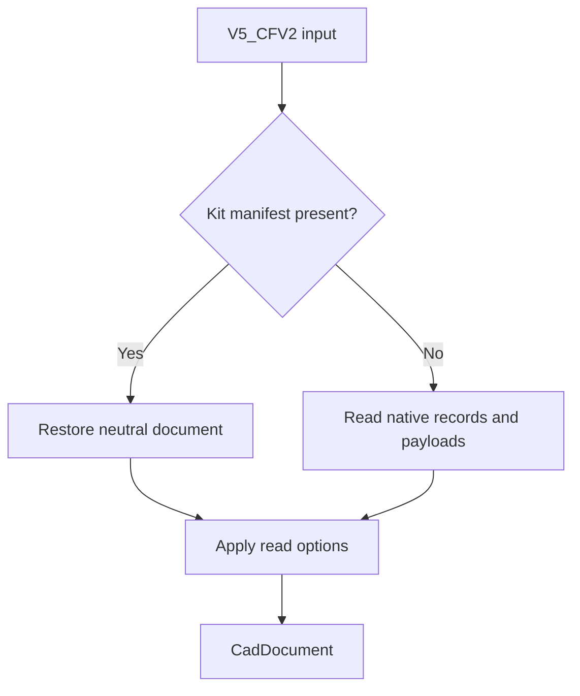

# CATIA adapter

## Purpose and scope

The `catia.v5` adapter reads and writes `.CATPart` and `.CATProduct` containers.
It supports source replay and neutral-data preservation paths.
Registration does not establish complete native CATIA feature reconstruction.

## Container

The adapter handles the `V5_CFV2` container.
Do not describe this container as a generic CFBF archive.
Its directory and stream rules belong to the CATIA container implementation.

| Stream or marker        | Use                                 |
| ----------------------- | ----------------------------------- |
| `1000_00000002_2`       | Part data                           |
| `1000_00000001_1`       | Product data                        |
| `Format`                | Document type information           |
| `KitInterchange`        | Embedded neutral document           |
| `CATSummaryInformation` | Application and version metadata    |
| `OSMX`                  | Native object information           |
| `CGM`, `MFBRP`          | Geometry payload identification     |
| `CGR`                   | Tessellation payload identification |

Markers identify candidate content.
Their presence does not establish complete decoding of every referenced record.

## Reading

The reader checks for an embedded Kit manifest.
When that manifest exists, it can restore the neutral document.
Otherwise, the reader examines native streams and available payloads.
Read filters then control the requested output information.

The manifest path and native decoding path provide different evidence.
Do not report manifest recovery as complete native feature decoding.

## Writing

| Metadata mode                    | Representation                         | Limit                                                                   |
| -------------------------------- | -------------------------------------- | ----------------------------------------------------------------------- |
| `exact_native_roundtrip`         | Source native replay                   | Does not prove cross-format translation                                 |
| `exact_carrier_roundtrip`        | Replay of a carrier source             | Does not establish native editability                                   |
| `native_base_with_neutral_edits` | Native base with a neutral overlay     | CATIA can retain the original native state instead of the neutral edits |
| `generated_cfv2`                 | New container with neutral information | Container generation does not establish usable native features          |

The native-base path uses the input document's own data.
An unrelated donor file is not an authorized substitute.
The writer can add `KitInterchange` information to retain neutral edits.
A target application need not interpret that information.

## Semantic comparison

The adapter uses a semantic digest to decide whether a replay path applies.
The comparison excludes designated source-dependent or envelope information.
A matching semantic digest is not an independent vendor acceptance result.
It is also not authentication of the source author.

## Use and recovery

1. Select `catia.v5` when the destination cannot identify its format.
2. Keep the part or product suffix consistent with the intended document type.
3. Set `allow_carrier=False` when the task requires the stricter policy.
4. Inspect every transfer and compatibility value.
5. Record the target application's actual behavior.

If the result retains only neutral edits, do not claim native CATIA editability.
Use [error recovery](../../Tasks/Troubleshoot.md) for rejected output.

## Sources

- [Adapter](../../../src/convert/adapters/catia/Adapter.py)
- [Container](../../../src/convert/adapters/catia/Container.py)
- [Format metadata](../../../src/convert/adapters/catia/Format.py)
- [CATIA integration coverage](../../../tests/convert/catia/)
