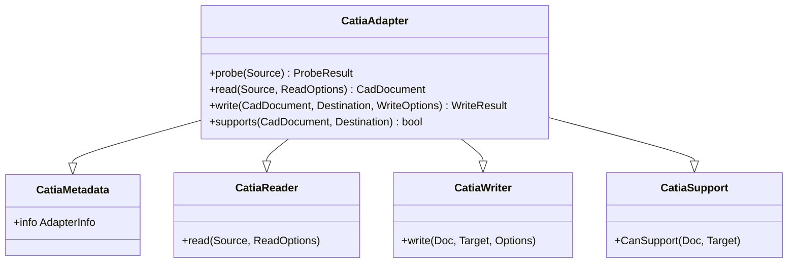
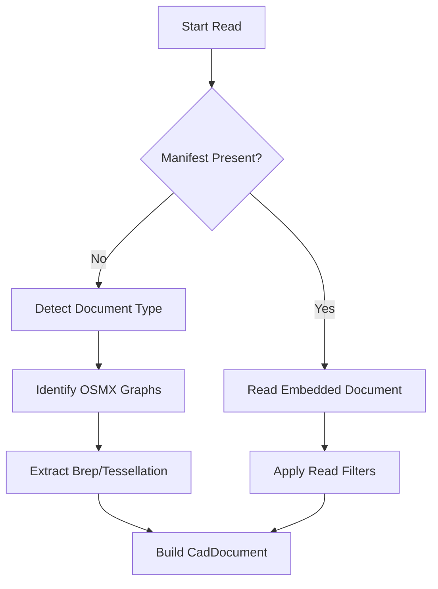
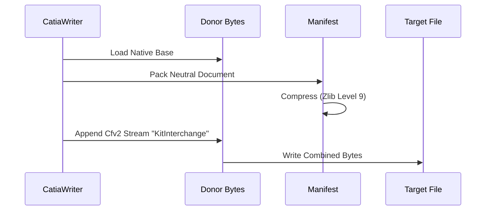

<!--
SPDX-License-Identifier: MIT
SPDX-FileCopyrightText: Copyright (c) 2026 Parashell, Odin Glynn-Martin, Stephen Harcourt
-->

Relevant source files

The following files were used as context for generating this wiki page:

- [src/convert/adapters/catia/Adapter.py](https://github.com/TryUniCAD/Kit/blob/aeff047c355622e812ab5d79b665d8f64c4075bb/src/convert/adapters/catia/Adapter.py)
- [src/convert/adapters/catia/Container.py](https://github.com/TryUniCAD/Kit/blob/aeff047c355622e812ab5d79b665d8f64c4075bb/src/convert/adapters/catia/Container.py)
- [tests/convert/catia/CatiaTests.py](https://github.com/TryUniCAD/Kit/blob/aeff047c355622e812ab5d79b665d8f64c4075bb/tests/convert/catia/CatiaTests.py)
- [re/Methodology.md](https://github.com/TryUniCAD/Kit/blob/aeff047c355622e812ab5d79b665d8f64c4075bb/re/Methodology.md)
- [src/convert/adapters/catia/Format.py](https://github.com/TryUniCAD/Kit/blob/aeff047c355622e812ab5d79b665d8f64c4075bb/src/convert/adapters/catia/Format.py)

# CATIA Format Adapter

The CATIA Format Adapter enables the Kit SDK to read and write CATIA V5 files. It handles the extraction of geometry, feature history, and assembly structures from `.CATPart` and `.CATProduct` containers. The adapter treats these files as CFBF (Compound File Binary Format) envelopes containing various binary streams and records.

## Architecture Overview

The adapter consists of four primary components that implement the standard Kit adapter interface. These components handle metadata identification, source probing, document reading, and destination writing.

The diagram shows the class hierarchy of the CATIA adapter, combining metadata, reading, writing, and support logic.

## Container Structure

CATIA V5 files utilize the `V5_CFV2` container format. This format organizes data into an outer directory and optional nested directories, each containing multiple data streams. The adapter parses these streams to identify the document type and extract payloads.

### Supported Streams

| Stream Name             | Purpose                      | Role               |
| ----------------------- | ---------------------------- | ------------------ |
| `1000_00000002_2`       | Primary Part Data            | Feature History    |
| `1000_00000001_1`       | Primary Product Data         | Assembly Structure |
| `Format`                | Document Type Marker         | Metadata           |
| `KitInterchange`        | Embedded Kit Manifest        | Document           |
| `CATSummaryInformation` | Version and Application Info | Metadata           |

## Read Logic

The `CatiaReader` processes `V5_CFV2` archives by detecting the document type and extracting native payloads. If a `KitInterchange` stream exists, it restores the neutral document from the embedded manifest.

The flow diagram illustrates the decision path between reading a native CATIA file and restoring an embedded Kit document.

### Payload Identification

The adapter classifies binary streams based on signatures and declarations:

- **OSMX**: Native feature history or assembly structure.
- **CGM**: Native B-Rep geometry.
- **MFBRP**: B-Rep topology data.
- **CGR**: Native tessellation (SceneGraph/SurfacicReps).

## Write Logic

The `CatiaWriter` supports three primary write modes based on the availability of the source document's own native data and the target configuration.

### Write Modes

| Mode                             | Description                                                             | Compatibility                 |
| -------------------------------- | ----------------------------------------------------------------------- | ----------------------------- |
| `exact_native_roundtrip`         | Replays original native bytes for unmodified documents.                 | `native-exact`                |
| `native_base_with_neutral_edits` | Preserves native streams but adds a neutral manifest for edits.         | `native-base-neutral-overlay` |
| `generated_cfv2`                 | Generates a new CFV2 container from scratch with embedded neutral data. | `kit-neutral-only`            |

### Native Base Preservation

When `native-base-neutral-overlay` is active, the adapter appends a `KitInterchange` stream to an existing CATIA file. This preserves the original native features for CATIA while allowing Kit to store changes in a neutral format.

This sequence shows how the adapter overlays neutral Kit data onto native source-document bytes.

## Semantic Validation

To ensure data integrity, the adapter calculates a `catia.roundtrip_sha256` digest. This digest is a hash of the document's semantic content, excluding specific source-dependent metadata and the native envelope payloads themselves.

## Implementation Details

The adapter uses standard Python libraries for low-level data handling:

- `struct`: For parsing binary headers and extent offsets.
- `hashlib`: For generating SHA256 digests of streams and manifests.
- `zlib`: For compressing and decompressing the embedded Kit manifest.

### OSMX Graph Extraction

The adapter identifies native features by searching for `OSMX` markers within the container. It maps these graphs to `FeatureStep` and `Body` records in the `CadDocument`, allowing for basic structural representation of the part history.

### Conclusion

The CATIA Format Adapter provides a robust bridge between CATIA V5 files and the Kit neutral model. By supporting both native byte replay and generated neutral carriers, it ensures maximum interoperability while preserving original proprietary data whenever possible.

Carrier and neutral-overlay modes preserve data but do not establish editable native CATIA features. Inspect the output attestation and require target-application acceptance; see [Getting started](../../GettingStarted.md).
