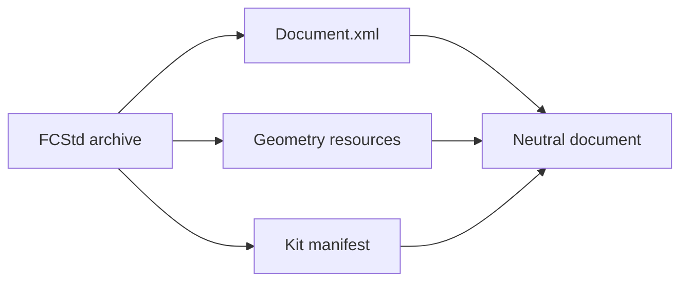

# FreeCAD adapter

## Purpose and scope

The `freecad.fcstd` adapter handles `.FCStd` files through direct archive parsing and writing.
Production conversion does not require a FreeCAD application or module.
Feature coverage depends on the implemented reader and writer families.

## Archive structure

A FreeCAD document is a ZIP archive with `Document.xml` and related resources.
Shape data can reside in `.brp` members.
Mesh data can reside in `.bms` members.
Kit can also store a neutral manifest in `interchange/document.json`.

An embedded manifest and a native object graph are different representations.
The vendor application does not necessarily interpret the neutral manifest.

## Resource limits

The archive implementation uses these limits:

| Item                   | Limit     |
| ---------------------- | --------- |
| Archive members        | 16,384    |
| Individual member      | 512 MiB   |
| Total expanded members | 1 GiB     |
| `Document.xml`         | 512 MiB   |
| Compression ratio      | 500       |
| External files         | 256       |
| Manifest JSON depth    | 256       |
| XML depth              | 256       |
| XML nodes              | 2,000,000 |

These values use binary byte units.
The archive checks also reject unsafe paths and unsupported entry types.
A limit failure is not permission to disable validation.

## Native interpretation

The native reader maps object declarations, properties, sketches, and feature dependencies into neutral records.
The protocol tables identify recognized type families.
A recognized type identifier does not prove complete reconstruction of every instance.

| Component     | Responsibility                                    |
| ------------- | ------------------------------------------------- |
| `Archive.py`  | Archive resources and document representation     |
| `Native.py`   | Native object graph interpretation                |
| `Protocol.py` | Type and property vocabulary                      |
| `Brep.py`     | B-rep handling                                    |
| `Adapter.py`  | Public adapter operations and result construction |

## Write paths

The writer can replay suitable unchanged source data.
For other inputs, it constructs native records for implemented features and retains additional information as required.
Inspect the resulting transfers and usability flags.
Do not infer losslessness from a generated `Document.xml` file.

The `portable` writer option defaults to true in the inspected adapter revision.
For assemblies, portable output can include companion component files.
The final destination identifies the base location for those files.
Keep the output bundle together when moving it.

## Assembly behavior

The adapter maps native assembly objects and links to neutral definitions and instances.
Constraint mappings depend on the implemented native joint representation.
A matching joint name does not establish equal motion or constraint behavior.
Inspect the [assembly model](../Model/Assembly.md) and acceptance evidence.

## Use and recovery

1. Keep the source and destination paths separate.
2. Check the requested feature families before conversion.
3. Inspect the writer's transfer records.
4. Preserve companion outputs with the main file.
5. Obtain the required remote target-application evidence.

If archive validation fails, record the limit or invalid member.
If native output is incomplete, retain the structured failure.
Do not load FreeCAD as a production fallback.

## Sources

- [Adapter](../../../src/convert/adapters/freecad/Adapter.py)
- [Archive validation](../../../src/convert/adapters/freecad/Archive.py)
- [Native interpretation](../../../src/convert/adapters/freecad/Native.py)
- [Protocol tables](../../../src/convert/adapters/freecad/Protocol.py)
- [FreeCAD integration coverage](../../../tests/convert/freecad/)
