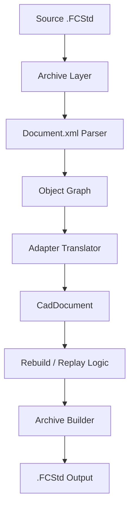
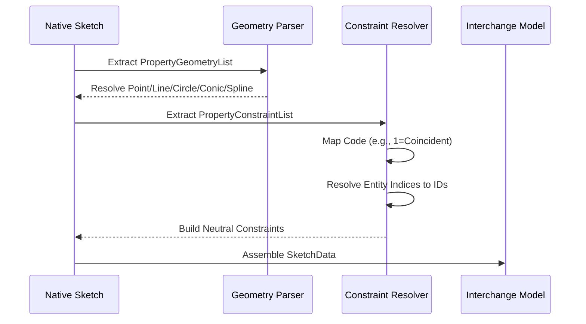

<!--
SPDX-License-Identifier: MIT
SPDX-FileCopyrightText: Copyright (c) 2026 Parashell, Odin Glynn-Martin, Stephen Harcourt
-->

Relevant source files

The following files were used as context for generating this wiki page:

- [src/convert/adapters/freecad/Adapter.py](https://github.com/TryUniCAD/Kit/blob/aeff047c355622e812ab5d79b665d8f64c4075bb/src/convert/adapters/freecad/Adapter.py)
- [src/convert/adapters/freecad/Archive.py](https://github.com/TryUniCAD/Kit/blob/aeff047c355622e812ab5d79b665d8f64c4075bb/src/convert/adapters/freecad/Archive.py)
- [src/convert/adapters/freecad/Brep.py](https://github.com/TryUniCAD/Kit/blob/aeff047c355622e812ab5d79b665d8f64c4075bb/src/convert/adapters/freecad/Brep.py)
- [src/convert/adapters/freecad/Native.py](https://github.com/TryUniCAD/Kit/blob/aeff047c355622e812ab5d79b665d8f64c4075bb/src/convert/adapters/freecad/Native.py)
- [src/convert/adapters/freecad/Protocol.py](https://github.com/TryUniCAD/Kit/blob/aeff047c355622e812ab5d79b665d8f64c4075bb/src/convert/adapters/freecad/Protocol.py)
- [tests/convert/freecad/FreecadTests.py](https://github.com/TryUniCAD/Kit/blob/aeff047c355622e812ab5d79b665d8f64c4075bb/tests/convert/freecad/FreecadTests.py)

# FreeCAD Format Adapter

The FreeCAD Format Adapter is a core component of the Kit interchange system. It provides bidirectional translation between FreeCAD's native `.FCStd` format and the neutral Kit `CadDocument` model. The adapter operates by directly parsing and generating FreeCAD ZIP-based archives without requiring a FreeCAD installation or vendor runtime.

## Architecture Overview

The adapter follows a layered architecture to handle the complexities of the FreeCAD file format. It decomposes the conversion process into archive handling, object graph parsing, and geometry reconstruction.

The diagram above shows the data flow from a native FreeCAD file through the parsing layers to a neutral document, and the subsequent path back to a generated FreeCAD file.

### Component Roles

| Component        | Responsibility                                                        |
| :--------------- | :-------------------------------------------------------------------- |
| `FreeCadAdapter` | Entry point implementing `probe`, `read`, and `write` interfaces.     |
| `Archive.py`     | Handles ZIP structure, resource limits, and XML extraction.           |
| `Native.py`      | Decodes native FreeCAD object graphs, sketches, and features.         |
| `Brep.py`        | Translates OpenCASCADE B-Rep data between FreeCAD and neutral models. |
| `Protocol.py`    | Defines type IDs, constraint codes, and feature family mappings.      |

## Archive Handling

FreeCAD files are ZIP archives containing a primary `Document.xml` and auxiliary sidecar files like `.brp` (OpenCASCADE B-Rep) or `.bms` (Binary Mesh). The adapter enforces strict security and resource limits during archive extraction to prevent exploits like compression bombs or unsafe path traversals.

### Resource Limits

| Limit                   | Value   | Description                                       |
| :---------------------- | :------ | :------------------------------------------------ |
| `MAX_ENTRY_SIZE`        | 512 MB  | Maximum size of a single file within the archive. |
| `MAX_TOTAL_SIZE`        | 1024 MB | Maximum aggregate size of all entries.            |
| `MAX_ENTRIES`           | 16,384  | Maximum number of files in one archive.           |
| `MAX_COMPRESSION_RATIO` | 500     | Prevents "ZIP bomb" attacks.                      |

## Object Graph Translation

The adapter parses the `Document.xml` to reconstruct the parametric history. It maps native FreeCAD types to neutral `FeatureKind` and `GeometryKind` enums.

### Supported Feature Types

The adapter recognizes over 90 native feature types. Key families include:

- **PartDesign**: Pads, Pockets, Revolutions, Grooves, Fillets, Chamfers.
- **App**: Planes, Links, Parts.
- **Assembly**: Assembly Objects, Joint Groups, Joints.

### Sketch and Constraint Parsing

Native sketches are translated by mapping `Sketcher::PropertyConstraintList` to neutral `SketchConstraint` objects.

## Write Logic: Rebuild vs. Replay

The adapter implements two distinct write strategies: **Exact Replay** and **Reconstruction**.

### Exact Replay

If the `CadDocument` contains metadata proving it was originally read from a FreeCAD file and has not undergone semantic changes, the adapter performs an `exact_native_roundtrip`. This re-emits the original binary streams and XML to ensure 100% fidelity.

### Reconstruction (Rebuild)

If the document was modified or originated from another CAD system (e.g., SOLIDWORKS), the adapter synthesizes a new `Document.xml` and generates the necessary sidecar files.

1. **Manifest Generation**: Converts the document to a JSON manifest embedded in the archive.
2. **XML Synthesis**: Builds an object graph using `PartDesign` and `Part` workbench objects.
3. **Geometry Generation**: Converts neutral B-Rep models into OpenCASCADE `.brp` strings.

## Assembly Support

The adapter handles FreeCAD assemblies by mapping `App::Part` and `App::Link` objects to neutral `ComponentDefinition` and `ComponentInstance` records. It supports external references by resolving relative paths within the document root.

### External Document Handling

- **Portability**: If the `portable` option is set, the adapter bundles referenced `.FCStd` files into a subfolder named after the main assembly.
- **Link Mapping**: Re-maps `XLink` attributes in the generated XML to point to the new bundled locations.
