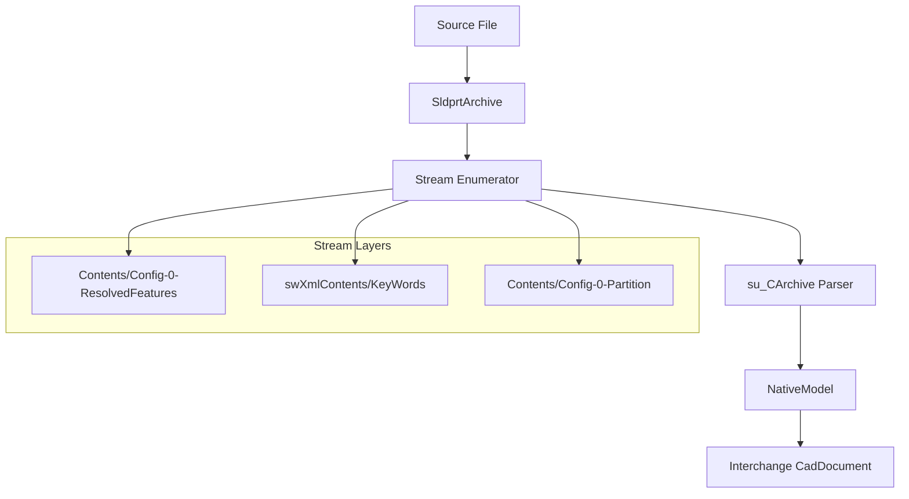
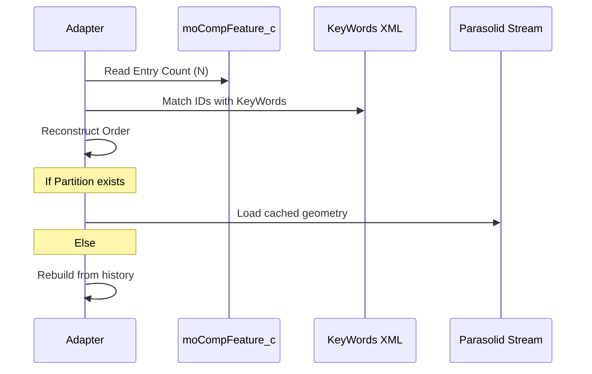

<!--
SPDX-License-Identifier: MIT
SPDX-FileCopyrightText: Copyright (c) 2026 Parashell, Odin Glynn-Martin, Stephen Harcourt
-->

Relevant source files

The following files were used as context for generating this wiki page:

- [src/convert/adapters/solidworks/core/Adapter.py](https://github.com/TryUniCAD/Kit/blob/aeff047c355622e812ab5d79b665d8f64c4075bb/src/convert/adapters/solidworks/core/Adapter.py)
- [src/convert/adapters/solidworks/container/Container.py](https://github.com/TryUniCAD/Kit/blob/aeff047c355622e812ab5d79b665d8f64c4075bb/src/convert/adapters/solidworks/container/Container.py)
- [src/convert/adapters/solidworks/container/Archive.py](https://github.com/TryUniCAD/Kit/blob/aeff047c355622e812ab5d79b665d8f64c4075bb/src/convert/adapters/solidworks/container/Archive.py)
- [re/Methodology.md](https://github.com/TryUniCAD/Kit/blob/aeff047c355622e812ab5d79b665d8f64c4075bb/re/Methodology.md)
- [re/solidworks/archive/Grammar.md](https://github.com/TryUniCAD/Kit/blob/aeff047c355622e812ab5d79b665d8f64c4075bb/re/solidworks/archive/Grammar.md)
- [re/solidworks/features/RevolveDonorSpec.md](https://github.com/TryUniCAD/Kit/blob/aeff047c355622e812ab5d79b665d8f64c4075bb/re/solidworks/features/RevolveDonorSpec.md)

# SOLIDWORKS Format Adapter

The SOLIDWORKS Format Adapter enables the Kit SDK to read and write `.SLDPRT` and `.SLDASM` files. It translates proprietary binary records into a neutral CAD interchange model, supporting geometry, feature trees, and assembly structures without requiring a local SOLIDWORKS installation.

The adapter operates by parsing a proprietary container format that uses a raw-deflate stream archive with nibble-swapped names. The writer contains first-principles generation and source-document replay/edit paths. These must be distinguished from donor-patching experiments in `re/`, which are not production conversion strategies.

## Architecture and Components

The adapter uses a layered architecture to handle the complexity of the SOLIDWORKS format. It separates the physical container framing from the logical object serialization layer (`su_CArchive`).

This diagram shows the flow from a physical file through the archive and stream layers to the neutral document model.

### Key Classes

| Class           | Description                                                                              |
| :-------------- | :--------------------------------------------------------------------------------------- |
| `SldprtAdapter` | The primary entry point for probing, reading, and writing SOLIDWORKS files.              |
| `SldprtArchive` | Manages the physical container, handling deflate decompression and stream access.        |
| `NativeModel`   | Represents the decoded SOLIDWORKS-specific feature tree and geometry before translation. |
| `su_CArchive`   | Implements the vendor-specific version of MFC `CArchive` object serialization.           |

## Container Framing

SOLIDWORKS files are compound binary containers. The adapter identifies these files by a header version and a signature triplet consisting of a file ID and local/central/end signatures.

- **Stream Names**: Encoded using a nibble-swapped scheme (e.g., `Contents/Config-0-ResolvedFeatures`).
- **Body Cache**: The `Contents/Config-0-Partition` stream contains Parasolid geometry. If this stream is missing or deleted, SOLIDWORKS rebuilds the solid from the feature tree records.
- **Metadata**: XML side-streams like `swXmlContents/KeyWords` store document-level metadata and configuration info.

## Object Serialization (su_CArchive)

The adapter implements a byte-compatible clone of MFC `CArchive` serialization. This layer handles the mapping of class definitions to numeric indices.

### Tag Grammar

| Tag Bytes    | Meaning                                             |
| :----------- | :-------------------------------------------------- |
| `00 00`      | Null object pointer.                                |
| `ff ff`      | New class definition (followed by schema and name). |
| `t & 0x8000` | Class or object reference (index into the map).     |

When you insert or delete an object, the adapter must renumber every subsequent class-reference token because the map counter increments for every new definition and object in stream order.

## Feature Tree Translation

The feature tree is controlled primarily by the `moCompFeature_c` record. This record is a fixed-stride array where each entry corresponds to a tree node (interleaving sketches and features).

The sequence diagram illustrates the prioritization of the feature tree and the optional nature of the geometry cache.

- **Rebuild Order**: SOLIDWORKS derives the rebuild order from the array order in `moCompFeature_c`, not from the physical order of objects in the stream.
- **Boss vs Cut**: This operation is often opaque and implied by derived face-identity records rather than a simple boolean flag.
- **Sketches**: 2D coordinates are stored as `float64` pairs in meters, wrapped in 18-byte prefixes.

## Writing and acceptance

The [adapter implementation](https://github.com/TryUniCAD/Kit/blob/aeff047c355622e812ab5d79b665d8f64c4075bb/src/convert/adapters/solidworks/core/Adapter.py) dispatches supported native generation through `EncodeNativePart` and also contains source-document replay/edit paths. Reusing the input document's own streams is distinct from selecting an unrelated donor fixture.

Production writers must derive output from decoded format knowledge. Do not use research skeletons, recorded vendor streams, or opaque donor blocks as runtime templates. Unsupported feature families remain incomplete until their grammar and target-application acceptance are established.

A byte-identical replay, a carrier, or a claimed native mode does not establish a successful cross-format translation. Verify body count, volume, center of mass, feature tree, editable dimensions, and rebuild behavior in an isolated vendor oracle with healthy controls. See [the acceptance standard](../../../.agents/skills/standard-pr-practice/references/Standards/Portable/LosslessTranslation.md).
