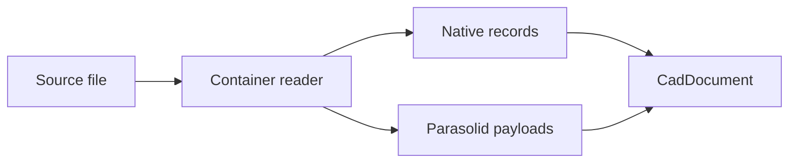

# SOLIDWORKS adapter

## Purpose and scope

Kit registers one SOLIDWORKS adapter with part and assembly identifiers.
Its primary `format_id` is `solidworks.sldprt`.
Its `aliases` field contains `solidworks.sldasm`.
The adapter reads source records and writes implemented native structures or preservation representations.
It does not invoke SOLIDWORKS during production conversion.

| Identifier          | Suffix    |
| ------------------- | --------- |
| `solidworks.sldprt` | `.SLDPRT` |
| `solidworks.sldasm` | `.SLDASM` |

`available_adapters()` returns one entry for this adapter.
Read its `aliases` field to find the assembly identifier.
See [format selection](../../Tasks/SelectFormat.md) for a discovery example.

Registration is not evidence of complete feature-family support.
Inspect the exact source, target, and capability results for each conversion.

## Container and records

The container layer handles physical streams and compression.
The logical record layer interprets serialized objects and their references.
Keep these layers separate when diagnosing a failed file.

| Stream                               | Information                          |
| ------------------------------------ | ------------------------------------ |
| `Contents/Config-0-ResolvedFeatures` | Serialized feature records           |
| `Contents/Config-0-Partition`        | Cached Parasolid geometry            |
| `swXmlContents/KeyWords`             | Metadata useful for feature identity |
| `Contents/Definition`                | Native document definition records   |
| `Contents/CMgr`                      | Configuration-related records        |
| `Contents/Config-0-ModelHeader`      | Model header records                 |

The implemented container uses encoded stream names and compressed data.
A valid stream directory does not prove valid native feature records.
A valid feature record does not establish a successful vendor rebuild.

## Read flow

The reader combines available feature, geometry, and assembly information.
Source metadata and diagnostics qualify the decoded result.
The cached body geometry and feature history provide different evidence.

## Feature history

The resolved-feature grammar includes class definitions and object references.
The archive map changes as records are read.
Structural edits require consistent identifiers and map indices.
See [feature resolution](SolidworksFeatures.md) for the observed grammar.

The `moCompFeature_c` record supplies feature-tree ordering information in the documented research families.
Do not infer rebuild order from physical stream order alone.
Boss and cut behavior can depend on several related records.
A single flag change is not a general operation converter.

## Writing and acceptance

The adapter includes first-principles native generation and source-document replay or edit paths.
A source replay uses the input document's own data.
An unrelated donor fixture is prohibited in production writing.

Native generation must derive each emitted structure from known format rules.
Unsupported feature families remain unsupported until their grammar and acceptance evidence are available.
Do not present a carrier or a mode label as a completed translation.

## Geometry cache boundary

The partition stream can contain geometry derived from feature history.
Some measured research cases permit regeneration by the vendor application.
That observation does not authorize deleting caches in arbitrary documents.
Verify the field, source family, and vendor version before relying on regeneration.

## Inspect a result

1. Record the part or assembly format identifier.
2. Record the selected configuration.
3. Inspect native and carrier transfers separately.
4. Check body and feature-history evidence.
5. Check assembly references when applicable.
6. Obtain the required target-application measurements.

Expected result: the report identifies both implemented behavior and unresolved acceptance conditions.
See [result evaluation](../../Tasks/InspectResult.md).

## Sources

- [Adapter implementation](../../../src/convert/adapters/solidworks/core/Adapter.py)
- [Format metadata](../../../src/convert/adapters/solidworks/container/Format.py)
- [Container](../../../src/convert/adapters/solidworks/container/Container.py)
- [Archive](../../../src/convert/adapters/solidworks/container/Archive.py)
- [Research grammar](../../../re/solidworks/archive/Grammar.md)
- [SOLIDWORKS research index](../../../re/solidworks/README.md)
