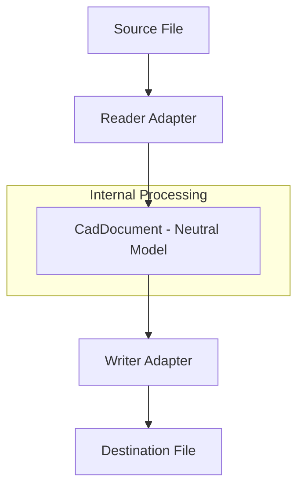
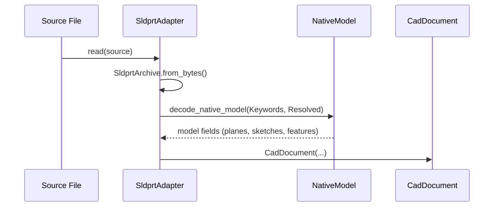

<!--
SPDX-License-Identifier: MIT
SPDX-FileCopyrightText: Copyright (c) 2026 Parashell, Odin Glynn-Martin, Stephen Harcourt
-->

Relevant source files

The following files were used as context for generating this wiki page:

- [re/Methodology.md](https://github.com/TryUniCAD/Kit/blob/aeff047c355622e812ab5d79b665d8f64c4075bb/re/Methodology.md)
- [src/convert/adapters/solidworks/core/Adapter.py](https://github.com/TryUniCAD/Kit/blob/aeff047c355622e812ab5d79b665d8f64c4075bb/src/convert/adapters/solidworks/core/Adapter.py)
- [src/convert/adapters/freecad/Adapter.py](https://github.com/TryUniCAD/Kit/blob/aeff047c355622e812ab5d79b665d8f64c4075bb/src/convert/adapters/freecad/Adapter.py)
- [README.md](https://github.com/TryUniCAD/Kit/blob/aeff047c355622e812ab5d79b665d8f64c4075bb/README.md)
- [re/solidworks/archive/Grammar.md](https://github.com/TryUniCAD/Kit/blob/aeff047c355622e812ab5d79b665d8f64c4075bb/re/solidworks/archive/Grammar.md)

# Architecture Overview

Kit is an open-source CAD interchange SDK that translates geometry, feature trees, and assemblies between proprietary binary formats. It reads and writes these formats natively, eliminating the requirement for local CAD software installations during the conversion process.

The system utilizes a modular adapter-based architecture. Every conversion follows a linear pipeline where a reader adapter parses a source file into a neutral `CadDocument` model, which a writer adapter then serializes into the destination format. This architecture enables bidirectional interoperability between supported formats like SOLIDWORKS (`.SLDPRT`, `.SLDASM`) and FreeCAD (`.FCStd`).

## Core Conversion Pipeline

The conversion process is structured as a unidirectional data flow mediated by an internal neutral representation. The `convert(source, destination)` function manages this pipeline by selecting the appropriate adapters based on file extensions.

_This diagram illustrates the standard route for format translation within the Kit SDK._

### Components and Responsibilities

| Component          | Responsibility                                                             | Key Classes/Functions                    |
| :----------------- | :------------------------------------------------------------------------- | :--------------------------------------- |
| **Reader Adapter** | Parses proprietary binary containers and streams into the neutral model.   | `probe()`, `read()`                      |
| **CadDocument**    | Acts as the neutral intermediate representation for geometry and metadata. | `CadDocument`, `CadSource`               |
| **Writer Adapter** | Serializes the neutral model into a specific target format.                | `supports()`, `write()`                  |
| **Registry**       | Manages the lookup and instantiation of available adapters.                | `Registry.reader()`, `Registry.writer()` |

## Reverse Engineering Methodology

Kit's ability to handle proprietary formats like SOLIDWORKS 2025 is derived from a systematic reverse-engineering playbook. This methodology moves from container framing to static decompilation to ensure floating-point exactness in reconstructed files.

### The Measurement Oracle

A critical component of the architecture is the **measurement oracle**. This is an unattended verification loop that uses vendor APIs (like SOLIDWORKS COM) to quantitatively validate the correctness of generated files by comparing mass properties such as volume and center of mass.

### Serialization Layers

Proprietary formats are addressed through a layered approach:

1.  **Container Framing**: Cracking the file envelope (e.g., modified ZIP or OLE/CFBF).
2.  **Archive Layer**: Decoding object serialization protocols, such as MFC-style `CArchive` or the vendor's specialized `su_CArchive`.
3.  **Stream Mapping**: Locating specific records like feature trees (`moCompFeature_c`) and sketch coordinates.

## Adapter Implementation

Each format adapter implements a standard protocol to ensure they can be plugged into the conversion engine.

### SOLIDWORKS Adapter (`sldprt`/`sldasm`)

The SOLIDWORKS adapter handles complex compound streams. It includes logic to process `swXmlContents` for metadata and binary lanes for resolved geometry. It supports both "exact" replay mode—where source bytes are preserved if no semantic changes occur—and "generated" mode for new geometry.

_This sequence shows how the SOLIDWORKS adapter reconstructs a neutral document from binary streams._

### FreeCAD Adapter (`fcstd`)

The FreeCAD adapter manages `.FCStd` files, which are ZIP containers holding `Document.xml` and sidecar B-rep files. It translates FreeCAD-specific object types (e.g., `PartDesign::Pad`) into neutral feature steps.

## Capability and Attestation

Kit uses an **attestation system** to track which features survive a round-trip conversion. This is necessary because different formats have varying levels of support for complex features like parametric history or assembly mates.

- **Native Mode**: The feature was reconstructed using the target's native records.
- **Carrier Mode**: The feature data is preserved as an opaque blob (carrier) to prevent data loss even if the target application cannot edit it.
- **Mixed Mode**: A combination where some parts of a feature are native and others are carried.
