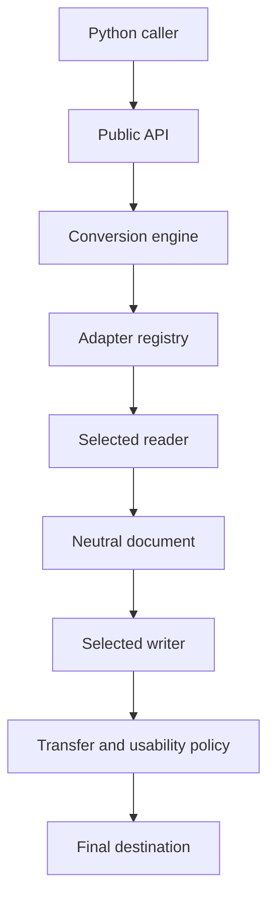

# SDK architecture

## Purpose

This reference describes the boundary between the public API, adapters, and neutral model.
It is for integrators and adapter developers.
It does not specify complete format support.

## Components

| Component     | Responsibility                                          | Source                                                                      |
| ------------- | ------------------------------------------------------- | --------------------------------------------------------------------------- |
| Public API    | Accept caller options and return public result types    | [API](../../../src/convert/api/__init__.py)                                 |
| Engine        | Coordinate the read and write operations                | [Engine](../../../src/convert/engine/EngineConvert.py)                      |
| Registry      | Discover adapters and apply selection and output policy | [Registry](../../../src/convert/adapters/registry/)                         |
| Reader        | Decode source information into the neutral model        | [Adapter protocols](../../../src/convert/adapters/base/AdapterProtocols.py) |
| Neutral model | Represent document information and validate references  | [Document model](../../../src/interchange/document/models/DocumentModel.py) |
| Writer        | Produce target structures and transfer evidence         | [Writer result](../../../src/convert/adapters/base/WriteResult.py)          |
| Staging       | Separate policy checks from final destination writes    | [Staging](../../../src/convert/adapters/staging/)                           |

## Conversion boundary

The registry checks writer results before committing staged output.
The caller receives an attestation about the representation.
The attestation does not execute an independent vendor measurement.

## Dependency direction

Readers and writers share the neutral model contract.
A source adapter does not need to call a destination adapter directly.
The public API translates compatibility names into implementation options.
Keep external callers on the public API unless they own an adapter integration.

## Production and research

Production modules must not depend on a CAD installation, vendor service, or oracle harness.
Research tooling can use vendor applications in isolated environments.
Research evidence can inform a parser or writer.
Recorded donor bytes must not become production templates.

## Extension workflow

1. Identify the owning adapter or model contract.
2. Read the applicable repository standards.
3. Add behavior in focused modules.
4. Preserve the declared input and output contracts.
5. Add integration coverage at the real component boundary.
6. Document capability limits and acceptance evidence.

Run tests in remote CI.
See [contribution workflow](../Overview/Contributing.md).

## Failure boundaries

Selection errors identify missing or ambiguous adapters.
Reader errors identify unsupported or invalid input.
Model validation errors identify inconsistent records or references.
Writer policy errors identify unacceptable output claims or capability loss.
Destination errors identify filesystem or stream failures.

Keep these categories separate in application logs.
See [error recovery](../../Tasks/Troubleshoot.md).
