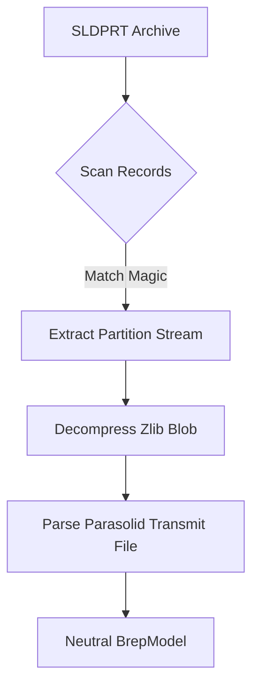
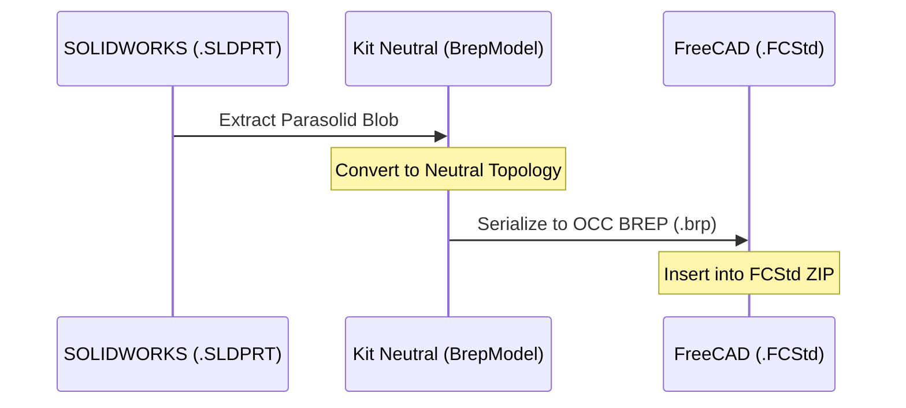

<!--
SPDX-License-Identifier: MIT
SPDX-FileCopyrightText: Copyright (c) 2026 Parashell, Odin Glynn-Martin, Stephen Harcourt
-->

Relevant source files

The following files were used as context for generating this wiki page:

- [src/convert/adapters/solidworks/container/Parasolid.py](https://github.com/TryUniCAD/Kit/blob/aeff047c355622e812ab5d79b665d8f64c4075bb/src/convert/adapters/solidworks/container/Parasolid.py)
- [src/convert/adapters/freecad/Archive.py](https://github.com/TryUniCAD/Kit/blob/aeff047c355622e812ab5d79b665d8f64c4075bb/src/convert/adapters/freecad/Archive.py)
- [src/convert/adapters/solidworks/core/Adapter.py](https://github.com/TryUniCAD/Kit/blob/aeff047c355622e812ab5d79b665d8f64c4075bb/src/convert/adapters/solidworks/core/Adapter.py)
- [re/solidworks/README.md](https://github.com/TryUniCAD/Kit/blob/aeff047c355622e812ab5d79b665d8f64c4075bb/re/solidworks/README.md)
- [re/solidworks/archive/Grammar.md](https://github.com/TryUniCAD/Kit/blob/aeff047c355622e812ab5d79b665d8f64c4075bb/re/solidworks/archive/Grammar.md)
- [re/solidworks/features/Revolve.md](https://github.com/TryUniCAD/Kit/blob/aeff047c355622e812ab5d79b665d8f64c4075bb/re/solidworks/features/Revolve.md)

# Geometry Translation (Parasolid & OpenCASCADE)

Kit provides bidirectional translation between CAD-neutral B-rep models and vendor-specific geometry formats, primarily focusing on Parasolid (used by SOLIDWORKS) and OpenCASCADE (used by FreeCAD). The system handles the extraction, transformation, and re-injection of B-rep data into proprietary containers.

## Parasolid Translation

Parasolid translation manages the extraction and encoding of `.x_t` (text) and `.x_b` (binary) geometry data within SOLIDWORKS `.SLDPRT` and `.SLDASM` files.

### Geometry Extraction

Kit identifies Parasolid payloads by scanning compound stream records for specific magic numbers or headers. It identifies native Parasolid content within raw-deflate streams. The decoder extracts compressed Parasolid transmit blobs and converts them into neutral `BrepModel` structures.

### Payload Management

The following diagram illustrates the flow of Parasolid data during a SOLIDWORKS part read:

The system identifies `Contents/Config-0-Partition` as the primary Parasolid body cache in SOLIDWORKS files.

### Feature-Based Rebuilds

Kit can drop the Parasolid geometry cache entirely in SOLIDWORKS files. If the cache is absent, SOLIDWORKS rebuilds the identical solid geometry from the feature history records (`Contents/Config-0-ResolvedFeatures`) and XML metadata.

## OpenCASCADE Translation

OpenCASCADE translation facilitates B-rep interchange for FreeCAD `.FCStd` files, typically using the BREP format.

### BREP Serialization

The system converts neutral B-rep models into OpenCASCADE-compatible ASCII BREP strings. These strings start with the standard header: `CASCADE Topology V1, (c) Matra-Datavision`.

### FreeCAD Geometry Logic

FreeCAD adapters handle geometry through `Part::PropertyPartShape` properties. Kit manages primary `.brp` (BREP) files and associated sidecar files like `.Map.txt` (Element Maps) to preserve topological naming and entity mappings.

## Comparison of Geometry Formats

| Format          | Native CAD | Storage Method              | Neutral Representation           |
| :-------------- | :--------- | :-------------------------- | :------------------------------- |
| **Parasolid**   | SOLIDWORKS | Compressed blobs in streams | `BrepModel` / `ParasolidPayload` |
| **OpenCASCADE** | FreeCAD    | ASCII `.brp` files in ZIP   | `BrepModel` / `ProvenAsciiBrep`  |

## Cross-Format Data Flow

Conversion between formats utilizes a central neutral model.

### Geometry Consistency Rules

- **Stale Caches**: Stale derived caches (like bounding boxes or Parasolid face blobs) are generally safe to leave in the document; the vendor application recomputes them on load.
- **Incorrect Caches**: Writing plausible but mathematically incorrect geometry caches often leads to application crashes or zero-volume bodies.
- **Feature Identity**: SOLIDWORKS identifies bodies via a `final_feature_id` which must correlate with the B-rep bodies stored in the Parasolid partition.

## Implementation Details

### Parasolid Payload Schema

The `BrepPayload` object for Parasolid data includes specific attributes used for reconstruction:

| Attribute         | Type    | Description                         |
| :---------------- | :------ | :---------------------------------- |
| `format_id`       | string  | Set to `"parasolid"`                |
| `kind`            | string  | e.g., `"partition"` or `"shape"`    |
| `wrapper_offset`  | integer | Byte offset of the vendor wrapper   |
| `compressed_size` | integer | Size of the zlib-compressed payload |

### Code Snippet: OpenCASCADE BREP Header Validation

Kit validates OpenCASCADE ASCII BREP strings by checking for the structural header.

Consult the linked source file for the exact implementation; this reference does not duplicate executable code.
