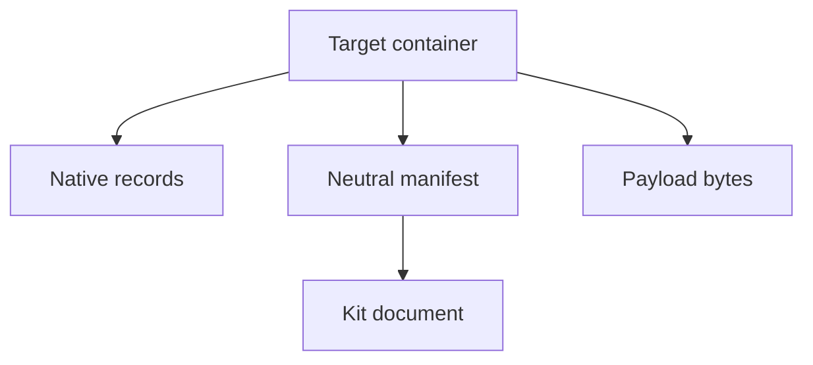

<!--
SPDX-License-Identifier: MIT
SPDX-FileCopyrightText: Copyright (c) 2026 Parashell, Odin Glynn-Martin, Stephen Harcourt
-->

# Serialization and payload records

## Purpose

Serialization converts model records into portable data.
Payload records retain associated bytes and their meaning.
This reference is for integrators who store or inspect neutral documents.

## Data boundary

The wire layer accepts defined primitive and collection types.
The decoder reconstructs recognized model records from that representation.
Field mappings retain compatibility with historical public names.

| Element           | Responsibility                                          |
| ----------------- | ------------------------------------------------------- |
| `KWireData`       | Recursive wire-data contract                            |
| `CheckWireData`   | Validation of wire values                               |
| `KWireFields`     | Common field-name mapping                               |
| `KTypeWireFields` | Type-specific field mapping                             |
| JSON codec        | Text encoding and decoding through the model serializer |

An accepted wire value is not automatically a valid CAD document.
Model validation must also check references and domain constraints.

## JSON encoding

The JSON codec uses sorted keys and preserves non-ASCII text.
The JSON adapter writes UTF-8 output.
Type markers allow the decoder to identify model records.
Do not edit type markers or field names as ordinary prose.

See [JSON adapter](../Adapters/Json.md) for stream and file behavior.
See [read and write](../../Tasks/ReadWrite.md) for the public API procedure.

## Payload roles

| Role           | Information                      |
| -------------- | -------------------------------- |
| `BREP`         | Boundary representation data     |
| `TESSELLATION` | Display mesh data                |
| `DOCUMENT`     | Native source document data      |
| `VERIFICATION` | Verification-related information |
| `AUXILIARY`    | Additional resources or metadata |

A role describes purpose.
It does not guarantee that the target application can use the bytes.
A document payload can retain private source data.
Inspect payloads before distributing a serialized model.

## Embedded manifests

FreeCAD output can contain `interchange/document.json`.
CATIA output can contain `KitInterchange`.
These representations let Kit retain neutral information.
Their presence does not establish native target interpretation of all retained information.

The native records and manifest can describe different levels of editability.
Inspect the writer's transfer report before acceptance.

## Integrity and provenance

A digest detects a mismatch relative to the expected digest.
An attacker who controls both bytes and digest can replace both.
Do not describe an unsigned hash as proof of authorship or authenticity.

Semantic digests can support replay decisions.
They can exclude designated envelope or source-dependent fields.
Record which digest and comparison scope support a claim.
Do not substitute a semantic match for target-application measurements.

## Input limits

Archive readers apply format-specific size, depth, and resource limits.
The FreeCAD manifest depth limit is 256 in the inspected revision.
That value is not a universal limit for every decoder.
See [security boundaries](../Operations/Security.md).

## Sources

- [Wire data](../../../src/interchange/serialization/WireData.py)
- [Field mappings](../../../src/interchange/serialization/WireFields.py)
- [JSON codec](../../../src/interchange/serialization/JsonCodec.py)
- [Payload model](../../../src/interchange/payloads/PayloadRecord.py)
