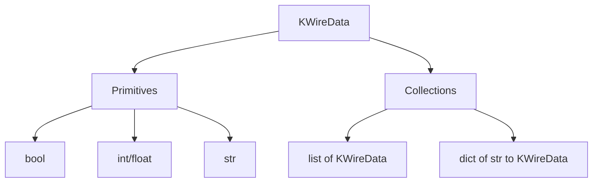
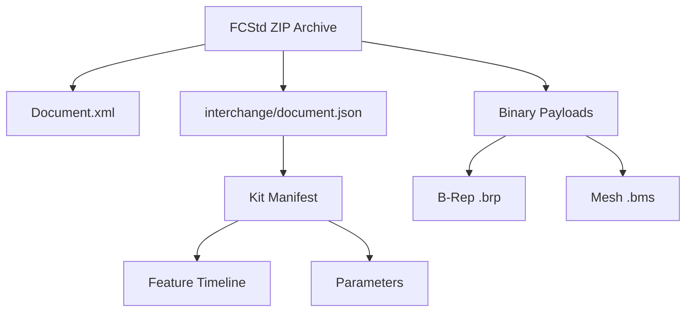

<!--
SPDX-License-Identifier: MIT
SPDX-FileCopyrightText: Copyright (c) 2026 Parashell, Odin Glynn-Martin, Stephen Harcourt
-->

Relevant source files

The following files were used as context for generating this wiki page:

- [src/interchange/serialization/WireData.py](https://github.com/TryUniCAD/Kit/blob/aeff047c355622e812ab5d79b665d8f64c4075bb/src/interchange/serialization/WireData.py)
- [src/interchange/serialization/WireFields.py](https://github.com/TryUniCAD/Kit/blob/aeff047c355622e812ab5d79b665d8f64c4075bb/src/interchange/serialization/WireFields.py)
- [src/convert/adapters/freecad/Archive.py](https://github.com/TryUniCAD/Kit/blob/aeff047c355622e812ab5d79b665d8f64c4075bb/src/convert/adapters/freecad/Archive.py)
- [src/convert/adapters/catia/Adapter.py](https://github.com/TryUniCAD/Kit/blob/aeff047c355622e812ab5d79b665d8f64c4075bb/src/convert/adapters/catia/Adapter.py)
- [re/solidworks/archive/Grammar.md](https://github.com/TryUniCAD/Kit/blob/aeff047c355622e812ab5d79b665d8f64c4075bb/re/solidworks/archive/Grammar.md)
- [src/interchange/enums/EnumDocument.py](https://github.com/TryUniCAD/Kit/blob/aeff047c355622e812ab5d79b665d8f64c4075bb/src/interchange/enums/EnumDocument.py)

# Wire Serialization & Payloads

Wire Serialization & Payloads manages the translation of CAD document structures into a neutral, portable data format and handles the associated binary data (payloads) required for proprietary formats. The system ensures that complex data graphs, such as parametric history and B-Rep geometry, remain valid across different CAD environments by enforcing strict data contracts and using standardized serialization techniques.

The architecture separates logical metadata (the "wire") from physical binary data (the "payload"). This separation allows the project to support multiple CAD formats—including FreeCAD, CATIA, and SOLIDWORKS—while maintaining a single, consistent internal representation for conversion and interoperability tasks.

## Wire Data Architecture

The "wire" layer defines the recursive data contract for all serialized documents. It utilizes a centralized mapping system to ensure that identifiers and fields remain byte-compatible across different versions of the software.

### Recursive Data Contract

The `KWireData` type alias establishes the foundation for all serialized data. It allows for primitive types (bool, int, float, str) as well as recursive structures like lists and dictionaries. The system validates untrusted parser output against this contract before any further processing occurs.

The `CheckWireData` function recursively traverses inputs to verify they satisfy these constraints.

### Field Mapping and Compatibility

To maintain backward compatibility, the system employs a field mapping table (`KWireFields`). This table translates historical internal keys into current standardized field names. Specific records, such as `BrepVertex` or `Selection`, use refined mappings (`KTypeWireFields`) to resolve identifier collisions without weakening the overall wire contract.

## Proprietary Serialization Grammars

Each supported CAD format uses specific serialization grammars to store its internal object graphs. The project reverse-engineers these grammars to enable first-principles writing and accurate reading.

### su_CArchive (SOLIDWORKS)

SOLIDWORKS uses a proprietary object serialization system known as `su_CArchive`. It is byte-compatible with MFC `CArchive` but exported from vendor-specific DLLs. It uses a tag-based grammar to define and reference classes and objects.

| Tag     | Meaning          | Data Structure                              |
| :------ | :--------------- | :------------------------------------------ | ------------------------------- |
| `00 00` | Null Object      | Null pointer sentinel                       |
| `FF FF` | New Class        | `u16 schema` + `u16 nameLen` + `ascii name` |
| `0x8000 | i`               | Class Reference                             | 15-bit index into the class map |
| `i`     | Object Reference | Index into the object map                   |

### V5_CFV2 (CATIA)

CATIA utilizes the `V5_CFV2` container format. This format organizes data into an envelope containing multiple streams and records. Serialization involves defining class ordinals and base-class relationships within the container's directory structure.

## Payload Management

Payloads are binary blobs associated with a CAD document, such as BREP models or tessellation meshes. Each payload is assigned a role and verified via cryptographic hashes.

### Payload Roles

The system categorizes payloads based on their semantic purpose in the document.

| Role           | Description                      | Typical Formats        |
| :------------- | :------------------------------- | :--------------------- |
| `BREP`         | Boundary Representation geometry | Parasolid, OpenCASCADE |
| `TESSELLATION` | Discrete surface mesh data       | CGR, MeshKernel        |
| `DOCUMENT`     | The primary native document file | FCStd, CATPart, SLDPRT |
| `VERIFICATION` | Checksums or signatures          | SHA256                 |
| `AUXILIARY`    | Supporting metadata or sidecars  | JSON, XML              |

### FreeCAD Archive Integration

FreeCAD archives (`.FCStd`) serve as a primary container for neutral Kit documents. The archive includes a specific entry, `interchange/document.json`, which holds the serialized manifest.

The `Archive` module enforces safety limits on these payloads, such as a maximum entry size of 512 MB and strict validation of file paths to prevent directory traversal.

## Integrity and Verification

The serialization system maintains data integrity through multi-level validation and measurement oracles.

1.  **JSON Depth Limits:** Embedded manifests are restricted to a maximum depth (e.g., 256) to prevent recursion-based attacks during deserialization. Sources: [src/convert/adapters/freecad/Archive.py:136](https://github.com/TryUniCAD/Kit/blob/aeff047c355622e812ab5d79b665d8f64c4075bb/src/convert/adapters/freecad/Archive.py), [src/convert/adapters/catia/Adapter.py:53](https://github.com/TryUniCAD/Kit/blob/aeff047c355622e812ab5d79b665d8f64c4075bb/src/convert/adapters/catia/Adapter.py)
2.  **SHA256 Checksums:** Every binary payload and the neutral manifest itself are hashed. The system refuses to load documents if the current data does not match the attested hash. Sources: [src/convert/adapters/freecad/Archive.py:1571-1582](https://github.com/TryUniCAD/Kit/blob/aeff047c355622e812ab5d79b665d8f64c4075bb/src/convert/adapters/freecad/Archive.py), [src/convert/adapters/catia/Adapter.py:270-305](https://github.com/TryUniCAD/Kit/blob/aeff047c355622e812ab5d79b665d8f64c4075bb/src/convert/adapters/catia/Adapter.py)
3.  **Semantic Digests:** High-level semantic summaries are generated to determine if edits made to a document can be replayed natively or if they require a carrier-only fallback. Sources: [src/convert/adapters/catia/Adapter.py:1185-1235](https://github.com/TryUniCAD/Kit/blob/aeff047c355622e812ab5d79b665d8f64c4075bb/src/convert/adapters/catia/Adapter.py)
