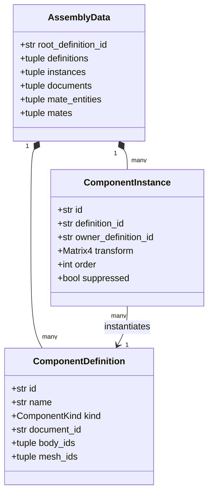
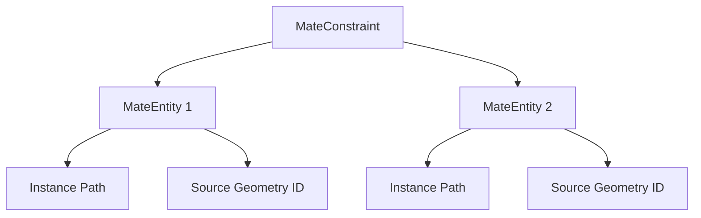
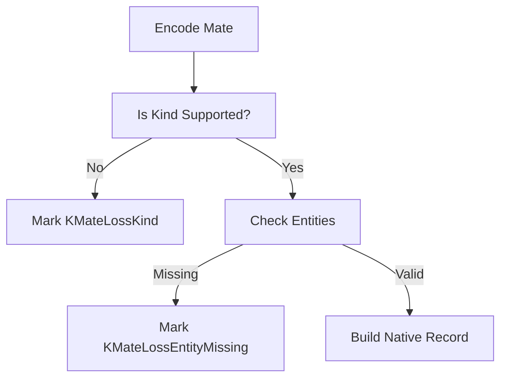

<!--
SPDX-License-Identifier: MIT
SPDX-FileCopyrightText: Copyright (c) 2026 Parashell, Odin Glynn-Martin, Stephen Harcourt
-->

Relevant source files

The following files were used as context for generating this wiki page:

- [src/convert/adapters/solidworks/assembly/Assembly.py](https://github.com/TryUniCAD/Kit/blob/aeff047c355622e812ab5d79b665d8f64c4075bb/src/convert/adapters/solidworks/assembly/Assembly.py)
- [src/convert/adapters/solidworks/core/Adapter.py](https://github.com/TryUniCAD/Kit/blob/aeff047c355622e812ab5d79b665d8f64c4075bb/src/convert/adapters/solidworks/core/Adapter.py)
- [src/convert/adapters/freecad/Native.py](https://github.com/TryUniCAD/Kit/blob/aeff047c355622e812ab5d79b665d8f64c4075bb/src/convert/adapters/freecad/Native.py)
- [src/convert/adapters/freecad/Adapter.py](https://github.com/TryUniCAD/Kit/blob/aeff047c355622e812ab5d79b665d8f64c4075bb/src/convert/adapters/freecad/Adapter.py)
- [tests/interchange/fixtures/AssemblyFixture.py](https://github.com/TryUniCAD/Kit/blob/aeff047c355622e812ab5d79b665d8f64c4075bb/tests/interchange/fixtures/AssemblyFixture.py)

# Assembly & Constraints Model

The Assembly & Constraints Model defines the structured representation of multi-part CAD assemblies and the kinematic relationships (mates) between their components. This model enables the project to preserve hierarchical structures, component instances, and geometric constraints across different CAD formats such as SOLIDWORKS and FreeCAD.

The model captures component definitions, instances with spatial transforms, and mate constraints. It serves as the primary neutral structure for transferring assembly data while accounting for format-specific limitations like opaque source records or unsupported joint types.

## Assembly Structure

An assembly consists of a root definition and a collection of definitions, instances, and documents. The hierarchy is defined by parent-child relationships between instances and definitions.

### Component Definitions and Instances

A `ComponentDefinition` represents a unique part or sub-assembly blueprint. A `ComponentInstance` represents a specific occurrence of a definition within an assembly, positioned by a `Matrix4` transform.

### Hierarchical Resolution

The model resolves complex hierarchies by tracking `owner_definition_id` for every instance. In SOLIDWORKS, this is stored in the `COMPONENT_TREE_STREAM`, while FreeCAD uses `App::Link` objects.

| Component      | Description                                                                       |
| :------------- | :-------------------------------------------------------------------------------- |
| **Definition** | The master record for a part or assembly, containing geometry or nested children. |
| **Instance**   | A specific occurrence of a definition with unique position and visibility state.  |
| **Root**       | The top-level definition that contains all other components.                      |

## Constraints and Mates

Constraints (mates) define how components are restricted in space relative to each other. These are modeled as `MateConstraint` objects referencing `MateEntity` objects.

### Mate Model

A mate links two or more entities. Each entity defines a path to a specific component occurrence and the source geometry identifier (e.g., a face or edge name).

### Supported Mate Kinds

The project maps format-specific joints to a neutral `MateKind`.

| Kind           | Description             | SOLIDWORKS Native | FreeCAD Native           |
| :------------- | :---------------------- | :---------------- | :----------------------- |
| **Coincident** | Faces or edges touching | `coincident`      | `Fixed` (JointType 0)    |
| **Concentric** | Shared axes or centers  | `concentric`      | `Revolute` (JointType 1) |
| **Hinge**      | Revolute movement       | `revolute`        | `Revolute`               |
| **Distance**   | Fixed offset            | `distance`        | `Distance` property      |
| **Angle**      | Fixed rotational offset | `angle`           | `Angle` property         |

## Transformation and Encodings

Assemblies require precise coordinate transformations and encoding logic to move between binary formats and the neutral model.

### Coordinate Systems

The model uses 16-value 4x4 matrices (`Matrix4`) to define component positions.

- **SOLIDWORKS**: Matrices are stored in the `COMPONENT_TREE_STREAM` XML attributes. Lengths are converted from meters to millimeters.
- **FreeCAD**: Uses `App::PropertyPlacement` which combines a position vector and a rotation quaternion.

### Capability and Loss Tracking

When transferring assemblies, the model tracks "Loss Reasons" if native records cannot be fully reproduced.

## External Reference Management

Assemblies often reference external files. The model manages these through "Portable Bundles" or "Carrier Envelopes".

1.  **Portable Bundle**: Re-writes component paths to relative locations within a sub-folder to ensure the assembly opens on another machine.
2.  **Carrier Envelope**: Embeds the original source bytes inside the destination file to prevent data loss even if the translator cannot fully express the assembly structure.
