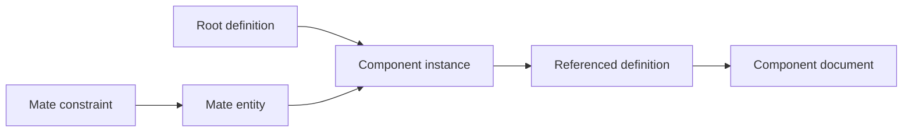

# Assembly and constraint model

## Purpose

The assembly model represents reusable components and their occurrences.
It also records constraints between component entities.
Use this reference when inspecting assembly preservation or portability.

## Structure

| Record or field      | Responsibility                                    |
| -------------------- | ------------------------------------------------- |
| `root_definition_id` | Identifies the top-level definition               |
| `definitions`        | Contains shared part or subassembly descriptions  |
| `instances`          | Contains occurrences with placement and ownership |
| `documents`          | Contains referenced neutral documents             |
| `mate_entities`      | Identifies entities used by constraints           |
| `mates`              | Contains constraints between entities             |
| `mate_groups`        | Groups related constraints                        |
| `attributes`         | Retains additional assembly information           |

A definition describes a shared component.
An instance describes one occurrence of that component.
Several instances can refer to one definition.
Do not duplicate a definition merely because its instances have different placements.

The instance owner identifies its place in the assembly hierarchy.
A component path and a definition identifier serve different purposes.

## Placements

Instances use a 4-by-4 transform representation.
Keep coordinate frames and length units consistent across the assembly.
Do not compare raw translation values from different unit systems.
An apparently correct viewport does not establish correct placement or mass properties.

## Constraints

A mate refers to component entities and their geometry.
Supported neutral kinds include relationships such as coincident, concentric, distance, and angle.
A target format can express a different subset or interpretation.
Do not equate constraint names without checking behavior.

A missing entity reference can make a constraint unusable even when its kind is supported.
Inspect capability transfers and the adapter's constraint mapping.
For acceptance, verify component motion and constraint behavior where the task requires them.

## External documents

Assemblies can refer to external source documents.
A portable output must preserve the required component data and usable references.
The FreeCAD writer can create companion output files.
Those files form part of the deliverable.

Do not distribute only the top-level file when its result requires companion files.
Do not treat embedded opaque bytes as proof of a complete native assembly.
See [FreeCAD output](../Adapters/Freecad.md) and [write staging](../Architecture/Engine.md).

## Inspection procedure

1. Identify the root definition.
2. Resolve each instance's definition and owner.
3. Check placements with explicit units.
4. Resolve the required component documents.
5. Inspect mate entities and constraints.
6. Compare the output transfer records with the source assembly.

Expected result: every required occurrence, reference, and constraint has an identified representation.
Report unresolved component paths and constraint losses before acceptance.

## Sources

- [Assembly model](../../../src/interchange/document/models/DocumentModel.py)
- [Component instance](../../../src/interchange/assembly/ComponentInstance.py)
- [Mate constraint](../../../src/interchange/assembly/MateConstraint.py)
- [Assembly validation](../../../src/interchange/document/validation/DocumentAssemblyValidate.py)
