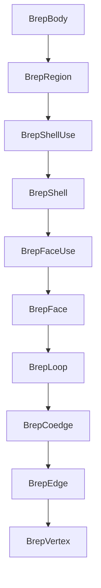
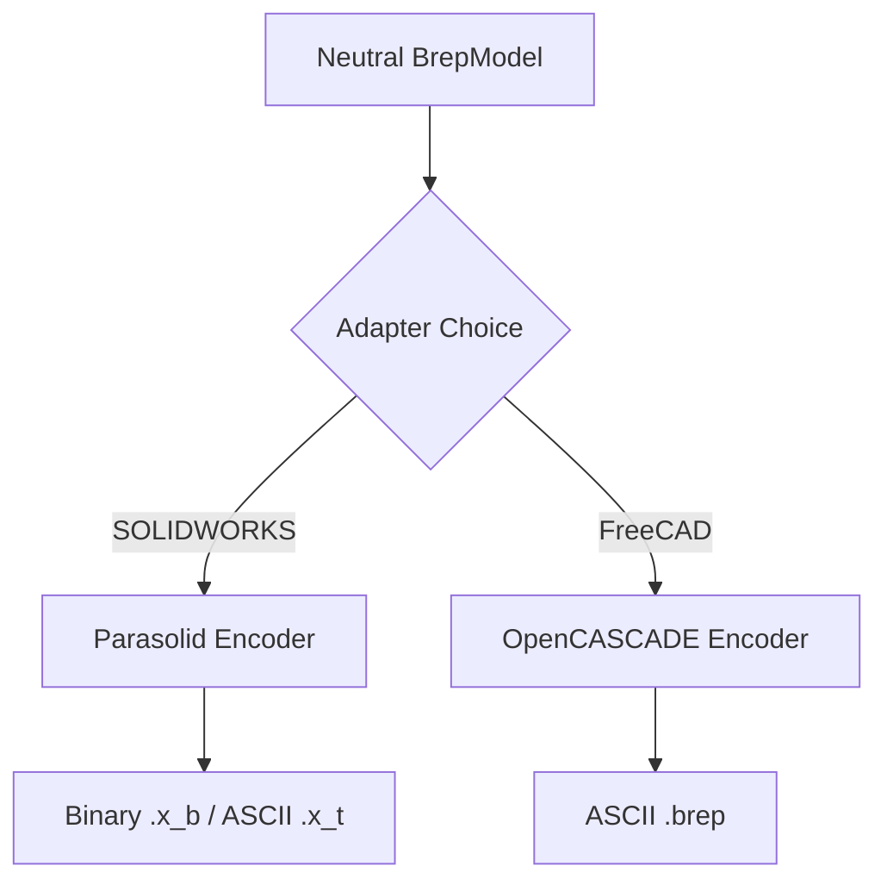

<!--
SPDX-License-Identifier: MIT
SPDX-FileCopyrightText: Copyright (c) 2026 Parashell, Odin Glynn-Martin, Stephen Harcourt
-->

Relevant source files

The following files were used as context for generating this wiki page:

- [src/convert/geometry/Parasolid.py](https://github.com/TryUniCAD/Kit/blob/aeff047c355622e812ab5d79b665d8f64c4075bb/src/convert/geometry/Parasolid.py)
- [src/convert/geometry/Opencascade.py](https://github.com/TryUniCAD/Kit/blob/aeff047c355622e812ab5d79b665d8f64c4075bb/src/convert/geometry/Opencascade.py)
- [src/convert/adapters/freecad/Brep.py](https://github.com/TryUniCAD/Kit/blob/aeff047c355622e812ab5d79b665d8f64c4075bb/src/convert/adapters/freecad/Brep.py)
- [tests/interchange/compatibility/CompatFieldsBrep.py](https://github.com/TryUniCAD/Kit/blob/aeff047c355622e812ab5d79b665d8f64c4075bb/tests/interchange/compatibility/CompatFieldsBrep.py)
- [src/convert/adapters/freecad/Archive.py](https://github.com/TryUniCAD/Kit/blob/aeff047c355622e812ab5d79b665d8f64c4075bb/src/convert/adapters/freecad/Archive.py)

# Boundary Representation (B-Rep)

Boundary Representation (B-Rep) defines the topological and geometric structure of 3D models within the Kit project. It provides a neutral format to facilitate bidirectional interoperability between proprietary CAD formats like SOLIDWORKS (Parasolid) and open formats like FreeCAD (OpenCASCADE).

B-Rep models represent shapes by defining their boundaries as a hierarchical arrangement of topological entities (e.g., bodies, faces, edges) associated with underlying geometric carriers (e.g., surfaces, curves, points).

## 1. Topology Model

The B-Rep system uses a nested hierarchy to define the connectivity of a 3D solid or sheet. Every entity includes a unique identifier, provenance metadata, and optional attributes.

### 1.1 Topological Hierarchy

The following entities compose the topological structure:

- **BrepBody**: The root container for a single solid or sheet object. It manages regions, wire IDs, and vertex IDs.
- **BrepRegion**: Represents a continuous volume (solid) or a set of shells (voids or sheets).
- **BrepShell**: Defines a boundary of a region as a collection of face uses.
- **BrepFace**: A bounded portion of a surface. It references one or more loops.
- **BrepLoop**: A closed circuit of coedges that defines the boundaries of a face.
- **BrepCoedge**: An oriented use of an edge within a loop.
- **BrepEdge**: A bounded portion of a curve, defined by start and end vertices.
- **BrepVertex**: A point in 3D space marking the end of an edge.

The diagram shows the parent-child relationships between topological entities in a B-Rep model.

## 2. Geometric Carriers

Geometry defines the mathematical representation of topological entities. Every edge and face references a specific curve or surface carrier.

### 2.1 Surfaces

Surfaces provide the mathematical definition for faces. The project supports several analytic and free-form types.

| Surface Type        | Description                                   | Key Fields                            |
| :------------------ | :-------------------------------------------- | :------------------------------------ |
| **PlaneSurface**    | A flat, infinite surface.                     | Origin, Normal, Ref Direction         |
| **CylinderSurface** | A cylindrical surface defined by an axis.     | Origin, Axis, Radius                  |
| **ConeSurface**     | A conical surface with a specific half-angle. | Origin, Axis, Radius, Half Angle      |
| **SphereSurface**   | A spherical surface centered at a point.      | Center, Radius, Axis                  |
| **TorusSurface**    | A donut-shaped surface.                       | Center, Axis, Major/Minor Radius      |
| **NurbsSurface**    | A Non-Uniform Rational B-Spline surface.      | Control Points, Knots, Multiplicities |

### 2.2 Curves

Curves provide the mathematical definition for edges.

- **LineCurve**: A straight line defined by an origin and direction.
- **CircleCurve**: A circular path defined by center, axis, and radius.
- **EllipseCurve**: An elliptical path defined by major and minor radii.
- **NurbsCurve**: A B-spline curve defined by control points and knot vectors.
- **IntersectionCurve**: A curve derived from the intersection of two surfaces.

## 3. Format Implementation

The project implements specific logic to handle B-Rep data from different CAD kernels.

### 3.1 Parasolid (X_T / X_B)

The `Parasolid` module handles binary and ASCII Parasolid data used by SOLIDWORKS. It encodes `BrepModel` instances into "transmit files" using specific schema markers like `SCH_1200000_12006`.

- **Encoding**: The `EncodeBrepModel` function validates topology before serializing entities into a byte stream. It ensures body transforms are identity and handles SOLIDWORKS-specific feature ID mapping.
- **Indexing**: Uses an `IndexAllocator` to map interchange identifiers to native record indices (e.g., Bridges, Loops, Edges).
- **Vendor Attributes**: Writes specific SOLIDWORKS attributes such as `SWEntUnchanged` and `SDL/TYSA_COLOUR`.

### 3.2 OpenCASCADE / FreeCAD

The `Opencascade` and `Brep` modules handle the ASCII B-Rep format used by OpenCASCADE and FreeCAD.

- **Structure**: Files start with the header `CASCADE Topology V1, (c) Matra-Datavision`.
- **Parsing**: The `DecodeAsciiBrep` function tokenizes the ASCII stream to reconstruct the topological graph. It validates object counts (e.g., `TShapes`) and ensures bottom-up ordering.
- **Tessellation**: Converts B-Rep surfaces into mesh data (vertices and triangles) for visualization when native execution is unavailable.

The flowchart illustrates the transformation of a neutral BrepModel into format-specific outputs.

## 4. Verification and Validation

Every B-Rep model undergoes structural and geometric validation.

1. **Topology Validation**: Detects incomplete ownership, non-manifold edges, or disconnected wires.
2. **Geometric Verification**: Confirms that curve endpoints match vertex locations and that sampled points on a face reside on the underlying surface carrier.
3. **Round-trip Integrity**: The `VerifyBrepData` function ensures that encoding a model and immediately decoding it results in identical topological counts and class types.

B-Rep serves as the foundational data structure for geometry within Kit. It ensures that complex topological relationships and precise analytic surfaces are preserved during translation between different CAD applications.
