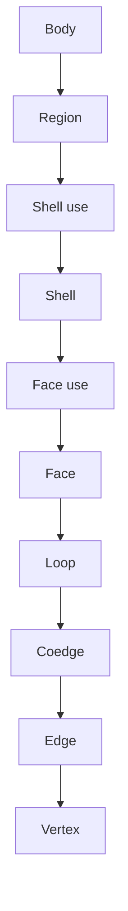

<!--
SPDX-License-Identifier: MIT
SPDX-FileCopyrightText: Copyright (c) 2026 Parashell, Odin Glynn-Martin, Stephen Harcourt
-->

# Boundary representation

## Purpose

A B-rep describes geometry through boundaries and their relationships.
Kit separates geometric curves and surfaces from topological uses.
This reference is for readers who inspect or implement geometry conversion.

## Topology

| Record | Meaning                        |
| ------ | ------------------------------ |
| Body   | Solid or sheet-level structure |
| Region | Region bounded by shells       |
| Shell  | Collection of face uses        |
| Face   | Bounded area of a surface      |
| Loop   | Ordered boundary of a face     |
| Coedge | Oriented use of an edge        |
| Edge   | Bounded curve segment          |
| Vertex | Endpoint or topological point  |
| Wire   | Connected edge structure       |

Shell uses and face uses retain orientation in their owning structures.
Do not remove those distinctions when flattening the model for inspection.

The graph shows ownership and reference relationships.
The geometric definitions reside in separate curve and surface collections.

## Geometry

| Geometry family     | Typical information                        |
| ------------------- | ------------------------------------------ |
| Plane               | Origin and reference directions            |
| Cylinder            | Axis and radius                            |
| Cone                | Axis, radius, and angle                    |
| Sphere              | Center and radius                          |
| Torus               | Axis and major and minor radii             |
| NURBS               | Control data, knots, and multiplicities    |
| Line or conic curve | Position, direction, and family parameters |
| Intersection curve  | Relationship to intersecting surfaces      |

A data type describes the neutral representation.
Adapter coverage can be narrower than the complete neutral type set.

## Validation boundary

`BrepModel.validate()` returns structural validation findings.
Its optional design-body identifiers support checks against the document body set.
An empty finding tuple does not establish target-application loadability.

Check orientation, references, units, and geometric consistency together.
Matching entity counts do not prove equal shape.
A matching volume does not prove equal position or editable history.

## Format translation

The Parasolid path handles the implemented transmit grammar for SOLIDWORKS geometry.
The OpenCASCADE path handles the implemented ASCII B-rep representation used by FreeCAD.
These are format readers and writers, not permission to load proprietary kernels at runtime.

See [geometry translation](../Data/Geometry.md) for cache and payload limits.
See [B-rep extraction](../../Tasks/ExtractGeometry.md) to copy available payloads.

## Acceptance evidence

Record body count, volume, center of mass, units, and tolerances.
Record the source and target versions.
For translation acceptance, verify the feature tree against the source node by node.
Change a driving dimension and verify that a rebuild changes the geometry correctly.
A B-rep-only result does not satisfy the repository's parametric acceptance requirement.
Keep measurements tied to the exact generated file.

## Sources

- [B-rep model](../../../src/interchange/brep/topology/BrepModel.py)
- [Topology records](../../../src/interchange/brep/topology/BrepTopology.py)
- [B-rep validation](../../../src/interchange/brep/validation/BrepValidate.py)
- [Geometry modules](../../../src/convert/geometry/)
