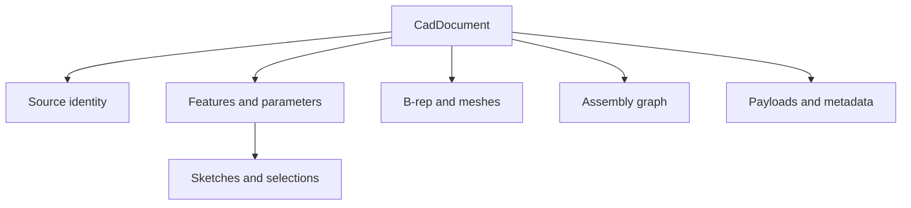

<!--
SPDX-License-Identifier: MIT
SPDX-FileCopyrightText: Copyright (c) 2026 Parashell, Odin Glynn-Martin, Stephen Harcourt
-->

# Neutral document model

## Purpose

`CadDocument` is the neutral record between a reader and a writer.
It contains design information, geometry, source identity, and diagnostics.
This reference is for integrators who inspect or construct documents.

## Document fields

| Field              | Content                                | Important condition                                 |
| ------------------ | -------------------------------------- | --------------------------------------------------- |
| `source`           | Source identity and format             | Retain the original provenance                      |
| `configurations`   | Named design variants                  | Preserve selection and suppression relationships    |
| `parameters`       | Values, units, and expressions         | Distinguish driving values from measured values     |
| `support_planes`   | Reference frames                       | Keep sketch references valid                        |
| `sketches`         | Sketch entities and constraints        | Preserve entity identifiers                         |
| `selections`       | References used by features            | Keep references consistent after edits              |
| `feature_timeline` | Ordered modeling operations            | Preserve dependencies and order                     |
| `bodies`           | Design body records                    | Relate them to geometry and features                |
| `meshes`           | Tessellation records                   | Meshes do not replace feature history               |
| `brep_payloads`    | Geometry payload records               | Inspect format and role                             |
| `diagnostics`      | Reader or model observations           | Retain limitations in reports                       |
| `capabilities`     | Declared information categories        | Compare them with writer transfers                  |
| `metadata`         | Additional information                 | Do not infer vendor support from arbitrary metadata |
| `units`            | Document unit system                   | Default: millimeters                                |
| `schema_version`   | Model schema identifier                | Default: `1.0`                                      |
| `assembly`         | Optional component graph               | See [assembly](Assembly.md)                         |
| `brep`             | Optional neutral topology and geometry | See [B-rep](Brep.md)                                |

The root dataclass is frozen.
A frozen root does not by itself prove deep immutability of every supplied object.
Use the model contracts when constructing nested values.

## Relationships

Features refer to other records by identifier.
Assembly definitions and instances form a separate graph.
The geometry graph can refer to design bodies.

## Read a document

Use `open_document` through the [read and write procedure](../../Tasks/ReadWrite.md).
The reader determines which source semantics it can expose.
An empty collection can reflect absent source data or a reader limitation.
Inspect diagnostics before drawing a conclusion.

`include_brep` and `include_tessellation` control requested read content.
Information excluded at this boundary cannot be assumed present during writing.

## Validate a document

Document validation checks relationships across model domains.
The validation modules cover feature, assembly, mesh, and reference consistency.
A valid model does not prove that a target writer implements all its features.
It also does not prove geometric acceptance in a vendor application.

When editing a document, preserve identifiers, units, and dependent references.
Do not change a parameter while ignoring its configuration or feature dependencies.
Keep original source provenance distinguishable from newly authored values.

## Payloads and preservation

A document can carry native bytes with an explicit payload role.
Preserved bytes can support replay or inspection.
They do not establish decoded semantics or native output in another format.
See [serialization](../Data/Serialization.md).

## Sources

- [Root model](../../../src/interchange/document/models/DocumentModel.py)
- [Document validation](../../../src/interchange/document/validation/DocumentValidate.py)
- [Read filters](../../../src/interchange/document/models/DocumentFilter.py)
- [Result evaluation](../../Tasks/InspectResult.md)
