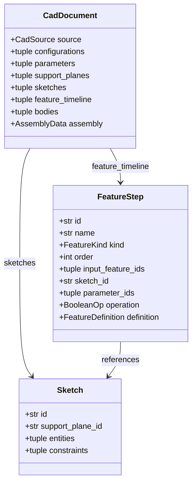
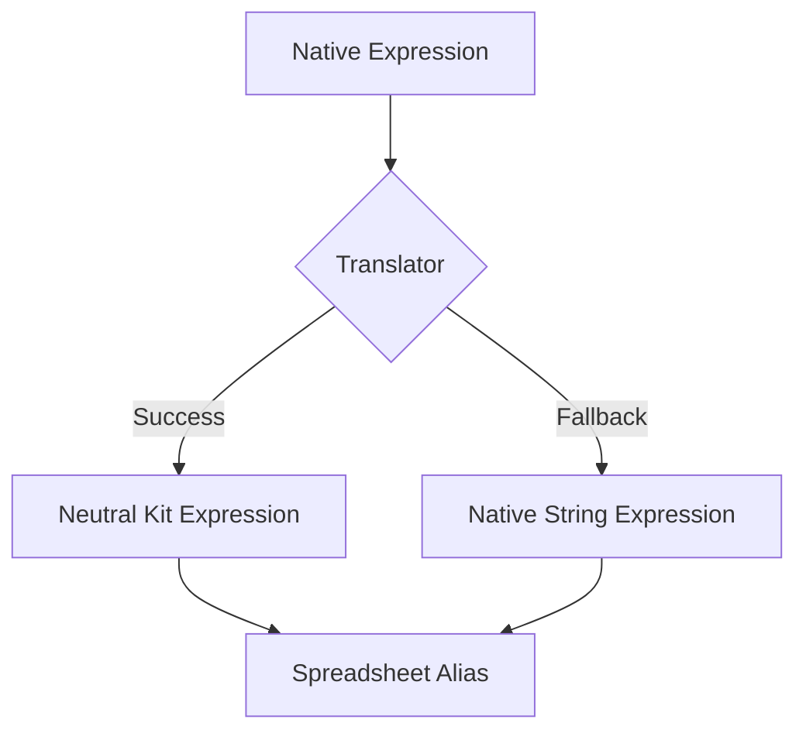

<!--
SPDX-License-Identifier: MIT
SPDX-FileCopyrightText: Copyright (c) 2026 Parashell, Odin Glynn-Martin, Stephen Harcourt
-->

<details>
<summary>Relevant source files</summary>

The following files were used as context for generating this wiki page:

- [src/convert/adapters/freecad/Native.py](https://github.com/TryUniCAD/Kit/blob/aeff047c355622e812ab5d79b665d8f64c4075bb/src/convert/adapters/freecad/Native.py)
- [src/convert/adapters/solidworks/core/Adapter.py](https://github.com/TryUniCAD/Kit/blob/aeff047c355622e812ab5d79b665d8f64c4075bb/src/convert/adapters/solidworks/core/Adapter.py)
- [src/convert/adapters/freecad/Archive.py](https://github.com/TryUniCAD/Kit/blob/aeff047c355622e812ab5d79b665d8f64c4075bb/src/convert/adapters/freecad/Archive.py)
- [re/solidworks/archive/Grammar.md](https://github.com/TryUniCAD/Kit/blob/aeff047c355622e812ab5d79b665d8f64c4075bb/re/solidworks/archive/Grammar.md)
- [re/solidworks/features/RevolveDonorSpec.md](https://github.com/TryUniCAD/Kit/blob/aeff047c355622e812ab5d79b665d8f64c4075bb/re/solidworks/features/RevolveDonorSpec.md)
- [tests/convert/freecad/FreecadTests.py](https://github.com/TryUniCAD/Kit/blob/aeff047c355622e812ab5d79b665d8f64c4075bb/tests/convert/freecad/FreecadTests.py)
- [re/Methodology.md](https://github.com/TryUniCAD/Kit/blob/aeff047c355622e812ab5d79b665d8f64c4075bb/re/Methodology.md)
</details>

# Parametric Features Model

The Parametric Features Model provides a neutral intermediate representation for CAD feature histories, enabling translation between proprietary formats like SOLIDWORKS, FreeCAD, and CATIA. It captures the design intent through a timeline of operations, sketches, parameters, and geometric relationships rather than just static boundary representation (B-rep) geometry.

## Architecture and Components

The model organizes a CAD document into a structured hierarchy. Every parametric document contains a feature timeline, which is an ordered sequence of operations that build the solid model.

### Data Hierarchy

The following diagram illustrates the relationship between the primary components of the parametric model:



### Key Data Structures

| Component         | Description                                                                 |
| :---------------- | :-------------------------------------------------------------------------- |
| **FeatureStep**   | Represents a single operation in the model history (e.g., Extrude, Fillet). |
| **Sketch**        | Defines 2D geometry and constraints on a specific support plane.            |
| **Parameter**     | Stores driving values, units, and expressions for features and sketches.    |
| **SupportPlane**  | Defines the 3D coordinate system and transform for a sketch or reference.   |
| **Configuration** | Manages sets of parameter overrides and feature suppression states.         |

## Feature Operations

The model supports various standard CAD operations, categorized into additive, subtractive, and decorative features.

### Extrusion (Pad/Pocket)

Extrusions define a profile projected along a vector. The `ExtrudeFeature` class captures parameters such as:

- **Length**: Primary projection distance.
- **End Condition**: Blind, Through All, Up To Last, Up To Face, etc.
- **Symmetry**: Whether the extrusion projects equally in both directions.
- **Draft Angle**: Tapering of the side faces.

### Revolution

Revolutions sweep a profile around an axis. This requires:

- **Angle**: The sweep extent in degrees or radians.
- **Axis**: A reference to a sketch centerline or a 3D reference axis.

### Boolean Operations

Operations combine features using logic such as:

- **Join/Add**: Merges two solids.
- **Cut/Sub**: Removes the tool volume from the base solid.
- **Intersect**: Retains only the shared volume.

## Parameters and Expressions

Design intent is preserved through parameters and mathematical relationships.

- **Parameters**: Each parameter carries a `ValueKind` (Length, Angle, Boolean, Integer, String) and optional units (mm, deg, rad).
- **Expressions**: The system translates proprietary expression formats into a neutral "Kit" language or preserves them as "native" strings.
- **Spreadsheet Integration**: In FreeCAD, parameters are often mapped to `Spreadsheet::Sheet` aliases for global control.



## Implementation and Translation Logic

Translation involves mapping proprietary binary or XML records to the neutral model and back.

### Adapter Data Flow

```mermaid
sequenceDiagram
    participant S as Source File
    participant R as Reader Adapter
    participant N as Neutral Document
    participant W as Writer Adapter
    participant D as Destination File

    S->>R: Binary/XML Data
    R->>R: Object Segmentation
    R->>R: Decode Native Records
    R->>>N: Build CadDocument
    N->>W: Neutral Model
    W->>W: Select Supported Native Writer
    W->>W: Emit Derived Native Records
    W->>D: Write Compound File
```

### Native reconstruction and source edits

Adapters can emit supported feature families from decoded grammar or preserve and edit the source document's own streams where supported. An unrelated donor skeleton is not a valid production substitute for missing grammar. Consult [the SOLIDWORKS writer boundary](../Adapters/Solidworks.md#writing-and-acceptance) and verify feature editability and rebuilds in the target application.
