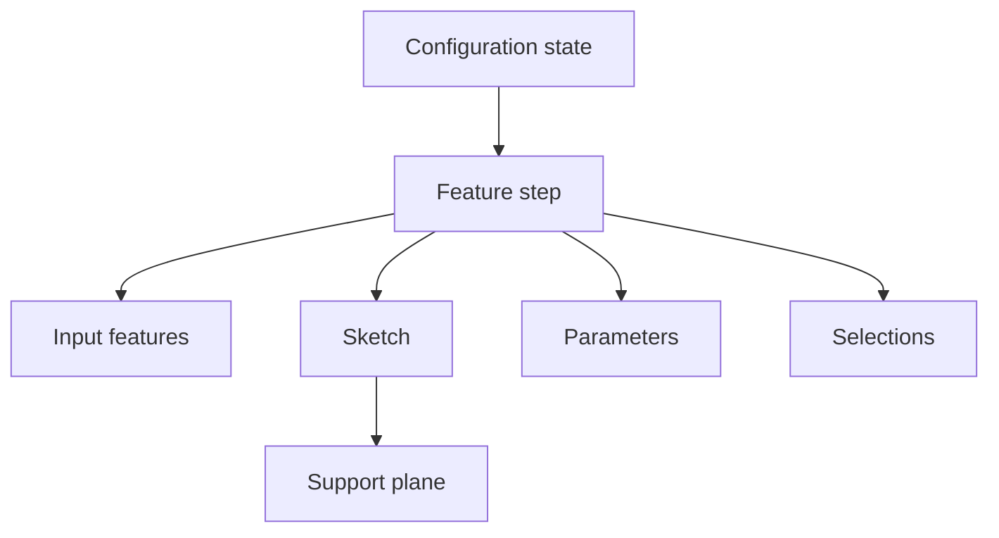

<!--
SPDX-License-Identifier: MIT
SPDX-FileCopyrightText: Copyright (c) 2026 Parashell, Odin Glynn-Martin, Stephen Harcourt
-->

# Parametric feature model

## Purpose

The feature model represents modeling operations and their dependencies.
It preserves information needed for editable history.
A shape or mesh alone cannot supply that history.

## Feature records

| Field                  | Meaning                                        |
| ---------------------- | ---------------------------------------------- |
| `id`, `name`           | Stable identity and display name               |
| `kind`                 | Feature category                               |
| `order`                | Position in the timeline                       |
| `input_feature_ids`    | Dependencies on earlier features               |
| `sketch_id`            | Associated sketch                              |
| `parameter_ids`        | Parameters used by the feature                 |
| `operation`            | Boolean operation where applicable             |
| `definition`           | Typed feature parameters                       |
| `selection_ids`        | Referenced selections                          |
| `suppressed`           | Suppression state                              |
| `configuration_states` | State and parameter overrides by configuration |
| `provenance`           | Source evidence for the record                 |
| `attributes`           | Additional information                         |

The definition contract validates the supplied feature definition.
It does not prove that every writer can emit that feature.

## Supporting records

A sketch contains geometry and constraints on a support plane.
A parameter contains a value and its associated meaning or units.
A selection identifies geometry used by an operation.
Configurations can change parameter values and suppression states.

Preserve these references when changing a feature.
An identifier can remain syntactically valid while referring to the wrong entity.

## Operation families

Extrusion uses a profile, direction, extent, and end condition.
Revolution uses a profile, axis, and angle.
Boolean operations define how geometry combines with existing bodies.
Other families use their own typed definitions.

Do not infer complete family coverage from the presence of an enumeration value.
Check the source reader, neutral definition, target writer, and acceptance evidence separately.

## Expressions and units

A parameter can contain an expression or a literal value.
Preserve its language and unit context.
A retained native expression is not necessarily executable in another application.
A translated expression requires evidence that its references and evaluation retain the intended result.

Distinguish a driving parameter from a measured or driven value.
Do not substitute a final measurement for an editable design relationship.

## Review an edit

1. Identify the changed driving parameter or feature definition.
2. Check every dependent feature reference.
3. Check the selected configuration.
4. Check unit conversions.
5. Inspect the writer's capability report.
6. Obtain the required remote oracle evidence.

Expected result: the target feature tree retains the required history and changes correctly after a dimension edit.
A successful initial load is insufficient.

## Sources

- [Feature step](../../../src/interchange/features/FeatureStep.py)
- [Feature definitions](../../../src/interchange/features/)
- [Feature validation](../../../src/interchange/document/validation/DocumentFeatureValidate.py)
- [SOLIDWORKS feature records](../Adapters/SolidworksFeatures.md)
