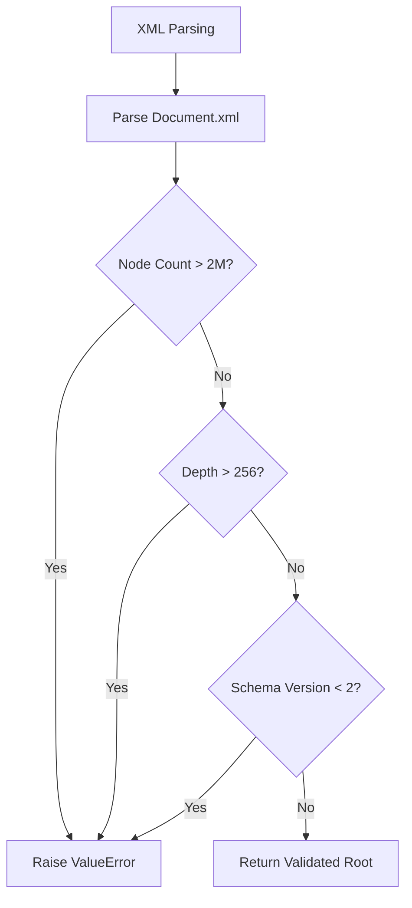

<!--
SPDX-License-Identifier: MIT
SPDX-FileCopyrightText: Copyright (c) 2026 Parashell, Odin Glynn-Martin, Stephen Harcourt
-->

Relevant source files

The following files were used as context for generating this wiki page:

- [src/convert/Security/PathBoundary.py](https://github.com/TryUniCAD/Kit/blob/aeff047c355622e812ab5d79b665d8f64c4075bb/src/convert/Security/PathBoundary.py)
- [src/convert/Security/ProgramBoundary.py](https://github.com/TryUniCAD/Kit/blob/aeff047c355622e812ab5d79b665d8f64c4075bb/src/convert/Security/ProgramBoundary.py)
- [SECURITY.md](https://github.com/TryUniCAD/Kit/blob/aeff047c355622e812ab5d79b665d8f64c4075bb/SECURITY.md)
- [src/convert/adapters/freecad/Archive.py](https://github.com/TryUniCAD/Kit/blob/aeff047c355622e812ab5d79b665d8f64c4075bb/src/convert/adapters/freecad/Archive.py)
- [AGENTS.md](https://github.com/TryUniCAD/Kit/blob/aeff047c355622e812ab5d79b665d8f64c4075bb/AGENTS.md)
- [Standard PR Practice](https://github.com/TryUniCAD/Kit/blob/aeff047c355622e812ab5d79b665d8f64c4075bb/.agents/skills/standard-pr-practice/SKILL.md)

# Security Boundaries & Validation

Security boundaries and validation logic protect the Kit project by enforcing strict constraints on file system access, external program execution, and data integrity during CAD format conversion. These systems prevent path traversal attacks, execution of unauthorized binaries, and resource exhaustion from malformed archives.

The project defines security scope within `src/`, `tools/`, and `.github/` directories, while excluding vendor tooling and local CAD installations from the primary security perimeter. Continuous integration scans for secrets, dependency vulnerabilities, and static-analysis findings; a passing scan is bounded by its configured coverage and revision.

## Path and Program Boundaries

The security system isolates file operations and program execution through dedicated boundary modules. These modules ensure that the application only interacts with verified paths and authorized external binaries.

### Path Resolution and Validation

The `PathBoundary` module provides functions to resolve and validate paths for inputs, temporary files, and labels. It prevents access outside of designated workspaces.

- `ResolveInput`: Resolves and verifies paths for source CAD documents.
- `ResolveTemp`: Manages the creation and resolution of temporary file paths for conversion artifacts.
- `ValidateLabel`: Enforces naming conventions on labels to ensure they are safe for use as identifiers.

### External Program Isolation

The `ProgramBoundary` module identifies the location of authorized external tools, such as the FreeCAD oracle used for verification. Functions like `GetFreecadPath` ensure that the system executes only the intended version of external applications.

## Archive and Content Validation

The conversion adapters implement deep validation for proprietary and open CAD containers. The `Archive` module for FreeCAD (FCStd) serves as a primary example of enforcing safety limits on ZIP structures and XML content.

### Archive Security Gates

The system validates ZIP archive members before extraction to prevent "zip bomb" attacks and path traversal.

| Constraint             | Limit / Logic | Purpose                                                     |
| :--------------------- | :------------ | :---------------------------------------------------------- |
| `KMaxEntries`          | 16,384        | Prevents resource exhaustion from excessive file counts.    |
| `KMaxEntrySize`        | 512 MB        | Limits the size of any single file within an archive.       |
| `KMaxTotalSize`        | 1 GB          | Limits the aggregate size of the processed archive.         |
| `KMaxCompressionRatio` | 500           | Detects and rejects potential "zip bombs."                  |
| Encryption             | Rejected      | Rejects encrypted entries to ensure content inspectability. |
| Symbolic Links         | Rejected      | Prevents path traversal via link redirection.               |

### XML Validation

CAD metadata stored in XML format (e.g., `Document.xml`) is subject to node and depth limits to prevent parser exploits.

The logic walks the XML tree, incrementing counters for nodes and tracking nesting depth. It requires a minimum schema version to ensure compatibility with modern security structures.

## Automated Security Posture

The repository employs an extensive set of automated tools within the CI pipeline to maintain its security posture.

### Security Toolchain

Automated monitoring covers secret auditing, dependency scanning, and static analysis.

- **Secret Auditing**: Gitleaks, TruffleHog, and detect-secrets scan for leaked credentials.
- **Dependency Scanning**: `pip-audit`, Safety, OSV-Scanner, Grype, and Trivy check for known vulnerabilities in the `uv.lock` dependency set.
- **Static Analysis**: Bandit, Semgrep, CodeQL, and dlint analyze Python code for security flaws.
- **Infrastructure & Workflow**: Checkov audits IaC, while `zizmor` and `actionlint` verify GitHub Actions safety.

### Agent Constraints

The project enforces strict workflow boundaries for delegated agents to prevent unauthorized modifications to the repository history.

- **Branch Protection**: Agents are prohibited from committing directly to the `main` branch.
- **Worktree Isolation**: Every delegated agent must run in its own isolated worktree.
