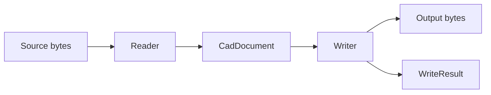

# Kit SDK overview

## Purpose and audience

Kit provides a Python interface for reading and writing CAD information.
This page introduces the model and its acceptance limits for Python integrators.
Start with [getting started](../../GettingStarted.md) for installation and task links.

## Data flow

A reader converts source bytes into a `CadDocument`.
A writer receives that neutral document and produces the requested output.
The writer reports capability transfers and output conditions.

A vendor application is not part of this flow.
An isolated oracle can evaluate the generated file afterward.

## Information in the model

| Information                           | Reference                                 |
| ------------------------------------- | ----------------------------------------- |
| Source identity and configurations    | [Document](../Model/Document.md)          |
| Features, sketches, and parameters    | [Features](../Model/Features.md)          |
| Component definitions and occurrences | [Assembly](../Model/Assembly.md)          |
| Geometry and topology                 | [B-rep](../Model/Brep.md)                 |
| Serialized records and payload bytes  | [Serialization](../Data/Serialization.md) |

A model field defines a representation.
It does not establish that every reader populates it or every writer emits it natively.

## Format selection

Use [the format procedure](../../Tasks/SelectFormat.md) to inspect the installed catalogue.
SOLIDWORKS, FreeCAD, CATIA, and interchange JSON have registered adapters.
The [Fusion public adapter](../../Changes/Fusion/Adapter/FusionPublicAdapter.md) supports qualified authored parameter, circle, rectangle, cylinder, cuboid, and frustum profiles. The earlier partial reader remains an explicit `strict=False` option.
Adapter registration is not a general support guarantee.

## Output evidence

Native output represents information through target structures.
A carrier retains information that the target may not interpret.
Replay uses the source document's own bytes where the adapter supports that operation.
These outcomes have different acceptance implications.

Use `allow_carrier=False` for the stricter registry policy.
Keep reader strictness separate from output policy.
Read [result evaluation](../../Tasks/InspectResult.md) before reporting success.

## Development evidence

Research combines controlled source files, runtime traces, and decoded format rules.
The [research method](../Research/Methodology.md) records the evidence for each finding.
Production writers must derive output from format knowledge.
Unrelated donor bytes and vendor-runtime fallbacks are prohibited.

## Sources and next steps

- [Public API](../../../src/convert/__init__.py)
- [Conversion engine](../Architecture/Engine.md)
- [Task procedures](../../Index.md#user-tasks)
- [Documentation standards](../../Standards/Scope.md)
