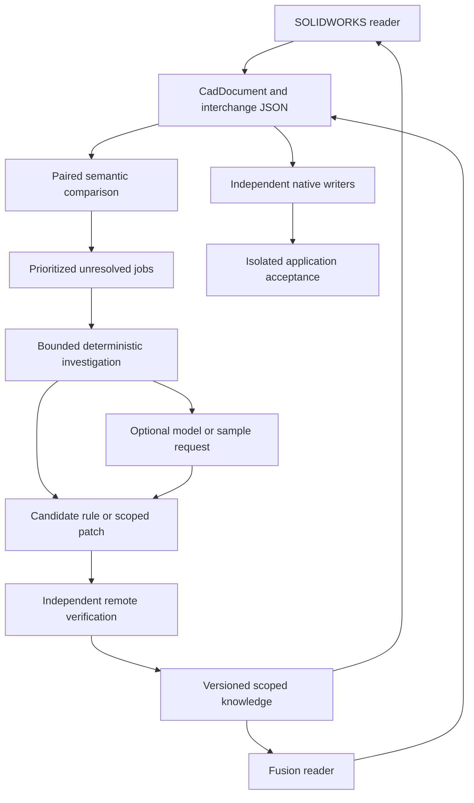

# Neutral-first CAD research automation plan

## Status and purpose

This document is a design for future implementation.
PR #94 contains the plan and the [completed A01 contract audit](NeutralContractAudit.md).
A01 introduces no runtime or schema change.
A02 is now authorized and implemented within [PR #94](https://github.com/TryUniCAD/Kit/pull/94).
Its offline corpus tooling and paired specifications are implemented; independent captures and measurement bindings remain outstanding.
A03 is now authorized and implements the [durable research controller](ResearchController.md); remote verification is tracked in the step register.
A04–A16 require a subsequent explicit request.
All implementation steps in this programme stay on PR #94 by explicit user instruction.
The [step register](AutomationSteps.md) records identifiable deliverables, dependencies and progress.

Use one portable `CadDocument` contract and its existing JSON serialization.
Native readers populate that contract independently.
Native writers consume its understood design information.
Begin with SOLIDWORKS and Fusion, then extend the same contract to FreeCAD, CATIA and other formats.
A common representation does not guarantee that every target supports every source capability.

The initial product milestone requires both SOLIDWORKS → neutral → Fusion and Fusion → neutral → SOLIDWORKS.
Each route requires native load, editable history, correct geometry and a successful driving-dimension rebuild.
Record independently qualified one-way routes separately.
Same-format roundtrips support investigation but cannot establish cross-format conversion support.

## Architecture

The local controller inspects files and schedules research.
Production readers and writers never require a CAD application, oracle service or research import.
Application workers belong exclusively to isolated authoring and acceptance workflows.
Missing workers block dependent jobs while independent offline work continues.

## Existing assets and revision boundaries

Reuse [the neutral model](../Model/Document.md), [JSON serialization](../Data/Serialization.md) and existing format codecs.
The [Fusion source-proof ledger](../../../src/convert/formats/Fusion/SourceProof/InspectSource.py) retains exact-source claims and unresolved entries.
The [SOLIDWORKS tooling](../../../re/tooling/) includes container inspection, tracing, serializer analysis and recovered program generation.
These components need integration and qualification, not a replacement universal parser.

At main `52dbbe55`, the tracked corpus includes 713 F3D files, one F3Z, 58 SOLIDWORKS parts and six SOLIDWORKS assemblies.
It also includes 27 CATIA parts, three CATIA products and 197 files named `ground_truth.json`.
These counts are inventory evidence, not equivalent design pairs or complete format coverage.
No FCStd inputs are tracked at that baseline.
The historical 165-file audit includes separate scratch inputs.

The Fusion study already exists on that main revision.
Native Fusion writer work in PR #92 remains a separately pinned dependency until merged and qualified.
Record the exact SDK revision, decoder options, sample hashes and application builds for every run.
Never combine results from different revisions silently.

## Neutral contract and paired examples

The contract preserves parameters, expressions, units, tolerances, sketches, constraints and reference frames.
It also preserves feature order, dependencies, selections, bodies, configurations, materials and assembly relationships.
Distinguish driving values from measured values.

Keep portable meaning, source provenance and unresolved native evidence distinguishable.
Opaque payload preservation does not count as semantic decoding or editable output.
Extend `src/interchange` only for demonstrated missing concepts with serialization compatibility evidence.
Sweep, loft, draft, mirror, helix and offset require individual contract audits before adding definitions.
Do not add every conceivable vendor option as an unqualified optional field.

Create paired designs from an explicit authoring specification.
Start with dimensioned rectangular and circular sketches, additive extrusions, a cut and a revolution.
Collect repeated saves and controlled changes to dimensions, direction, plane, units and termination.
Keep original files unchanged and retain their measured ground truth.
Do not mistake converter-generated files for independently authored source evidence.

Hold out whole design families and native lineages for independent evaluation.
Do not distribute near-duplicate saves between training and holdout sets.
The sample count and selection must distinguish the actual competing hypotheses.
A fixed percentage alone cannot establish independence or adequate coverage.

## Semantic comparison

Compare decoded graphs, not literal JSON equality or compressed-file offsets.
Match candidates using operation kind, ownership, parameters, geometry and reference relationships.
Names and native identifiers are evidence, not universal matching keys.
Preserve ambiguous matches and their alternatives.

Normalize units for calculation while retaining original context.
Declare quantity-specific numeric tolerances before evaluation.
Compare expressions and driving relationships as well as evaluated numbers.
Equal shapes can have different histories, such as an extruded circle and a revolved rectangle.

Report equal concepts, meaningful differences, source-decoding gaps, neutral-contract gaps and destination-writer gaps separately.
A disagreement does not identify the faulty reader without independent source evidence.
Agreement alone is insufficient because both readers can share an error.

## Deterministic investigation stages

1. Inventory files, hashes, versions, sample relationships and missing dependencies.
2. Run existing readers and account for unresolved records and relationships.
3. Compare qualified paired neutral documents and group shared gaps.
4. Prioritize dependencies, representative documents potentially unlocked and available distinguishing evidence.
5. Generate controlled experiment grids where application workers are available.
6. Unpack streams and align objects using supported identities and graph structure.
7. Search bounded primitive types, counts, lengths, references, enums, unit relationships and derived formulas.
8. Check confounding across independent grid dimensions and coupled fields across streams.
9. Record candidate field maps, unknowns, source spans and contradictions.
10. Generate narrowly scoped typed codec candidates from understood grammar.
11. Verify candidates independently and record counterexamples.
12. Retain scoped knowledge, rescan affected files and select the next runnable job.

Use the existing SOLIDWORKS segmentation and signature findings before attempting new inference.
Trace unfamiliar layouts only when existing evidence cannot establish their boundaries.
Apply the matching Fusion record/metadata tools to Fusion inputs.
Program decomposition is an existing building block, not a complete inferred-grammar compiler.
Research generators produce isolated candidate artifacts only.
Promote verified source and format vocabulary through the normal production review gates.
Production build, installation and conversion must not execute generators under `re/` or import research modules.
Place any required production generator outside `re/` before using it in a shipped build.

Preserve raw observations and normalize only independently established incidental differences.
Repeated saves help identify noise but do not authorize masking an unexplained span.
Formula fits are hypotheses until independent evidence establishes meaning.
Use exact comparisons for integer grammar and declared tolerances for appropriate numeric relationships.
Do not reuse holdout results repeatedly to tune a hypothesis.

## Durable controller and evidence

Use Python with uv and an initial Python 3.14 research environment for ZIP Zstandard support.
Keep the existing SDK compatibility requirements unchanged.
Research orchestration belongs under the existing `re/automation/`; the production SDK must not import it.

SQLite and content-addressed artifacts are the selected A03 implementation choices, not new repository-wide standards.
Record any evidence-based revision to those choices in the step register and PR comments.
The A03 controller uses SQLite for transactional job metadata and files for large immutable artifacts.
A single controller owns database writes and workers return structured results.
Bind SQL parameters and validate all external job records.

Jobs record dependencies, exact inputs, rule versions, attempts, leases and execution receipts.
States distinguish queued, running, waiting for evidence, waiting for CI, waiting for application, completed, rejected and failed.
Resume expired leases safely and reuse results only when all relevant inputs match.
Cache expensive decompilation by binary hash, analysis configuration and tool version.

Deduplicate unknowns within their format/version/layout scope.
Do not retry a contradicted hypothesis without changed evidence.
Invalidate dependent claims when their source evidence or rule changes.
Apply bounded concurrency, timeouts, memory limits and retry counts.
Give scarce application installations exclusive leases.
Avoid starvation of lower-frequency in-scope features.

Track syntax, semantics, references, neutral projection, native writing and application acceptance independently.
Do not use byte coverage or duplicate-heavy corpus counts as a substitute for complete-document capability.
Keep per-version and per-feature-variant evidence visible.

## Optional model investigations

Models are disabled by default and no API credential is required for offline operation.
Configure a provider or local runner explicitly when model investigations are enabled.
Use the least costly configured runner suitable for the question before escalating within budget.
Verify actual provider APIs, supported model settings and prices during integration.
No specific frontier model, beta feature or price is a requirement of this design.

Send a bounded packet containing the question, relevant records, graph links, sample differences and prior failed hypotheses.
Include relevant serializer findings and machine-checkable success criteria.
Never upload an entire private design automatically.
External transmission requires configured data-sharing authorization.

Accept structured hypotheses, experiment requests or isolated candidate patches.
Model confidence is not verification evidence.
Reject malformed output and enforce per-task and per-run call, token, time and monetary limits.
Cache equivalent requests with their model/version and evidence fingerprints.
Use allowlisted tools with validated arguments; never execute model-supplied shell commands or unrestricted expressions.

After bounded failures, park the question with all evidence and continue other work.
Resume only when an applicable tool, rule or new sample changes its prerequisites.

### Model escalation and failure log

Configure model runners as ordered tiers, from the least costly to the most capable.
Each question starts at the lowest tier unless the failure log routes it higher.
An attempt fails when its output is malformed, exceeds a limit or does not pass the question's machine-checkable success criteria.

Record every failed attempt in an append-only failure log before any retry.
Store the log in the durable evidence store with the job's attempts.
Each entry records:

- The question, its evidence fingerprint, job and attempt
- The tier, runner, model and model version
- The rejected output or proposal
- The check that failed and its exact failure output
- A failure signature: question kind, CAD format, feature family and failed check

After a failure, send the same question to the next tier.
Include the logged failure in that packet as a prior failed hypothesis.
The stronger model's answer must pass the same checks; its confidence is not evidence either.

When the log holds two or more failures with the same signature at one tier, start later questions with that signature one tier higher.
Repeat this for each tier, so a signature that keeps failing moves steadily to stronger models.
Record each routing change in the log with the entries that caused it.
Lower a raised starting tier only when a new tool, rule, runner or model version changes that signature's prerequisites.
When the highest tier fails, or the budget runs out, park the question as above.

The [parallel sessions design](ParallelSessions.md) describes the Codex runner, tier selector, error handling and session capacity limits.

## Application workers and independent writers

A SOLIDWORKS research worker can author and measure controlled samples through the existing Windows harness.
A Fusion research worker can use its existing capture and dispatcher tooling within its applicable authorization.
Worker requests and receipts identify sample hashes, actual recipe, application version and measurement errors.
Check that the saved sample implements the requested experiment.

Native writers consume portable neutral semantics and derive every required structure from understood grammar.
The qualified Fusion writer does not yet imply support for arbitrary neutral graphs.
Its portable-graph mapping requires explicit implementation and evidence.
Do not replace that work with a source-specific specification or replay payload.
No unrelated donor blocks or CAD runtime may participate in production conversion.

Keep same-format fixed points and normalized-byte comparisons as supporting diagnostics.
Qualify both initial cross-format routes independently.
Measure body count, volume, center of mass, feature history, units and applicable tolerances.
Change a driving dimension, rebuild, save and reopen the generated output.
For claimed complete parametric support, exercise every independent driving parameter within the qualified source scope.
Restore each parameter and verify the original geometry after its edit.
Independently compare all source sketch constraints, expression dependencies, references and feature states against their target counterparts.
A single successful dimension edit cannot qualify omitted dimensions or relationships.
Any missing required relationship blocks the affected route, even when both neutral readers omit it.
For assemblies, verify references, placements and constraint behavior.
Use healthy controls before and after each isolated acceptance batch.
Missing measurements remain unavailable evidence.

Compatibility, regression, smoke and acceptance tests run remotely under current repository policy.
Do not run local tests, collection or ad hoc verification substitutes.
Pending CI cannot be relabeled as passed research verification.
Research inspection and ordinary decoding remain local workloads.

## Failure handling

| Failure                                | Automatic action                                             | Boundary                                                        |
| -------------------------------------- | ------------------------------------------------------------ | --------------------------------------------------------------- |
| Environment, license or failed control | Bounded worker recovery and a circuit breaker                | Keep offline jobs running; discard unhealthy acceptance batches |
| Unreachable authoring setting          | Check actual API contracts and saved output                  | Mark unavailable cells; retain the missing experiment           |
| Unproved normalization                 | Request a distinguishing repeat save                         | Preserve the original span and park unresolved noise            |
| Segmentation or references             | Compare spans and retrieve matching traces                   | Bound retries and scope findings to the exact build             |
| Formula or semantic contradiction      | Retain the counterexample and refine the experiment          | Never promote a fit that fails independent evidence             |
| Model error or budget exhaustion       | Log the failure, escalate one tier, then park                | No credential or budget is required for remaining offline work  |
| Writer, load or edit failure           | Localize the failed native structure in the isolated harness | Diagnostic substitutions never become production output         |
| Regression                             | Quarantine the candidate and retain the last verified rule   | Revert only task-owned commits when authorized                  |
| Unsupported input                      | Reject the conversion with a specific reason                 | Preserve inputs and add a deduplicated backlog item             |
| Missing evidence or CI                 | Wait on an actual dependency change                          | Do not spin, invent measurements or claim completion            |

## Delivery and forecast

Implement the [step register](AutomationSteps.md) after implementation is explicitly authorized.
First replay a solved SOLIDWORKS family through the research machinery without model calls.
Then qualify paired neutral examples and expand cross-format native output.
Add richer sketches, constraints, cuts, revolutions, finishing operations, patterns, configurations and assemblies through demonstrated prerequisites.
FreeCAD, CATIA and later families extend the same contract with independent capability checks.

These ranges are provisional engineering estimates for one experienced engineer using existing Kit tooling and available remote CI.

| Milestone                                                   | Estimated elapsed development time                                  |
| ----------------------------------------------------------- | ------------------------------------------------------------------- |
| Existing-reader integration and bounded semantic comparison | 2–4 weeks                                                           |
| Durable unattended controller and optional model handoff    | 6–10 weeks total                                                    |
| First narrowly qualified bidirectional native conversion    | 2–4 months total, subject to missing grammar and application access |
| Broad ordinary-document coverage                            | Reforecast after a two-week operating pilot                         |

After the platform exists, simple missing fields may take hours to two working days.
A variant of an understood extrusion or revolution may take two to ten working days.
Complex constraints, surfaces or histories may require two to six weeks or longer.
Broad assembly or major-version semantics may require one to three months or longer.
Missing distinguishing evidence has no defensible completion date.
These are research estimates, not decoder runtime benchmarks or delivery promises.

The pilot records active investigation, CI queue time, evidence waits, model cost and independently verified documents unlocked.
Use those observations to update the forecast and priorities.

## Related information

- [Implementation steps and contributor progress](AutomationSteps.md)
- [Parallel research sessions and Codex runners](ParallelSessions.md)
- [Research automation agent instructions](../../../re/AGENTS.md)
- [Research method](Methodology.md)
- [Oracle evidence](Oracles.md)
- [SOLIDWORKS measured coverage](../../../re/solidworks/CorpusCoverage.md)
- [Fusion saved-file workflow](../../../re/Fusion/Notes/Workflow.md)
- [Canonical repository workflow](../../../.agents/skills/standard-pr-practice/SKILL.md)
