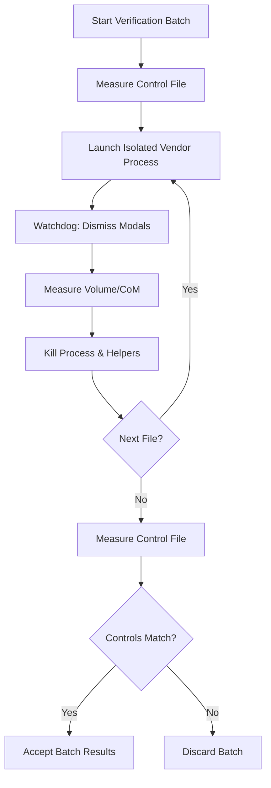
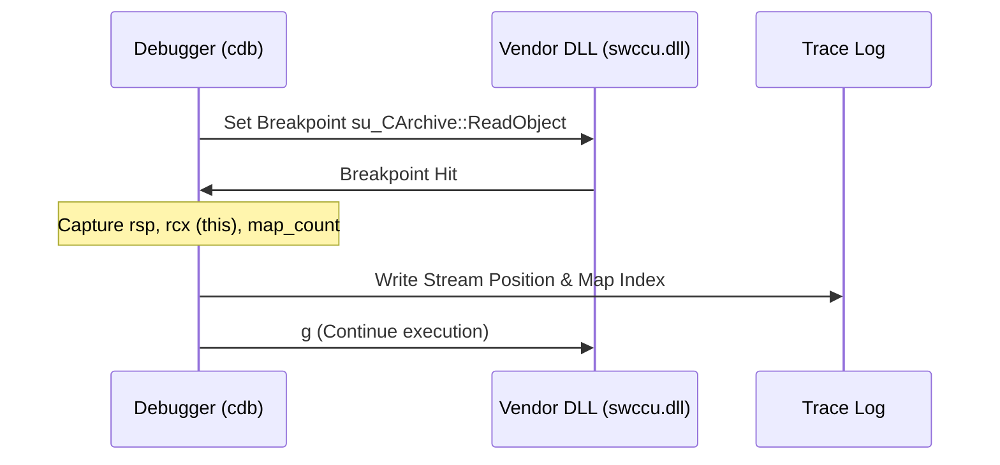

<!--
SPDX-License-Identifier: MIT
SPDX-FileCopyrightText: Copyright (c) 2026 Parashell, Odin Glynn-Martin, Stephen Harcourt
-->

Relevant source files

The following files were used as context for generating this wiki page:

- [re/Methodology.md](https://github.com/TryUniCAD/Kit/blob/aeff047c355622e812ab5d79b665d8f64c4075bb/re/Methodology.md)
- [re/README.md](https://github.com/TryUniCAD/Kit/blob/aeff047c355622e812ab5d79b665d8f64c4075bb/re/README.md)
- [re/solidworks/archive/Grammar.md](https://github.com/TryUniCAD/Kit/blob/aeff047c355622e812ab5d79b665d8f64c4075bb/re/solidworks/archive/Grammar.md)
- [re/solidworks/features/Revolve.md](https://github.com/TryUniCAD/Kit/blob/aeff047c355622e812ab5d79b665d8f64c4075bb/re/solidworks/features/Revolve.md)
- [re/tooling/windbg/Multitrace.py](https://github.com/TryUniCAD/Kit/blob/aeff047c355622e812ab5d79b665d8f64c4075bb/re/tooling/windbg/Multitrace.py)
- [re/tooling/harness/Serialize.py](https://github.com/TryUniCAD/Kit/blob/aeff047c355622e812ab5d79b665d8f64c4075bb/re/tooling/harness/Serialize.py)

# Reverse Engineering Methodology

This page describes isolated research and validation tooling. Donor fixtures and vendor automation are research inputs only; they must not enter production conversion paths. Observations depend on the documented corpus and vendor version, and do not establish production acceptance.

Reverse Engineering Methodology provides a reusable playbook for cracking proprietary binary CAD formats. This framework enables developers to achieve bidirectional interoperability with closed vendor applications like SOLIDWORKS, AutoCAD, CATIA, and NX. The core strategy avoids byte-staring in favor of building a measurement oracle and attacking the format through differential analysis, runtime tracing, and static decompilation.

The methodology ensures that every inference is verified quantitatively against the vendor application itself. By following a structured phase order, the project reduces the complexity of analyzing thousands of serializable classes, focusing only on those that impact geometry and feature history.

## 1. Execution Phases

The reverse engineering process follows a specific order where each phase provides ground truth for the next. This structure manages costs and increases the technical generality of the findings.

| Phase                       | Description                                                    | Key Outcome                                                                |
| :-------------------------- | :------------------------------------------------------------- | :------------------------------------------------------------------------- |
| **1. Container Framing**    | Analyze the file envelope and enumerate streams.               | Identifies standard containers (e.g., ZIP, OLE/CFBF) and magic numbers.    |
| **2. Measurement Oracle**   | Build an unattended verification loop using the vendor API.    | Provides quantitative correctness verdicts (e.g., volume, center of mass). |
| **3. Authored Corpus**      | Generate families of documents differing by a single property. | Locates fields for every variable property in the application.             |
| **4. Runtime Tracing**      | Trace the vendor's reader under a debugger (e.g., WinDbg/cdb). | Recovers object boundaries and index arithmetic.                           |
| **5. Static Decompilation** | Use Ghidra to analyze the vendor's serialization code.         | Identifies authoritative field orders, types, and version gates.           |
| **6. Write Path**           | Implement the actual product-level converter.                  | Delivers a verified translator independent of vendor APIs.                 |

## 2. Quantitative Measurement Oracle

The oracle is the most critical component of the methodology. It uses the vendor's own API (e.g., SOLIDWORKS COM, NXOpen, Pro/TOOLKIT) to verify if a generated or patched file is correct.

- **Quantitative Verification:** The system measures solid volume and center of mass rather than simple "boolean" opens. It aims for relative matches of $\le 6e-16$.
- **Process Isolation:** The harness launches one fresh vendor process per candidate to prevent session poisoning from crashes.
- **Batch Controls:** Known-good files are measured at the start and end of every batch. If a control fails, the entire batch is discarded.
- **Modal Management:** A watchdog thread clicks through startup modals or inconsistent toolbar dialogs to prevent blocking automation.

The diagram represents the automated verification loop used to ensure data integrity during reverse engineering. Sources: [re/Methodology.md:75-103](https://github.com/TryUniCAD/Kit/blob/aeff047c355622e812ab5d79b665d8f64c4075bb/re/Methodology.md)

## 3. Differential Corpus Analysis

Differential analysis involves authoring documents that vary by exactly one property (e.g., extrude depth, profile type, or end condition). By diffing these files, the methodology identifies the exact byte locations of authored parameters.

- **Control Pairs:** Authoring the same document twice reveals timestamps and session IDs (the noise floor).
- **Family Ladders:** Files with increasing feature counts (1, 2, 3... n) expose per-feature record blocks.
- **Round-Trip Artifacts:** Generated files are tagged to prevent them from being mistaken for vendor-source documents.

## 4. Runtime Trace and Segmentation

Runtime tracing recovers object boundaries, which is essential for structural edits like reordering or deleting features. Many CAD formats use MFC-style `CArchive` serialization, where classes are defined once and subsequent instances are indices into a map.

- **Entry Point Hooking:** The debugger hooks functions like `swccu!su_CArchive::ReadObject` or `ReadClass`.
- **State Capture:** The script logs the stream position, map counter, and buffer length at every hit.
- **Verification by Re-emission:** The trace is successful if reparsing the stream into a symbolic model and re-emitting it yields a byte-identical output.

The sequence diagram shows the runtime instrumentation of the serialization API to recover object boundaries. Sources: [re/tooling/windbg/Multitrace.py:46-56](https://github.com/TryUniCAD/Kit/blob/aeff047c355622e812ab5d79b665d8f64c4075bb/re/tooling/windbg/Multitrace.py), [re/Methodology.md:154-162](https://github.com/TryUniCAD/Kit/blob/aeff047c355622e812ab5d79b665d8f64c4075bb/re/Methodology.md)

## 5. Static Decompilation Strategy

Static analysis via Ghidra provides the authoritative types and logic for fields discovered during differential analysis.

- **API Renaming:** Decompilation results are improved by renaming overloaded `operator>>` calls to typed functions like `get_double` or `get_i32` based on demangled parameter types.
- **Vtable Slot Identification:** By mapping RTTI-named vftables to specific serialization slots (e.g., vtable slot 5 for `Serialize`), the methodology creates a class-to-serializer map for thousands of classes.
- **Version Gating:** Static analysis reveals code branches that only execute for specific document versions, explaining length differences that are invisible to single-version corpus diffing.

## 6. Verification and Attestation Discipline

Engineering discipline is maintained through a three-tier confidence vocabulary applied to every field identified.

| Confidence Level | Definition                                                                                   |
| :--------------- | :------------------------------------------------------------------------------------------- |
| **Confirmed**    | Field is read in decompilation AND reproduces a real traced span or measured number.         |
| **Partial**      | Field is read in decompilation, but no corpus file exercises the branch or varies the value. |
| **Not Found**    | Field is present in records but its purpose remains unresolved.                              |

**Key Rule: Stale vs. Wrong Caches.** Treat caches individually: only leave a cache stale or omit it when the target-version oracle has established safe recomputation. Writing a "plausible but wrong" cache often results in crashes or silent geometry corruption, whereas vendor applications usually recompute stale caches.
