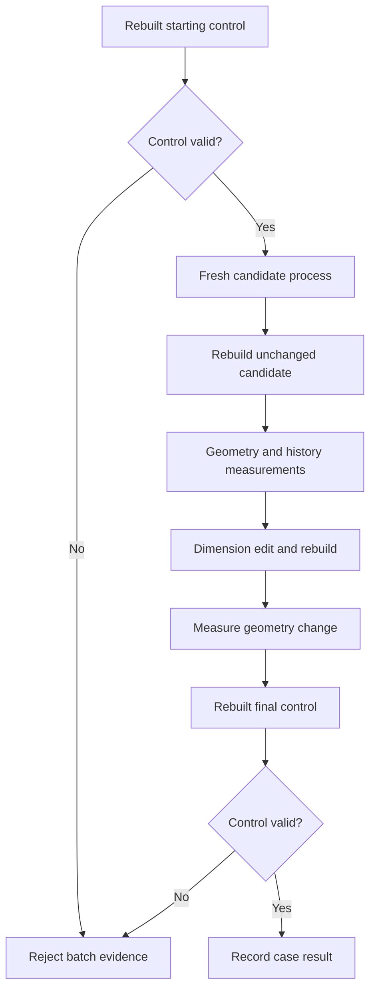

<!--
SPDX-License-Identifier: MIT
SPDX-FileCopyrightText: Copyright (c) 2026 Parashell, Odin Glynn-Martin, Stephen Harcourt
-->

# Oracle evidence and research fixtures

## Purpose

An oracle measures generated output through an isolated vendor application.
The measurement supports acceptance only for the recorded input, output, and application version.
Production conversion does not invoke the oracle.

## Before an oracle batch

Identify the source and candidate hashes.
Identify the vendor application build and required license.
Select known control documents with expected measurements.
Define units and tolerances before evaluating candidates.
Keep execution in the authorized remote validation environment.

## Measurement sequence

Control measurements must also follow a rebuild.

1. Measure the starting control.
2. Start a fresh application process for the candidate.
3. Open the candidate file.
4. Record load errors.
5. Rebuild the unchanged candidate.
6. Record rebuild errors.
7. Measure body count, volume, and center of mass.
8. Record the feature tree.
9. Change a driving dimension.
10. Rebuild the edited model.
11. Record rebuild errors.
12. Measure the resulting geometry change.
13. Close the candidate process.
14. Measure the final control.

Expected result: the report contains quantitative and editable-history evidence with healthy controls.
If either control fails, discard the affected batch results.
A file-open return value alone is insufficient.

The report can contain a failed candidate with healthy controls.
Healthy controls validate the measurement environment, not the candidate itself.

## Research fixtures

A fixture can isolate one feature or field for research.
A donor-patching experiment can help identify relationships in an undocumented record.
That experiment is not a production writer strategy.
Unrelated vendor bytes must not be embedded, copied, or patched into production output.

The source document's own data can support an implemented replay path.
Replay is still distinct from cross-format native generation.
Keep the provenance of each byte source explicit.

## Invalid conclusions

| Observation                  | Conclusion that remains unsupported           |
| ---------------------------- | --------------------------------------------- |
| The file opens               | Geometry and history are correct              |
| Volume matches               | Placement and topology match                  |
| A carrier roundtrips         | The target can edit the retained information  |
| Bytes match the source       | A different target format preserves semantics |
| One version rebuilds a cache | Every vendor version safely rebuilds it       |
| Static CI passes             | Licensed vendor acceptance ran                |

## Evidence retention

Store input identities, output identities, options, logs, measurements, and controls together.
Record the actual oracle result, including unavailable measurements.
Do not replace a failed or missing measurement with a claimed default.
Preserve the environment version so later investigators can assess drift.

## Sources

- [Research methodology](../../../re/Methodology.md)
- [Oracle integration tests](../../../tests/convert/solidworks/core/SolidworksOracleTests.py)
- [Oracle inspection sequence](../../../tests/oracle/Session.py)
- [Historical donor experiment](../../../re/solidworks/features/RevolveDonorSpec.md)
- [Lossless acceptance rule](../../../.agents/skills/standard-pr-practice/references/Standards/Portable/LosslessTranslation.md)
