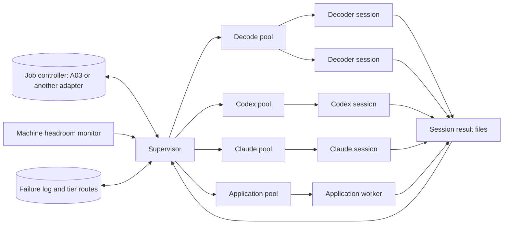

# Parallel research sessions and model runners

## Status and purpose

This page is a design for future implementation.
It describes how one machine runs many decoding sessions at the same time on top of a job controller.
The supervisor uses the controller only through the [controller interface](#controller-interface).
The [A03 controller](ResearchController.md) is the first adapter for that interface, but another controller can replace it.
It also describes how Codex and Claude runners execute optional model investigations from the [plan](AutomationPlan.md#optional-model-investigations).
Each model runner has its own ranked model ladder; see [Starting model rankings](#starting-model-rankings).
No step starts because of this page.
A07, A08, A10 and A15 still require an explicit request.
The child steps in [Delivery](#delivery) are proposals until a contributor claims them in the [step register](AutomationSteps.md).

## Terms

| Term       | Meaning                                                                                              |
| ---------- | ---------------------------------------------------------------------------------------------------- |
| Session    | One worker process that executes one claimed attempt of one job                                      |
| Runner     | A registered program that executes one job kind, for example a decoder script, Codex or Claude       |
| Pool       | A named group of sessions that share one capacity limit                                              |
| Supervisor | The local process that claims jobs, starts sessions, renews leases, stops sessions and finishes jobs |
| Candidate  | One model with one reasoning effort and per-attempt limits                                           |
| Tier       | One position in the ranked ladder of candidates                                                      |
| Headroom   | Free CPU and memory after the operator's reserve                                                     |

## Architecture



The supervisor is the only process that calls controller operations.
Sessions never write to the controller store and never hold lease tokens.
Each session reads a private session directory and writes result files to it.
The supervisor validates those files and then finishes the job through the controller.
This keeps the plan rule that a single controller owns its database writes.

Run one supervisor for each controller store.
The supervisor takes an exclusive lock file in its state directory at startup.
A second supervisor for the same store exits with a clear error.

## Session lifecycle

1. The supervisor selects a pool that has free capacity and machine headroom.
2. It claims one job for that pool through the controller interface.
3. It creates a private session directory under its state directory.
4. It copies the claimed input artifacts and writes `job.json` into that directory.
5. It starts the runner as an argument list, never through a shell.
6. It starts the runner in a new process group with an allowlisted environment.
7. It renews the lease at one third of `lease_seconds` while the process runs.
8. It reads `result.json` when the process exits.
9. It validates the result against the schema of that job kind.
10. It stores the result and calls `finish` with the outcome from the result.

The session directory contains these items:

| Path           | Writer     | Content                                               |
| -------------- | ---------- | ----------------------------------------------------- |
| `job.json`     | Supervisor | The claimed job, attempt, fingerprint and input paths |
| `inputs/`      | Supervisor | Verified copies of the bound input artifacts          |
| `work/`        | Runner     | Temporary files                                       |
| `result.json`  | Runner     | Requested outcome, reason and result records          |
| `stdout.log`   | Supervisor | Bounded capture of standard output                    |
| `stderr.log`   | Supervisor | Bounded capture of standard error                     |
| `receipt.json` | Supervisor | Exit status, duration, peak memory and signal         |

Keep a session directory until its job finishes.
Then keep only the stored artifacts and remove the directory.

### Stopping a session

The supervisor stops a session in these conditions:

- The execution deadline arrives.
- A heartbeat returns a stale-lease error because the job's inputs changed.
- The session exceeds its memory limit.
- The operator pauses the pool.

To stop a session, send `SIGTERM` to its process group.
After a 10-second grace period, send `SIGKILL` to that group.
Then finish the job with `retry` and the stop reason.
The controller must refuse a late result from an old lease.

### Supervisor restart

Leases expire if the supervisor stops unexpectedly.
On restart, the supervisor reads every remaining session directory.
It checks each recorded process identifier and process start time.
It stops a process only when both values match, so a reused process identifier is not affected.
It records an orphan receipt for each stopped session.
The controller then retries or fails each job under its normal attempt budget.

## Runners

A runner registry maps each job kind to one runner.
Store it in `re/automation/Runners.json`.
This example shows its proposed shape:

```json
{
  "runners": {
    "decode.sldprt": {
      "pool": "decode",
      "argv": ["python3", "-I", "re/automation/runners/DecodeSldprt.py", "--session", "{session}"],
      "result_schema": "re/automation/schemas/DecodeResult.json",
      "threads": 1,
      "initial_peak_memory_mib": 2048
    },
    "model.hypothesis": {
      "pool": "codex",
      "runner": "codex",
      "sandbox": "read-only",
      "result_schema": "re/automation/schemas/Hypothesis.json",
      "threads": 1,
      "initial_peak_memory_mib": 1024
    }
  }
}
```

The only substitution in `argv` is `{session}`.
The supervisor refuses a job kind that has no registry entry.
Job options reach the runner only through `job.json`, never through the command line.

Each runner follows one contract:

| Exit status | `result.json`      | Supervisor action                                                     |
| ----------- | ------------------ | --------------------------------------------------------------------- |
| `0`         | Valid              | Finish with the outcome in the result                                 |
| `0`         | Missing or invalid | Finish with `retry`; record the schema error                          |
| Not `0`     | Any                | Finish with `retry`; record the last 2,048 characters of `stderr.log` |
| Signal      | Any                | Finish with `retry`; record the signal and the stop reason            |

A runner selects `completed`, `rejected`, `waiting_evidence`, `waiting_ci` or `waiting_application` in its result.
The supervisor does not change that outcome.

### Many files at once

A decode campaign submits one job for each native file through the controller's batch submission.
Split large campaigns into batches that obey the controller's limits.
A comparison job depends on the two decode jobs of its pair.
The controller starts it only after both decode jobs complete.
Each pool then runs as many sessions as its capacity permits.

## Capacity: how many sessions run at the same time

### Limits for each pool

The supervisor calculates the capacity of each pool every 5 seconds.
The capacity is the smallest of these limits:

| Limit               | Calculation                                                                       |
| ------------------- | --------------------------------------------------------------------------------- |
| Configured maximum  | `max_sessions` for the pool in the supervisor configuration                       |
| CPU                 | `(logical CPUs − reserved CPUs) ÷ threads per session`, rounded down              |
| Memory              | `(available memory − reserved memory) ÷ peak memory estimate`, rounded down       |
| Controller          | The controller's running-job limit minus the sessions that other pools use        |
| Provider            | For model pools only: the provider's usage or rate limit and the remaining budget |
| Exclusive resources | For the application pool only: the number of verified available installations     |

The default reserve is 2 logical CPUs and 4 GiB of memory.
The operator can change the reserve in the supervisor configuration.
Set the controller's running-job limit to at least the sum of all pool maximums.
For A03, that limit is `max_running`.

### Peak memory estimate

Each pool starts with `initial_peak_memory_mib` from the runner registry.
After each session, the supervisor records the peak resident memory of the session process tree.
After 5 completed sessions of one job kind and tool version, use the 95th percentile of the last 50 measurements.
Add a 25% margin to that value.
A new tool version starts again from the registry value.

On Linux, read available memory from `MemAvailable` in `/proc/meminfo`.
On macOS, calculate available memory from free, inactive and purgeable pages in `vm_stat`.
`os.wait4` reports `ru_maxrss` in KiB on Linux and in bytes on macOS.
Normalize that value before you store it.

### Adaptive start

Do not start every pool at its full calculated capacity.
Start at half the capacity, with a minimum of one session.
Add one session after each minute without a failure when the following conditions are true:

- The one-minute load average is less than 85% of the logical CPUs.
- Available memory is more than the reserve plus one peak memory estimate.
- On Linux, `/proc/pressure/memory` reports `some avg10` below 10.

Halve the active limit of a pool when one of these events occurs:

- The operating system ends a session for memory.
- Available memory falls below the reserve.
- Two sessions in the pool exceed their deadline within 10 minutes.

The active limit never exceeds the calculated capacity.

### Calibration

Use `supervisor calibrate --kind <kind> --samples <count>` to measure a new job kind.
The command runs the selected sample jobs at 1, 2, 4 and 8 concurrent sessions.
It records completed jobs per minute and peak memory at each step.
It recommends the step after which throughput increases by less than 10%.
It stops a step early when memory headroom falls below the reserve.
Calibration results are local measurements, not test evidence.

### Example for one machine

This example uses a machine with 10 logical CPUs and 16 GiB of memory.
Of those CPUs, 4 are performance cores and 6 are efficiency cores.
The reserve is 2 CPUs and 4 GiB.

| Decoder peak memory | CPU limit | Memory limit | Decode pool capacity |
| ------------------- | --------- | ------------ | -------------------- |
| 1.5 GiB             | 8         | 8            | 8                    |
| 3 GiB               | 8         | 4            | 4                    |
| 6 GiB               | 8         | 2            | 2                    |

Efficiency cores execute a session more slowly than performance cores.
Use calibration results, not the CPU count alone, to set deadlines.

## Codex runner

### Invocation

The Codex runner executes `codex exec` without a shell.
This example shows the argument list for a read-only question:

```shell
codex exec --ignore-user-config --ignore-rules --ephemeral --skip-git-repo-check \
  --cd <session>/work --sandbox read-only \
  --model <model> --config model_reasoning_effort=<effort> \
  --output-schema <session>/schema.json --output-last-message <session>/answer.json \
  --json -
```

The runner writes the packet to standard input.
It stores the JSONL event stream from standard output as an artifact.
It reads token use from the token events of that stream.
It records uncached input, cached input, output and reasoning tokens separately.
Local Codex 0.160.1 history shows token events that also report the used percentage, length and reset time of each usage window.
The supervisor pauses the Codex pool when a window reaches `pause_at_usage_percent`.
Check the actual event names against the installed Codex version during integration.

Each option has one purpose:

| Option                  | Purpose                                                                          |
| ----------------------- | -------------------------------------------------------------------------------- |
| `--ignore-user-config`  | Ignores the operator's personal sandbox, servers and hooks; keeps authentication |
| `--ignore-rules`        | Ignores personal and project execution-policy files                              |
| `--ephemeral`           | Keeps session files out of the Codex home directory; the store keeps the record  |
| `--sandbox read-only`   | Prevents file writes by commands that the model runs                             |
| `--output-schema`       | Requires a final answer with the shape of the job kind                           |
| `--output-last-message` | Writes that final answer to a known file                                         |
| `--json`                | Writes machine-readable events for receipts and token counts                     |

Never use `danger-full-access`, `--dangerously-bypass-approvals-and-sandbox` or `--dangerously-bypass-hook-trust`.

### Task types

| Task               | Sandbox           | Working directory                           | Accepted output                      |
| ------------------ | ----------------- | ------------------------------------------- | ------------------------------------ |
| Hypothesis         | `read-only`       | Session packet files only                   | Structured field-map hypotheses      |
| Experiment request | `read-only`       | Session packet files only                   | A requested controlled sample recipe |
| Candidate patch    | `workspace-write` | A disposable Git worktree of the codec area | A diff and its claims                |

The supervisor collects a candidate patch with `git diff` from the disposable worktree.
It rejects a diff that changes a path outside the task's allowlist.
Codex never commits, pushes or merges.
A candidate patch goes to remote CI under the repository policy.
A hypothesis goes to the deterministic checker of its job kind.

### Rule change that this design needs

The plan currently says: never execute model-supplied shell commands.
Codex is an agent and runs its own commands during a session.
This design keeps the rule for the controller and the supervisor.
It permits model-run commands only inside the Codex operating-system sandbox, in a disposable session directory.
Network access stays disabled for those commands.
This exception requires explicit approval before A10 starts.
Record that approval in the plan and on PR #94.

### Private data boundary

The plan says: never upload an entire private design automatically.
The Codex sandbox restricts writes and network access for model-run commands.
It does not necessarily restrict file reads outside the working directory.
Before external transmission is enabled, run the Codex runner under a dedicated operating-system account or container.
That account can read only the session directory and the Codex authentication file.
Verify that boundary during integration before the first real packet.

### Codex errors

Separate model failures from infrastructure failures.
Only model failures count for escalation and tier routing.

| Error                                      | Detection                              | Action                                                                 | Model failure |
| ------------------------------------------ | -------------------------------------- | ---------------------------------------------------------------------- | ------------- |
| Answer does not match the schema           | Schema validation of `answer.json`     | Log the failure and escalate one tier                                  | Yes           |
| Answer fails the success criteria          | Deterministic checker                  | Log the failure and the counterexample, then escalate                  | Yes           |
| Time limit exceeded                        | Supervisor deadline                    | Stop the session, log the failure and escalate                         | Yes           |
| Token limit exceeded                       | Token use in the event stream          | Log the failure and escalate                                           | Yes           |
| Patch changes a path outside its allowlist | Diff path check                        | Reject the patch, log the failure and escalate                         | Yes           |
| Rate limit or usage limit                  | Error event or exit output from Codex  | Pause the Codex pool until the reported reset time                     | No            |
| Network or provider server error           | Error event or exit output from Codex  | Retry the same tier after 30, 120 and 600 seconds, then pause the pool | No            |
| Authentication error                       | Error event or exit output from Codex  | Stop the Codex pool and report to the operator                         | No            |
| Codex process crash                        | Exit status without a completion event | Retry once at the same tier, then park the question                    | No            |
| Inputs changed during the attempt          | Stale-lease error from a heartbeat     | Stop the session immediately; the controller requeues the job          | No            |

Codex can continue after a sandbox refuses one of its commands.
The supervisor judges only the final answer.

A paused Codex pool parks its queued jobs as an application wait.
Decode and comparison jobs continue during the pause.
The pool resumes at the reported reset time, or when the operator resumes it.

## Claude runner

The Claude runner has two modes.
The mode depends on the task type.

| Task               | Mode        | Model-run commands |
| ------------------ | ----------- | ------------------ |
| Hypothesis         | API         | None               |
| Experiment request | API         | None               |
| Candidate patch    | Claude Code | Sandboxed only     |

### API mode

API mode sends the packet in one request through the official `anthropic` Python SDK.
It gives the model no tools, so the model cannot run commands.
This mode needs no exception to the plan rule about model-supplied shell commands.

The request sets these values:

- `model` from the tier
- `output_config.effort` from the tier
- `output_config.format` with the JSON Schema of the job kind
- `max_tokens` from the tier
- Streaming, with the final message collected by the SDK helper

The supervisor reads `usage.input_tokens`, `usage.cache_read_input_tokens` and `usage.output_tokens` from the response.
Add the `anthropic` package to the research environment with `uv` when this mode is implemented.

Server-side refusal fallbacks are on by default for the models that support them.
A fallback can serve an answer from a different model.
The supervisor records the model that actually served each answer.
It adds the tokens and the result of a served answer to the ranking values of the serving model, not of the requested candidate.

### Claude Code mode

Claude Code mode runs `claude -p` in a disposable Git worktree for a candidate patch.
It uses the streamed JSON output for receipts and token counts.
It ignores personal settings, servers and hooks.
It allows only file edits inside the worktree and sandboxed commands without network access.
This mode needs the same approved exception as the Codex runner.
The Claude Code command-line program is not on the `PATH` of the current host.
Install it and check its actual options during integration.

### Claude errors

| Error                              | Detection                                      | Action                                                                 | Model failure |
| ---------------------------------- | ---------------------------------------------- | ---------------------------------------------------------------------- | ------------- |
| Answer does not match the schema   | Schema validation                              | Log the failure and escalate one tier                                  | Yes           |
| Answer fails the success criteria  | Deterministic checker                          | Log the failure and the counterexample, then escalate                  | Yes           |
| Answer stopped at `max_tokens`     | `stop_reason` is `max_tokens`                  | Log the failure and escalate                                           | Yes           |
| Refusal                            | `stop_reason` is `refusal` after all fallbacks | Park the question and record the refusal category                      | No            |
| Rate limit                         | HTTP 429 with a `retry-after` header           | Pause the Claude pool for the `retry-after` time                       | No            |
| Overloaded or server error         | HTTP 529 or 5xx after the SDK retries          | Retry the same tier after 30, 120 and 600 seconds, then pause the pool | No            |
| Connection error                   | SDK connection error after its retries         | Same as a server error                                                 | No            |
| Authentication or permission error | HTTP 401 or 403                                | Stop the Claude pool and report to the operator                        | No            |
| Invalid request                    | HTTP 400                                       | Stop the Claude pool and report the configuration error                | No            |

## Model selection

### Model candidates

Store the model candidates of each runner in a supervisor configuration file, for example `ModelTiers.json`:

```json
{
  "codex": {
    "candidates": [
      { "model": "<model-a>", "effort": "medium", "max_seconds": 600, "max_output_tokens": 20000 },
      { "model": "<model-b>", "effort": "high", "max_seconds": 1800, "max_output_tokens": 60000 }
    ],
    "token_weights": { "default": { "uncached_input": 1, "cached_input": 1, "output": 1 } },
    "budget": { "per_question_weighted_tokens": 2000000, "per_day_weighted_tokens": 20000000 },
    "pause_at_usage_percent": 90
  },
  "claude": {
    "candidates": [
      { "model": "<model-c>", "effort": "medium", "max_seconds": 600, "max_output_tokens": 16000 },
      { "model": "<model-d>", "effort": "high", "max_seconds": 1800, "max_output_tokens": 64000 }
    ],
    "token_weights": {
      "<model-c>": { "uncached_input": 0.0000001, "cached_input": 0.00000001, "output": 0.0000005 }
    },
    "budget": { "per_question_weighted_tokens": 5, "per_day_weighted_tokens": 50 }
  }
}
```

Each candidate is one model with one reasoning effort.
The same model at two efforts is two candidates.
The operator lists the candidates and the supervisor ranks them.
Each runner has its own ladder.
Do not compare tokens across runners, because their tokenizers differ.
The values above are examples, not recommendations or measured prices.
For Claude, set the weights to the price of one token, so that weighted tokens are a cost in US dollars.
For Codex, no price per token is published in the model list, so the weights stay at 1.

At startup, the supervisor validates each candidate.
For Codex, each model must appear in the model list of the installed Codex version.
For Codex, each effort must appear in the supported levels of that model.
For Claude, the Models API must return each model, and each effort must be a level that the model accepts.
If a candidate fails validation, the pool of that runner does not start.
The other pools continue.

### Model ranking by token efficiency

The Codex model list gives the display order, description and context window of each model, but no price.
Claude publishes a price for each token, but not the number of tokens that a task needs.
So the supervisor measures token efficiency itself for both runners.

The weighted tokens of one attempt use the `token_weights` values of its model, or the `default` values:

```text
weighted tokens = uncached input × uncached_input + cached input × cached_input + output × output
```

Output includes reasoning tokens.
Set the weights from the provider's current prices or usage rates during integration.
Until then, every weight is 1.

The supervisor calculates these values for each candidate:

| Value              | Calculation                                                 |
| ------------------ | ----------------------------------------------------------- |
| Pass rate          | Passed attempts ÷ all attempts                              |
| Tokens per attempt | Mean weighted tokens of one attempt                         |
| Tokens per pass    | Weighted tokens of all attempts ÷ passed attempts           |
| Reliable pass rate | The lower bound of the 90% Wilson interval of the pass rate |
| High token use     | The 90th percentile of weighted tokens of one attempt       |

A new candidate first answers a ranking set.
The ranking set contains at least 20 questions with known answers from solved families, for example the A09 pad-then-pad family.
Every candidate gets the same packets and the same checks.
Only the candidates in the starting ladder answer the full ranking set at first.
Each other candidate first answers 5 screening questions from the ranking set.
It continues to the full ranking set only when it passes at least 4 of them.
A candidate enters the ladder only after it completes the full ranking set.
After that, attempts on real questions keep its values current, so no full ranking set runs again unless its model version changes.

Remove a dominated candidate from the ladder.
Candidate X is dominated when another candidate Y meets both of these conditions:

- The reliable pass rate of Y is equal to or higher than the reliable pass rate of X.
- The tokens per pass of Y are at least 10% lower than the tokens per pass of X.

Both candidates need at least 20 ranked questions before this comparison applies.
For example, remove `gpt-5.6-luna` if `gpt-6-luna` passes at least as often and uses at least 10% fewer tokens per pass.
Record each removal with the numbers that caused it.

Sort the remaining candidates by tokens per pass, from lowest to highest.
That order is the tier ladder.
After dominated candidates are removed, the pass rate rises along the ladder.

Use the values of one route key when each tier has at least 20 attempts for that route key.
Otherwise, use the ranking-set values.
Rank again after every 50 new attempts and after any model version change.
Also rank one route key again at once when a [consistency flag](#consistency-and-automatic-re-ranking) changes for it.
A removed candidate returns only when a new model version or new measurements change the comparison.

The expected tokens to a pass from start tier `s` include the attempts that fail before a pass:

```text
expected(s) = T(s) + (1 − P(s)) × T(s+1) + (1 − P(s)) × (1 − P(s+1)) × T(s+2) + …
```

`T(i)` is the tokens per attempt and `P(i)` is the reliable pass rate of tier `i`.
A cheap tier that seldom passes can cost more than a stronger tier that passes the first time.

### Consistency and automatic re-ranking

A model can be good on average but inconsistent on one task.
The supervisor measures consistency for each candidate and route key, and changes that ladder automatically.

The reliable pass rate already ranks an inconsistent or little-tested candidate lower than its raw pass rate.
A candidate with 9 passes in 10 attempts ranks below a candidate with 90 passes in 100 attempts.

The supervisor also measures three consistency signals:

| Signal              | Calculation                                                                                    | Flag when               |
| ------------------- | ---------------------------------------------------------------------------------------------- | ----------------------- |
| Repeat disagreement | Repeated questions with both a pass and a failure ÷ all repeated questions                     | More than 20%           |
| Pass-rate drift     | Pass rate of the last 20 attempts compared with the reliable pass rate of all earlier attempts | 20 points or more lower |
| Token spread        | High token use ÷ median weighted tokens of one attempt                                         | More than 3             |

To measure repeat disagreement, send 1 in 10 questions to the same candidate a second time.
After 30 repeats on one route key without a repeat-disagreement flag, send only 1 in 50.
Return to 1 in 10 when any flag appears or the model version changes.
Send the repeat only when the first answer passes, so that the repeat costs no escalation.
A repeat answer is not used as a result; it only measures consistency.
Each repeat counts toward the budget.

These rules change the ladder of that route key:

1. A candidate with one flag moves one position higher in the ladder for that route key, after the next stronger candidate.
2. A candidate with two or more flags leaves the ladder of that route key.
3. A flagged candidate keeps its position for other route keys.
4. Token spread makes the budget check use high token use instead of the mean for that candidate.
5. Pass-rate drift also checks the model version. A changed version restarts the ranking set for that candidate.

A removed candidate gets 5 ranking-set questions for that route key each week.
It returns to the ladder when those questions and its last 20 attempts raise no flag.
Record each flag, position change, removal and return with the numbers that caused it.
These records go in the failure log next to the tier routes.
The thresholds are defaults that the operator can change in `ModelTiers.json`.

### Model selector

The selector takes these steps for each question:

1. Calculate the route key: question kind, CAD format and feature family.
2. Select the start tier. It is the higher of the routed tier from the failure log and the tier with the lowest `expected(s)`.
3. Look for a cached answer with the same packet fingerprint, model and model version. Use it if it exists.
4. Estimate the maximum weighted tokens of one attempt at the tier. If the remaining budget is smaller, park the question.
5. Run the attempt.
6. Check the result in this order: exit status, output schema, then the machine-checkable success criteria.
7. If all checks pass, record the answer and submit its verification jobs.
8. If a check fails, write a failure log entry and go to the next tier with that entry in the packet.
9. If the last tier fails, park the question with all of its evidence.

The failure signature is the route key plus the check that failed.
After two failures with the same signature at one tier, raise the start tier of that route key by one.
A new question uses the start tier of its route key, because its failing check is not known yet.
Lower a start tier only when a tool, rule, runner or model version changes for that signature.
Record each routing change with the failure log entries that caused it.

### Shared packet prefix

Most of a packet is the same for every question of one kind.
That part contains the instructions, the output schema and the shared format evidence.
Put that stable part first, in a fixed byte order, and the question-specific part last.
Then the provider can reuse its cached copy of the stable part.

For Claude API mode, mark the end of the stable part with a cache breakpoint.
Check `usage.cache_read_input_tokens` after the first questions of each kind.
If it stays at zero, a changing value is in the stable part, for example a time or an unsorted list.
For Codex, the stable part reaches the provider at the start of the packet on standard input.
Codex reports cached input tokens in its token events.

Cached input tokens have their own weight in `token_weights`.
So caching lowers the tokens per pass and changes the ranking only through measured use.

## Starting model rankings

These tables are the starting ladders before the ranking set runs.
They come from the published model descriptions and prices, not from measurement.
The [token-efficiency ranking](#model-ranking-by-token-efficiency) replaces each order after the ranking set.
An excluded model enters the ranking set only when the operator adds it again.
The operator ruled out the Astra and Fable models.
The supervisor never adds a ruled-out model back, and never sends a question to one.
So the strongest tier of each runner is now `xhigh` on its best remaining model.
A question that fails that tier is parked, as the plan requires.

### Codex ladder

The source is the Codex model list of 2026-11-13, read from the local Codex installation.

| Tier | Model           | Effort   | Reason for this position                                          |
| ---- | --------------- | -------- | ----------------------------------------------------------------- |
| 1    | `gpt-6-luna`    | `medium` | Described as fast and affordable for easier tasks                 |
| 2    | `gpt-6.1-terra` | `medium` | Newest generation; the older Terra model is described as balanced |
| 3    | `gpt-6.1-sol`   | `medium` | Described as the latest workhorse for coding and everyday work    |
| 4    | `gpt-6.1-sol`   | `high`   | The same model with deeper reasoning                              |
| 5    | `gpt-6.1-sol`   | `xhigh`  | The last tier                                                     |

The position of `gpt-6.1-terra` is an inference from the description of the older Terra model.
The `max` and `ultra` efforts start excluded.
Add them only when the ranking set shows a pass-rate gain over `xhigh`.

| Excluded model                                 | Reason                                                              |
| ---------------------------------------------- | ------------------------------------------------------------------- |
| `gpt-6-astra`                                  | Ruled out by operator decision                                      |
| `gpt-6-sol`                                    | Previous-generation workhorse; `gpt-6.1-sol` has the same role      |
| `gpt-5.6-sol`, `gpt-5.6-terra`, `gpt-5.6-luna` | Older generation; a newer model with the same role is in the ladder |
| `gpt-reserve`                                  | Hidden in the model list                                            |
| `codex-auto-review`                            | Hidden, and made for approval review, not research                  |

### Claude ladder

The source is the Anthropic first-party price table cached on 2026-11-03.
Prices are US dollars for one million input and output tokens.
Check the current prices during integration.

| Tier | Model               | Effort   | Price (input / output) | Reason for this position               |
| ---- | ------------------- | -------- | ---------------------- | -------------------------------------- |
| 1    | `claude-haiku-5-5`  | `medium` | $0.10 / $0.50          | Lowest price; its default effort       |
| 2    | `claude-sonnet-5-5` | `medium` | $2 / $10               | Everyday coding and agent work         |
| 3    | `claude-opus-5-5`   | `medium` | $4 / $20               | Current Opus model; its default effort |
| 4    | `claude-opus-5-5`   | `high`   | $4 / $20               | The same model with deeper reasoning   |
| 5    | `claude-opus-5-5`   | `xhigh`  | $4 / $20               | The last tier                          |

The ranking set also measures `claude-opus-5-5` at `low`.
A stronger model at low effort can use fewer tokens per pass than a weaker model at a high effort.
The `max` effort starts excluded on every model.

| Excluded model                                                           | Reason                                                |
| ------------------------------------------------------------------------ | ----------------------------------------------------- |
| `claude-fable-5-2`, `claude-fable-5-1`, `claude-fable-5`                 | Ruled out by operator decision                        |
| `claude-opus-5`, `claude-opus-4-8`, `claude-opus-4-7`, `claude-opus-4-6` | Older than `claude-opus-5-5` and $5 / $25             |
| `claude-sonnet-5`                                                        | Older than `claude-sonnet-5-5` at the same price      |
| `claude-sonnet-4-6`                                                      | Older than `claude-sonnet-5-5` and $3 / $15           |
| `claude-haiku-4-5`                                                       | Older than `claude-haiku-5-5` and ten times its price |
| `claude-mythos-5-2`, `claude-mythos-5-1`                                 | Available to verified organizations only              |

## General session errors

| Error                                                       | Action                                                                        |
| ----------------------------------------------------------- | ----------------------------------------------------------------------------- |
| Runner exits without a valid result                         | Finish with `retry` and the bounded error output                              |
| Operating system ends a session for memory                  | Double the peak memory estimate for that kind, halve the pool limit and retry |
| Deadline exceeded                                           | Stop the process group and finish with `retry`                                |
| Three infrastructure failures in one pool within 10 minutes | Pause that pool and report to the operator; other pools continue              |
| Attempt budget exhausted                                    | The controller marks the job `failed` for the current prerequisite generation |

The supervisor never changes a job's timeout, attempt budget or checks to force progress.
Those changes require a new job definition.

## Fairness

A07 will own priority ordering.
Until A07 exists, claims within one pool follow the controller's order.
For A03, that order is the job creation order.
Separate pools prevent long Codex sessions from blocking fast decode work.
Give each feature family a minimum share of each pool so that rare features also run.

## Controller interface

The supervisor needs these operations from a job controller:

| Operation        | Required behavior                                                             |
| ---------------- | ----------------------------------------------------------------------------- |
| Submit jobs      | Accepts a bounded batch atomically, with dependencies between jobs            |
| Claim for a pool | Returns one runnable job whose kind belongs to the pool, with a unique lease  |
| Renew a lease    | Extends the lease up to the deadline, or returns a distinct stale-lease error |
| Finish           | Accepts one outcome for the current lease and refuses a stale lease           |
| Pool capacity    | Holds a counted capacity for each shared resource, such as the Codex provider |
| Resource state   | Marks a resource available or unavailable and parks the jobs that need it     |
| Status           | Reports job states, attempts and reasons                                      |

The controller must also keep these guarantees:

- A job runs under at most one valid lease at a time.
- An attempt budget limits retries for one set of prerequisites.
- Changed inputs invalidate dependent jobs and their old leases.
- Each operation is transactional, so an interrupted supervisor leaves no partial state.

An adapter translates these operations into the commands of one controller.
The supervisor contains no controller-specific logic outside its adapter.

### A03 adapter

A03 supplies most of the interface through `submit-batch`, `claim`, `heartbeat`, `finish`, `resource` and `status`.
It needs three additions:

- Counted resources: `resource <name> --capacity <count>`. A03 resources are exclusive today, so a shared provider resource allows only one session.
- Pool-filtered claims: `claim --pool <name>` returns only jobs whose kind belongs to that pool.
- A distinct stale-lease error code from `heartbeat`, so that the supervisor can stop an invalidated session immediately.

These additions change the A03 schema to version 4 and require a version 3 migration.
They belong to A08a, because A03 is in its publication gate.

### Another controller

A different controller can replace A03 when it keeps every guarantee above.
Write a new adapter for it and run the same remote process tests against that adapter.
If a controller cannot filter claims by pool, the adapter cannot use it.
A claim of the wrong job kind would consume an attempt in the wrong pool.

## Status report

`supervisor status` reports this information for each pool:

- Running sessions, active limit, calculated capacity and the limit that applies
- Measured peak memory estimate for each job kind
- Pause state, pause reason and resume time
- Weighted tokens for the current question and the current day
- The used percentage of each Codex usage window
- The current tier ladder of each runner, with pass rate and tokens per pass for each candidate
- Each removed candidate and the candidate that dominated it
- The consistency flags of each candidate for each route key

## Delivery

| Proposed ID | Deliverable                                                                               | Depends on       |
| ----------- | ----------------------------------------------------------------------------------------- | ---------------- |
| A08a        | Supervisor, session directories, pools, controller interface and A03 adapter              | A03              |
| A08b        | Capacity limits, adaptive start and calibration                                           | A08a             |
| A10a        | Codex runner, sandbox options and private data boundary                                   | A08a, A07, A09   |
| A10b        | Candidate validation, selector, failure log and tier routes                               | A10a             |
| A10c        | Ranking set, token-efficiency ranking, dominated-model removal and consistency re-ranking | A10b, A09        |
| A10d        | Claude runner in API mode and Claude Code mode, with its error handling                   | A08a, A07, A09   |
| A15a        | Two-week pilot with measured capacity and model spend                                     | A08b, A10c, A10d |

## Verification

Remote process tests use runner programs that sleep, allocate memory, exit with an error, ignore `SIGTERM` or write invalid results.
A test-only Codex substitute writes recorded event streams and exit statuses to exercise each row of the Codex error table.
Recorded ranking data checks the dominance rule, the ladder order and the `expected(s)` start-tier choice.
Recorded attempts with mixed results check each consistency flag, the position changes, removal and return.
A test-only Claude API substitute returns recorded responses and HTTP errors to exercise each row of the Claude error table.
A second adapter test runs the supervisor process tests against a minimal in-test controller.
These tests run in remote CI under the repository policy.
A real Codex session runs only in an authorized A15a pilot.
Calibration results and pilot measurements are recorded on PR #94 as observations, not as test evidence.

## Related information

- [Neutral-first automation plan](AutomationPlan.md)
- [Step register](AutomationSteps.md)
- [Durable research controller](ResearchController.md)
