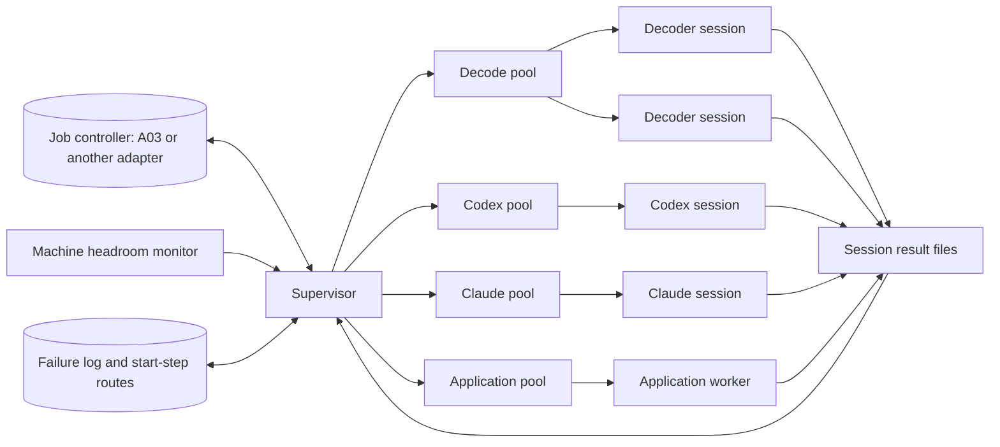

# Parallel research sessions and model runners

## Status and purpose

This page is a design for future implementation.
It describes how one machine runs many decoding sessions at the same time on top of a job controller.
The supervisor uses the controller only through the [controller interface](#controller-interface).
The [A03 controller](ResearchController.md) is the first adapter for that interface, but another controller can replace it.
It also describes how Codex and Claude runners execute optional model investigations from the [plan](AutomationPlan.md#optional-model-investigations).
Each model runner uses one fixed model at two efforts, as [Model selection](#model-selection) describes.
The [supervisor guide](ResearchSupervisor.md) describes the A08a implementation of the supervisor, session directories, pools and adapters.
No step starts because of this page.
The [step register](AutomationSteps.md) records authorization, ownership and status.
Claim a runnable child step there and on PR #94 before implementation.
Optional model execution and the proposed model-command exception require their separate authorizations.

## Terms

| Term       | Meaning                                                                                              |
| ---------- | ---------------------------------------------------------------------------------------------------- |
| Session    | One worker process that executes one claimed attempt of one job                                      |
| Runner     | A registered program that executes one job kind, for example a decoder script, Codex or Claude       |
| Pool       | A named group of sessions that share one capacity limit                                              |
| Supervisor | The local process that claims jobs, starts sessions, renews leases, stops sessions and finishes jobs |
| Candidate  | One model with one reasoning effort and per-attempt limits                                           |
| Step       | The first or the fallback candidate of a runner                                                      |
| Headroom   | Free CPU and memory after the operator's reserve                                                     |

## Architecture



The supervisor is the only process that calls controller operations.
Sessions never write to the controller store and never hold lease tokens.
Each session reads a private session directory and writes result files to it.
The supervisor validates those files and then finishes the job through the controller.
This keeps the plan rule that a single controller owns its database writes.

Run one supervisor for each controller store.
The supervisor takes an exclusive lock file in its state directory at startup.
A second supervisor for the same store exits with a clear error.

## Session lifecycle

1. The supervisor selects a pool that has free capacity and machine headroom.
2. It claims one job for that pool through the controller interface.
3. It creates a private session directory under its state directory.
4. It copies the claimed input artifacts and writes `job.json` into that directory.
5. It starts the runner as an argument list, never through a shell.
6. It starts the runner in a new process group with an allowlisted environment.
7. It renews the lease at one third of `lease_seconds` while the process runs.
8. It reads `result.json` when the process exits.
9. It validates the result against the schema of that job kind.
10. It stores the result and calls `finish` with the outcome from the result.

The session directory contains these items:

| Path           | Writer     | Content                                               |
| -------------- | ---------- | ----------------------------------------------------- |
| `job.json`     | Supervisor | The claimed job, attempt, fingerprint and input paths |
| `inputs/`      | Supervisor | Verified copies of the bound input artifacts          |
| `work/`        | Runner     | Temporary files                                       |
| `result.json`  | Runner     | Requested outcome, reason and result records          |
| `stdout.log`   | Supervisor | Bounded capture of standard output                    |
| `stderr.log`   | Supervisor | Bounded capture of standard error                     |
| `receipt.json` | Supervisor | Exit status, duration, peak memory and signal         |

Keep a session directory until its job finishes.
Then keep only the stored artifacts and remove the directory.

### Stopping a session

The supervisor stops a session in these conditions:

- The execution deadline arrives.
- A heartbeat returns a stale-lease error because the job's inputs changed.
- The session exceeds its memory limit.
- The operator pauses the pool.

To stop a session, send `SIGTERM` to its process group.
After a 10-second grace period, send `SIGKILL` to that group.
Then finish the job with `retry` and the stop reason.
The controller must refuse a late result from an old lease.

### Supervisor restart

Leases expire if the supervisor stops unexpectedly.
On restart, the supervisor reads every remaining session directory.
It checks each recorded process identifier and process start time.
It stops a process only when both values match, so a reused process identifier is not affected.
It records an orphan receipt for each stopped session.
The controller then retries or fails each job under its normal attempt budget.

## Runners

A runner registry maps each job kind to one runner.
Store it in `re/automation/Runners.json`.
This example shows its proposed shape:

```json
{
  "runners": {
    "decode.sldprt": {
      "pool": "decode",
      "argv": [
        "python3",
        "-I",
        "re/automation/runners/DecodeSldprt.py",
        "--session",
        "{session}"
      ],
      "result_schema": "re/automation/schemas/DecodeResult.json",
      "threads": 1,
      "initial_peak_memory_mib": 2048
    },
    "model.hypothesis": {
      "pool": "codex",
      "runner": "codex",
      "sandbox": "read-only",
      "result_schema": "re/automation/schemas/Hypothesis.json",
      "threads": 1,
      "initial_peak_memory_mib": 1024
    }
  }
}
```

The only substitution in `argv` is `{session}`.
The supervisor refuses a job kind that has no registry entry.
Job options reach the runner only through `job.json`, never through the command line.

Each runner follows one contract:

| Exit status | `result.json`      | Supervisor action                                                     |
| ----------- | ------------------ | --------------------------------------------------------------------- |
| `0`         | Valid              | Finish with the outcome in the result                                 |
| `0`         | Missing or invalid | Finish with `retry`; record the schema error                          |
| Not `0`     | Any                | Finish with `retry`; record the last 2,048 characters of `stderr.log` |
| Signal      | Any                | Finish with `retry`; record the signal and the stop reason            |

A runner selects `completed`, `rejected`, `waiting_evidence`, `waiting_ci` or `waiting_application` in its result.
The supervisor does not change that outcome.

### Many files at once

A decode campaign submits one job for each native file through the controller's batch submission.
Split large campaigns into batches that obey the controller's limits.
A comparison job depends on the two decode jobs of its pair.
The controller starts it only after both decode jobs complete.
Each pool then runs as many sessions as its capacity permits.

### Small files in one session

Starting a process for each small file wastes time.
The supervisor can claim up to 20 decode jobs of one kind and run them in one session.
It groups only files smaller than 1 MiB, unless the runner registry sets another `group_limit_bytes`.
Each file keeps its own job, lease and result.
The runner writes one result file for each job in the session directory.
The supervisor renews and finishes each lease separately.
A grouped session counts as one session for the CPU and memory limits.
It counts as one running job for each file against the controller's running-job limit.
If a grouped session crashes, the supervisor retries each of its jobs in its own session.
So one bad file cannot fail the other files again.

## Capacity: how many sessions run at the same time

### Limits for each pool

The supervisor calculates the capacity of each pool every 5 seconds.
The capacity is the smallest of these limits:

| Limit               | Calculation                                                                       |
| ------------------- | --------------------------------------------------------------------------------- |
| Configured maximum  | `max_sessions` for the pool in the supervisor configuration                       |
| CPU                 | `(logical CPUs − reserved CPUs) ÷ threads per session`, rounded down              |
| Memory              | `(available memory − reserved memory) ÷ peak memory estimate`, rounded down       |
| Controller          | The controller's running-job limit minus the sessions that other pools use        |
| Provider            | For model pools only: the provider's usage or rate limit and the remaining budget |
| Exclusive resources | For the application pool only: the number of verified available installations     |

The default reserve is 2 logical CPUs and 4 GiB of memory.
The operator can change the reserve in the supervisor configuration.
Set the controller's running-job limit to at least the sum of all pool maximums.
For A03, that limit is `max_running`.

### Peak memory estimate

Each pool starts with `initial_peak_memory_mib` from the runner registry.
After each session, the supervisor records the peak resident memory of the session process tree.
After 5 completed sessions of one job kind and tool version, use the 95th percentile of the last 50 measurements.
Add a 25% margin to that value.
A new tool version starts again from the registry value.

On Linux, read available memory from `MemAvailable` in `/proc/meminfo`.
On macOS, use free pages plus the larger of inactive or purgeable pages in `vm_stat`.
This lower-bound estimate does not assume that the inactive and purgeable sets are disjoint.
`os.wait4` reports `ru_maxrss` in KiB on Linux and in bytes on macOS.
Normalize that value before you store it.

### Adaptive start

Do not start every pool at its full calculated capacity.
Start at half the capacity, with a minimum of one session.
Add one session after each minute without a failure when the following conditions are true:

- The one-minute load average is less than 85% of the logical CPUs.
- Available memory is more than the reserve plus one peak memory estimate.
- On Linux, `/proc/pressure/memory` reports `some avg10` below 10.

Halve the active limit of a pool when one of these events occurs:

- The operating system ends a session for memory.
- Available memory falls below the reserve.
- Two sessions in the pool exceed their deadline within 10 minutes.

The active limit never exceeds the calculated capacity.

### Calibration

Use `supervisor calibrate --kind <kind> --samples <count>` to measure a new job kind.
The command runs the selected sample jobs at 1, 2, 4 and 8 concurrent sessions.
It records completed jobs per minute and peak memory at each step.
It recommends the step after which throughput increases by less than 10%.
It stops a step early when memory headroom falls below the reserve.
Calibration results are local measurements, not test evidence.

### Example for one machine

This example uses a machine with 10 logical CPUs and 16 GiB of memory.
Of those CPUs, 4 are performance cores and 6 are efficiency cores.
The reserve is 2 CPUs and 4 GiB.

| Decoder peak memory | CPU limit | Memory limit | Decode pool capacity |
| ------------------- | --------- | ------------ | -------------------- |
| 1.5 GiB             | 8         | 8            | 8                    |
| 3 GiB               | 8         | 4            | 4                    |
| 6 GiB               | 8         | 2            | 2                    |

Efficiency cores execute a session more slowly than performance cores.
Use calibration results, not the CPU count alone, to set deadlines.

## Application workers that stay busy

A scripted application grid takes seconds, so an idle CAD installation wastes the scarcest resource.
The application pool keeps each installation busy while runnable application jobs exist.

### Single Windows host

Run the controller, the supervisor, SOLIDWORKS and Fusion on one Windows machine.
Then the application pool needs no network job transport.
The supervisor does not support Windows yet; A08e adds that support.
Until A08e passes, Fusion can run queued capture scripts through the `KitCaptureRunner` add-in.

### Continuous claims

- Give the application pool one session for each verified installation.
- Mark each installation as one counted resource with a capacity of 1.
- Start the next claim as soon as a session finishes, with no idle poll between jobs.
- Never run two jobs in the same installation at the same time.

### Work ahead of decoding

- A07 submits grid jobs for every runnable gap, not only for the gap under investigation.
- Keep at least 10 queued application jobs for each installation.
- A decode or model job that needs a grid depends on that grid job, so it starts when the grid completes.
- When no requested grid is queued, run the standard grid of the highest-priority open feature family.
- Standard grids have the lowest priority.
- A requested grid takes the next free claim, but it never interrupts a running job.

### Reset only when necessary

After each job, close only the documents that the job owns.
Restart the application only in these conditions:

| Condition                                  | Action                                                                       |
| ------------------------------------------ | ---------------------------------------------------------------------------- |
| Repeat-save evidence is queued             | Collect the repeat saves of many recipes and do them across one restart      |
| 50 jobs since the last restart             | Restart between jobs; the operator can change the count                      |
| Process memory is more than its limit      | Restart between jobs                                                         |
| The application crashes or stops answering | Stop it, restart it, retry that job once, then park the job                  |
| The healthy control fails                  | Discard the batch, restart, measure the control again, then repeat the batch |

Measure the healthy control before and after each batch of up to 20 jobs.
A failed control invalidates every result of that batch.

### Utilization

`supervisor status` reports, for each installation, the busy time divided by the elapsed time.
While the application queue is not empty, the target is 90% or more.
A lower value identifies a slow restart, a slow claim or an empty queue.

## Codex runner

### Invocation

The Codex runner executes `codex exec` without a shell.
This example shows the argument list for a read-only question:

```shell
codex exec --ignore-user-config --ignore-rules --ephemeral --skip-git-repo-check \
  --cd <session>/work --sandbox read-only \
  --model <model> --config model_reasoning_effort=<effort> \
  --output-schema <session>/schema.json --output-last-message <session>/answer.json \
  --json -
```

The runner writes the packet to standard input.
It stores the JSONL event stream from standard output as an artifact.
It reads token use from the token events of that stream.
It records uncached input, cached input, output and reasoning tokens separately.
Local Codex 0.160.1 history shows token events that also report the used percentage, length and reset time of each usage window.
The supervisor pauses the Codex pool when a window reaches `pause_at_usage_percent`.
Check the actual event names against the installed Codex version during integration.

Each option has one purpose:

| Option                  | Purpose                                                                          |
| ----------------------- | -------------------------------------------------------------------------------- |
| `--ignore-user-config`  | Ignores the operator's personal sandbox, servers and hooks; keeps authentication |
| `--ignore-rules`        | Ignores personal and project execution-policy files                              |
| `--ephemeral`           | Keeps session files out of the Codex home directory; the store keeps the record  |
| `--sandbox read-only`   | Prevents file writes by commands that the model runs                             |
| `--output-schema`       | Requires a final answer with the shape of the job kind                           |
| `--output-last-message` | Writes that final answer to a known file                                         |
| `--json`                | Writes machine-readable events for receipts and token counts                     |

Never use `danger-full-access`, `--dangerously-bypass-approvals-and-sandbox` or `--dangerously-bypass-hook-trust`.

### Task types

| Task               | Sandbox           | Working directory                           | Accepted output                      |
| ------------------ | ----------------- | ------------------------------------------- | ------------------------------------ |
| Hypothesis         | `read-only`       | Session packet files only                   | Structured field-map hypotheses      |
| Experiment request | `read-only`       | Session packet files only                   | A requested controlled sample recipe |
| Candidate patch    | `workspace-write` | A disposable Git worktree of the codec area | A diff and its claims                |

The supervisor collects a candidate patch with `git diff` from the disposable worktree.
It rejects a diff that changes a path outside the task's allowlist.
Codex never commits, pushes or merges.
A candidate patch goes to remote CI under the repository policy.
A hypothesis goes to the deterministic checker of its job kind.

### Rule change that this design needs

The plan currently says: never execute model-supplied shell commands.
Codex is an agent and runs its own commands during a session.
This design keeps the rule for the controller and the supervisor.
It permits model-run commands only inside the Codex operating-system sandbox, in a disposable session directory.
Network access stays disabled for those commands.
This exception requires explicit approval before A10 starts.
Record that approval in the plan and on PR #94.

### Private data boundary

The plan says: never upload an entire private design automatically.
The Codex sandbox restricts writes and network access for model-run commands.
It does not necessarily restrict file reads outside the working directory.
Before external transmission is enabled, run the Codex runner under a dedicated operating-system account or container.
That account can read only the session directory and the Codex authentication file.
Verify that boundary during integration before the first real packet.

### Codex errors

Separate model failures from infrastructure failures.
Only model failures count for escalation and start-step routing.

| Error                                      | Detection                              | Action                                                                 | Model failure |
| ------------------------------------------ | -------------------------------------- | ---------------------------------------------------------------------- | ------------- |
| Answer does not match the schema           | Schema validation of `answer.json`     | Log the failure and run the fallback step                              | Yes           |
| Answer fails the success criteria          | Deterministic checker                  | Log the failure and the counterexample, then escalate                  | Yes           |
| Time limit exceeded                        | Supervisor deadline                    | Stop the session, log the failure and escalate                         | Yes           |
| Token limit exceeded                       | Token use in the event stream          | Log the failure and escalate                                           | Yes           |
| Patch changes a path outside its allowlist | Diff path check                        | Reject the patch, log the failure and escalate                         | Yes           |
| Rate limit or usage limit                  | Error event or exit output from Codex  | Pause the Codex pool until the reported reset time                     | No            |
| Network or provider server error           | Error event or exit output from Codex  | Retry the same step after 30, 120 and 600 seconds, then pause the pool | No            |
| Authentication error                       | Error event or exit output from Codex  | Stop the Codex pool and report to the operator                         | No            |
| Codex process crash                        | Exit status without a completion event | Retry once at the same step, then park the question                    | No            |
| Inputs changed during the attempt          | Stale-lease error from a heartbeat     | Stop the session immediately; the controller requeues the job          | No            |

Codex can continue after a sandbox refuses one of its commands.
The supervisor judges only the final answer.

A paused Codex pool parks its queued jobs as an application wait.
Decode and comparison jobs continue during the pause.
The pool resumes at the reported reset time, or when the operator resumes it.

## Claude runner

The Claude runner has two modes.
The mode depends on the task type.

| Task               | Mode        | Model-run commands |
| ------------------ | ----------- | ------------------ |
| Hypothesis         | API         | None               |
| Experiment request | API         | None               |
| Candidate patch    | Claude Code | Sandboxed only     |

### API mode

API mode sends the packet in one request through the official `anthropic` Python SDK.
It gives the model no tools, so the model cannot run commands.
This mode needs no exception to the plan rule about model-supplied shell commands.

The request sets these values:

- `model` from the step
- `output_config.effort` from the step
- `output_config.format` with the JSON Schema of the job kind
- `max_tokens` from the step
- Streaming, with the final message collected by the SDK helper

The supervisor reads `usage.input_tokens`, `usage.cache_read_input_tokens` and `usage.output_tokens` from the response.
Add the `anthropic` package to the research environment with `uv` when this mode is implemented.

Server-side refusal fallbacks are on by default for the models that support them.
A fallback can serve an answer from a different model.
The supervisor records the model that actually served each answer.
It reports the tokens and the result of a served answer under the serving model, not the requested candidate.

### Claude Code mode

Claude Code mode runs `claude -p` in a disposable Git worktree for a candidate patch.
It uses the streamed JSON output for receipts and token counts.
It ignores personal settings, servers and hooks.
It allows only file edits inside the worktree and sandboxed commands without network access.
This mode needs the same approved exception as the Codex runner.
The Claude Code command-line program is not on the `PATH` of the current host.
Install it and check its actual options during integration.

### Claude errors

| Error                              | Detection                                      | Action                                                                 | Model failure |
| ---------------------------------- | ---------------------------------------------- | ---------------------------------------------------------------------- | ------------- |
| Answer does not match the schema   | Schema validation                              | Log the failure and run the fallback step                              | Yes           |
| Answer fails the success criteria  | Deterministic checker                          | Log the failure and the counterexample, then escalate                  | Yes           |
| Answer stopped at `max_tokens`     | `stop_reason` is `max_tokens`                  | Log the failure and escalate                                           | Yes           |
| Refusal                            | `stop_reason` is `refusal` after all fallbacks | Park the question and record the refusal category                      | No            |
| Rate limit                         | HTTP 429 with a `retry-after` header           | Pause the Claude pool for the `retry-after` time                       | No            |
| Overloaded or server error         | HTTP 529 or 5xx after the SDK retries          | Retry the same step after 30, 120 and 600 seconds, then pause the pool | No            |
| Connection error                   | SDK connection error after its retries         | Same as a server error                                                 | No            |
| Authentication or permission error | HTTP 401 or 403                                | Stop the Claude pool and report to the operator                        | No            |
| Invalid request                    | HTTP 400                                       | Stop the Claude pool and report the configuration error                | No            |

## Model selection

### Fixed model pairs

Each runner uses one model at two reasoning efforts.
New questions start at the first step unless the failure log routes their signature to the fallback.
The fallback also receives questions after a first-step model failure.

| Runner | First step                  | Fallback step              |
| ------ | --------------------------- | -------------------------- |
| Claude | `claude-opus-5-5`, `medium` | `claude-opus-5-5`, `xhigh` |
| Codex  | `gpt-6.1-sol`, `medium`     | `gpt-6.1-sol`, `xhigh`     |

The supervisor uses no other model or effort.
It has no ranking set, no ranked ladder and no automatic model replacement.
The supervisor records each failure by step and signature for the use report.

Store the pairs in a supervisor configuration file, for example `ModelSteps.json`:

```json
{
  "codex": {
    "first": {
      "model": "gpt-6.1-sol",
      "effort": "medium",
      "max_seconds": 600,
      "max_output_tokens": 20000
    },
    "fallback": {
      "model": "gpt-6.1-sol",
      "effort": "xhigh",
      "max_seconds": 1800,
      "max_output_tokens": 60000
    },
    "budget": {
      "per_question_weighted_tokens": 2000000,
      "per_day_weighted_tokens": 20000000
    },
    "pause_at_usage_percent": 90
  },
  "claude": {
    "first": {
      "model": "claude-opus-5-5",
      "effort": "medium",
      "max_seconds": 600,
      "max_output_tokens": 16000
    },
    "fallback": {
      "model": "claude-opus-5-5",
      "effort": "xhigh",
      "max_seconds": 1800,
      "max_output_tokens": 64000
    },
    "token_weights": {
      "uncached_input": 0.000004,
      "cached_input": 0.0000004,
      "output": 0.00002
    },
    "budget": {
      "per_question_weighted_tokens": 5,
      "per_day_weighted_tokens": 50
    }
  }
}
```

The time, token and budget values are examples, not measured limits.
For Claude, set the weights to the current price of one token, so that weighted tokens are a cost in US dollars.
For Codex, no price per token is published in the model list, so the weights stay at 1.
Check current prices and limits during integration.

At startup, the supervisor validates both steps of each runner.
For Codex, the model must appear in the model list of the installed Codex version, and each effort must be a supported level of that model.
For Claude, the Models API must return the model, and each effort must be a level that the model accepts.
If a step fails validation, the pool of that runner does not start.
The other pools continue.

### Model selector

The selector takes these steps for each question:

1. Calculate the route key: question kind, CAD format and feature family.
2. Select the start step. It is the first step, unless the failure log routes that route key to the fallback.
3. Look for a cached answer with the same packet fingerprint, model, effort and model version. Use it if it exists.
4. Estimate the maximum weighted tokens of one attempt at the step. If the remaining budget is smaller, park the question.
5. Run the attempt.
6. Check the result in this order: exit status, output schema, then the machine-checkable success criteria.
7. If all checks pass, record the answer and submit its verification jobs.
8. If a first-step check fails, write a failure log entry and run the fallback step with that entry in the packet.
9. If the fallback step fails, park the question with all of its evidence.

The failure signature is the route key plus the check that failed.
After two first-step failures with the same signature, later questions with that route key start at the fallback step.
Return a route key to the first step only when a tool, rule, runner or model version changes for that signature.
Record each routing change with the failure log entries that caused it.

### Use report

The supervisor reports these values for each step and route key:

- Attempts, passes and model failures
- Mean and 90th percentile weighted tokens of one attempt
- Weighted tokens of all attempts divided by passed attempts

The report helps the operator set budgets and limits.
It does not change the selected models.

### Shared packet prefix

Most of a packet is the same for every question of one kind.
That part contains the instructions, the output schema and the shared format evidence.
Put that stable part first, in a fixed byte order, and the question-specific part last.
Then the provider can reuse its cached copy of the stable part.

For Claude API mode, mark the end of the stable part with a cache breakpoint.
Check `usage.cache_read_input_tokens` after the first questions of each kind.
If it stays at zero, a changing value is in the stable part, for example a time or an unsorted list.
For Codex, the stable part reaches the provider at the start of the packet on standard input.
Codex reports cached input tokens in its token events.

## General session errors

| Error                                                       | Action                                                                                |
| ----------------------------------------------------------- | ------------------------------------------------------------------------------------- |
| Runner exits without a valid result                         | Finish with `retry` and the bounded error output                                      |
| Operating system ends a session for memory                  | Double the peak memory estimate for that kind, halve the pool limit and retry         |
| Deadline exceeded                                           | Stop the process group and finish with `retry`                                        |
| Three infrastructure failures in one pool within 10 minutes | Pause that pool and run bounded health probes after a cooldown. Other pools continue. |
| Attempt budget exhausted                                    | The controller marks the job `failed` for the current prerequisite generation         |

The supervisor never changes a job's timeout, attempt budget or checks to force progress.
Those changes require a new job definition.
Resume a paused pool when its health probe passes. When recovery attempts are exhausted, park dependent jobs until the worker state changes and report any external prerequisite requiring operator action.

## Fairness

A07 will own priority ordering.
Until A07 exists, claims within one pool follow the controller's order.
For A03, that order is the job creation order.
Separate pools prevent long Codex sessions from blocking fast decode work.
Give each feature family a minimum share of each pool so that rare features also run.

## Controller interface

The supervisor needs these operations from a job controller:

| Operation        | Required behavior                                                             |
| ---------------- | ----------------------------------------------------------------------------- |
| Submit jobs      | Accepts a bounded batch atomically, with dependencies between jobs            |
| Claim for a pool | Returns one runnable job whose kind belongs to the pool, with a unique lease  |
| Renew a lease    | Extends the lease up to the deadline, or returns a distinct stale-lease error |
| Finish           | Accepts one outcome for the current lease and refuses a stale lease           |
| Pool capacity    | Holds a counted capacity for each shared resource, such as the Codex provider |
| Resource state   | Marks a resource available or unavailable and parks the jobs that need it     |
| Status           | Reports job states, attempts and reasons                                      |

The controller must also keep these guarantees:

- A job runs under at most one valid lease at a time.
- An attempt budget limits retries for one set of prerequisites.
- Changed inputs invalidate dependent jobs and their old leases.
- Each operation is transactional, so an interrupted supervisor leaves no partial state.

An adapter translates these operations into the commands of one controller.
The supervisor contains no controller-specific logic outside its adapter.

### A03 adapter

A03 supplies most of the interface through `submit-batch`, `claim`, `heartbeat`, `finish`, `resource` and `status`.
It needs three additions:

- Counted resources: `resource <name> --capacity <count>`. A03 resources are exclusive today, so a shared provider resource allows only one session.
- Pool-filtered claims: `claim --pool <name>` returns only jobs whose kind belongs to that pool.
- A distinct stale-lease error code from `heartbeat`, so that the supervisor can stop an invalidated session immediately.

These additions change the A03 schema to version 4 and require a version 3 migration.
They belong to A08a, because A03 is in its publication gate.

### Another controller

A different controller can replace A03 when it keeps every guarantee above.
Write a new adapter for it and run the same remote process tests against that adapter.
If a controller cannot filter claims by pool, the adapter cannot use it.
A claim of the wrong job kind would consume an attempt in the wrong pool.

## Status report

`supervisor status` reports this information for each pool:

- Running sessions, active limit, calculated capacity and the limit that applies
- Measured peak memory estimate for each job kind
- Pause state, pause reason and resume time
- Weighted tokens for the current question and the current day
- The used percentage of each Codex usage window
- The two steps of each runner, with attempts, passes and tokens per pass for each step
- Each route key that starts at the fallback step, and the failures that caused it

## Delivery

| Proposed ID | Deliverable                                                                     | Depends on                                  |
| ----------- | ------------------------------------------------------------------------------- | ------------------------------------------- |
| A08a        | Supervisor, session directories, pools, controller interface and A03 adapter    | A03                                         |
| A08b        | Capacity limits, adaptive start and calibration                                 | A08a                                        |
| A08c        | Application workers that stay busy, with scheduled resets and healthy controls  | A02b, A08a                                  |
| A08e        | Windows host support for the supervisor and application workers                 | A08a                                        |
| A10a        | Codex runner, sandbox options and private data boundary                         | A08a, A07, A09                              |
| A10b        | Step validation, selector, failure log and start-step routes                    | A10a                                        |
| A10c        | Use report for each model step and route key                                    | A10b, A09                                   |
| A10d        | Claude runner in API mode and Claude Code mode, with its error handling         | A08a, A07, A09                              |
| A15a        | Two-week pilot with measured capacity; model spend only for enabled model pools | A07, A08b, A14; A10c/A10d only when enabled |

The step register also separates A08c application workers and A14 remote gates.
A models-off pilot does not depend on model runners.

## Verification

Remote process tests use runner programs that sleep, allocate memory, exit with an error, ignore `SIGTERM` or write invalid results.
A test-only Codex substitute writes recorded event streams and exit statuses to exercise each row of the Codex error table.
Recorded attempts check the fallback after a first-step failure, parking after a fallback failure and the two-failure start-step route.
A test-only Claude API substitute returns recorded responses and HTTP errors to exercise each row of the Claude error table.
A second adapter test runs the supervisor process tests against a minimal in-test controller.
These tests run in remote CI under the repository policy.
A real Codex session runs only in an authorized A15a pilot.
Calibration results and pilot measurements are recorded on PR #94 as observations, not as test evidence.

## Related information

- [Neutral-first automation plan](AutomationPlan.md)
- [Step register](AutomationSteps.md)
- [Durable research controller](ResearchController.md)
