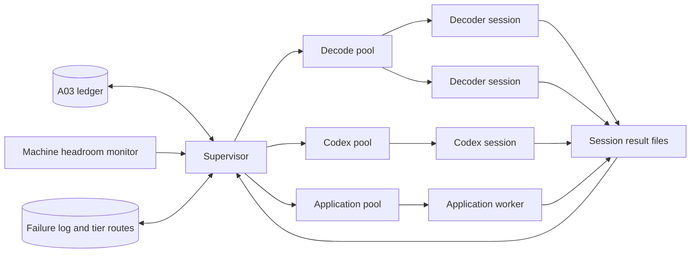

# Parallel research sessions and Codex runners

## Status and purpose

This page is a design for future implementation.
It describes how one machine runs many decoding sessions at the same time on top of the [A03 controller](ResearchController.md).
It also describes how a Codex runner executes optional model investigations from the [plan](AutomationPlan.md#optional-model-investigations).
No step starts because of this page.
A07, A08, A10 and A15 still require an explicit request.
The child steps in [Delivery](#delivery) are proposals until a contributor claims them in the [step register](AutomationSteps.md).

## Terms

| Term       | Meaning                                                                                              |
| ---------- | ---------------------------------------------------------------------------------------------------- |
| Session    | One worker process that executes one claimed attempt of one job                                      |
| Runner     | A registered program that executes one job kind, for example a decoder script or Codex               |
| Pool       | A named group of sessions that share one capacity limit                                              |
| Supervisor | The local process that claims jobs, starts sessions, renews leases, stops sessions and finishes jobs |
| Tier       | One model setting: model, reasoning effort and per-attempt limits                                    |
| Headroom   | Free CPU and memory after the operator's reserve                                                     |

## Architecture



The supervisor is the only process that calls controller commands.
Sessions never write to the ledger and never hold lease tokens.
Each session reads a private session directory and writes result files to it.
The supervisor validates those files and then calls `finish`.
This keeps the A03 rule that a single controller owns database writes.

Run one supervisor for each store.
The supervisor takes an exclusive lock file in the store directory at startup.
A second supervisor for the same store exits with a clear error.

## Session lifecycle

1. The supervisor selects a pool that has free capacity and machine headroom.
2. It claims one job for that pool through `claim --pool <name>`.
3. It creates a private session directory under the store.
4. It copies the claimed input artifacts and writes `job.json` into that directory.
5. It starts the runner as an argument list, never through a shell.
6. It starts the runner in a new process group with an allowlisted environment.
7. It renews the lease at one third of `lease_seconds` while the process runs.
8. It reads `result.json` when the process exits.
9. It validates the result against the schema of that job kind.
10. It stores the result and calls `finish` with the outcome from the result.

The session directory contains these items:

| Path           | Writer     | Content                                               |
| -------------- | ---------- | ----------------------------------------------------- |
| `job.json`     | Supervisor | The claimed job, attempt, fingerprint and input paths |
| `inputs/`      | Supervisor | Verified copies of the bound input artifacts          |
| `work/`        | Runner     | Temporary files                                       |
| `result.json`  | Runner     | Requested outcome, reason and result records          |
| `stdout.log`   | Supervisor | Bounded capture of standard output                    |
| `stderr.log`   | Supervisor | Bounded capture of standard error                     |
| `receipt.json` | Supervisor | Exit status, duration, peak memory and signal         |

Keep a session directory until its job finishes.
Then keep only the stored artifacts and remove the directory.

### Stopping a session

The supervisor stops a session in these conditions:

- The execution deadline arrives.
- A heartbeat returns a stale-lease error because the job's inputs changed.
- The session exceeds its memory limit.
- The operator pauses the pool.

To stop a session, send `SIGTERM` to its process group.
After a 10-second grace period, send `SIGKILL` to that group.
Then finish the job with `retry` and the stop reason.
The controller already refuses a late result from an old lease.

### Supervisor restart

Leases expire if the supervisor stops unexpectedly.
On restart, the supervisor reads every remaining session directory.
It checks each recorded process identifier and process start time.
It stops a process only when both values match, so a reused process identifier is not affected.
It records an orphan receipt for each stopped session.
The controller then retries or fails each job under its normal attempt budget.

## Runners

A runner registry maps each job kind to one runner.
Store it in `re/automation/Runners.json`.
This example shows its proposed shape:

```json
{
  "runners": {
    "decode.sldprt": {
      "pool": "decode",
      "argv": ["python3", "-I", "re/automation/runners/DecodeSldprt.py", "--session", "{session}"],
      "result_schema": "re/automation/schemas/DecodeResult.json",
      "threads": 1,
      "initial_peak_memory_mib": 2048
    },
    "model.hypothesis": {
      "pool": "codex",
      "runner": "codex",
      "sandbox": "read-only",
      "result_schema": "re/automation/schemas/Hypothesis.json",
      "threads": 1,
      "initial_peak_memory_mib": 1024
    }
  }
}
```

The only substitution in `argv` is `{session}`.
The supervisor refuses a job kind that has no registry entry.
Job options reach the runner only through `job.json`, never through the command line.

Each runner follows one contract:

| Exit status | `result.json`      | Supervisor action                                                     |
| ----------- | ------------------ | --------------------------------------------------------------------- |
| `0`         | Valid              | Finish with the outcome in the result                                 |
| `0`         | Missing or invalid | Finish with `retry`; record the schema error                          |
| Not `0`     | Any                | Finish with `retry`; record the last 2,048 characters of `stderr.log` |
| Signal      | Any                | Finish with `retry`; record the signal and the stop reason            |

A runner selects `completed`, `rejected`, `waiting_evidence`, `waiting_ci` or `waiting_application` in its result.
The supervisor does not change that outcome.

### Many files at once

A decode campaign submits one job for each native file through `submit-batch`.
Split large campaigns into batches that obey the A03 limits.
A comparison job depends on the two decode jobs of its pair.
The controller starts it only after both decode jobs complete.
Each pool then runs as many sessions as its capacity permits.

## Capacity: how many sessions run at the same time

### Limits for each pool

The supervisor calculates the capacity of each pool every 5 seconds.
The capacity is the smallest of these limits:

| Limit               | Calculation                                                                      |
| ------------------- | -------------------------------------------------------------------------------- |
| Configured maximum  | `max_sessions` for the pool in the supervisor configuration                      |
| CPU                 | `(logical CPUs − reserved CPUs) ÷ threads per session`, rounded down             |
| Memory              | `(available memory − reserved memory) ÷ peak memory estimate`, rounded down      |
| Controller          | A03 `max_running` minus the sessions that other pools use                        |
| Provider            | For the Codex pool only: the current provider allowance and the remaining budget |
| Exclusive resources | For the application pool only: the number of verified available installations    |

The default reserve is 2 logical CPUs and 4 GiB of memory.
The operator can change the reserve in the supervisor configuration.
Set A03 `max_running` to at least the sum of all pool maximums.

### Peak memory estimate

Each pool starts with `initial_peak_memory_mib` from the runner registry.
After each session, the supervisor records the peak resident memory of the session process tree.
After 5 completed sessions of one job kind and tool version, use the 95th percentile of the last 50 measurements.
Add a 25% margin to that value.
A new tool version starts again from the registry value.

On Linux, read available memory from `MemAvailable` in `/proc/meminfo`.
On macOS, calculate available memory from free, inactive and purgeable pages in `vm_stat`.
`os.wait4` reports `ru_maxrss` in KiB on Linux and in bytes on macOS.
Normalize that value before you store it.

### Adaptive start

Do not start every pool at its full calculated capacity.
Start at half the capacity, with a minimum of one session.
Add one session after each minute without a failure when the following conditions are true:

- The one-minute load average is less than 85% of the logical CPUs.
- Available memory is more than the reserve plus one peak memory estimate.
- On Linux, `/proc/pressure/memory` reports `some avg10` below 10.

Halve the active limit of a pool when one of these events occurs:

- The operating system ends a session for memory.
- Available memory falls below the reserve.
- Two sessions in the pool exceed their deadline within 10 minutes.

The active limit never exceeds the calculated capacity.

### Calibration

Use `supervisor calibrate --kind <kind> --samples <count>` to measure a new job kind.
The command runs the selected sample jobs at 1, 2, 4 and 8 concurrent sessions.
It records completed jobs per minute and peak memory at each step.
It recommends the step after which throughput increases by less than 10%.
It stops a step early when memory headroom falls below the reserve.
Calibration results are local measurements, not test evidence.

### Example for one machine

This example uses a machine with 10 logical CPUs and 16 GiB of memory.
Of those CPUs, 4 are performance cores and 6 are efficiency cores.
The reserve is 2 CPUs and 4 GiB.

| Decoder peak memory | CPU limit | Memory limit | Decode pool capacity |
| ------------------- | --------- | ------------ | -------------------- |
| 1.5 GiB             | 8         | 8            | 8                    |
| 3 GiB               | 8         | 4            | 4                    |
| 6 GiB               | 8         | 2            | 2                    |

Efficiency cores execute a session more slowly than performance cores.
Use calibration results, not the CPU count alone, to set deadlines.

## Codex runner

### Invocation

The Codex runner executes `codex exec` without a shell.
This example shows the argument list for a read-only question:

```shell
codex exec --ignore-user-config --ignore-rules --ephemeral --skip-git-repo-check \
  --cd <session>/work --sandbox read-only \
  --model <model> --config model_reasoning_effort=<effort> \
  --output-schema <session>/schema.json --output-last-message <session>/answer.json \
  --json -
```

The runner writes the packet to standard input.
It stores the JSONL event stream from standard output as an artifact.
It reads token use from the completion event of that stream.
Check the actual event names against the installed Codex version during integration.

Each option has one purpose:

| Option                  | Purpose                                                                          |
| ----------------------- | -------------------------------------------------------------------------------- |
| `--ignore-user-config`  | Ignores the operator's personal sandbox, servers and hooks; keeps authentication |
| `--ignore-rules`        | Ignores personal and project execution-policy files                              |
| `--ephemeral`           | Keeps session files out of the Codex home directory; the store keeps the record  |
| `--sandbox read-only`   | Prevents file writes by commands that the model runs                             |
| `--output-schema`       | Requires a final answer with the shape of the job kind                           |
| `--output-last-message` | Writes that final answer to a known file                                         |
| `--json`                | Writes machine-readable events for receipts and token counts                     |

Never use `danger-full-access`, `--dangerously-bypass-approvals-and-sandbox` or `--dangerously-bypass-hook-trust`.

### Task types

| Task               | Sandbox           | Working directory                           | Accepted output                      |
| ------------------ | ----------------- | ------------------------------------------- | ------------------------------------ |
| Hypothesis         | `read-only`       | Session packet files only                   | Structured field-map hypotheses      |
| Experiment request | `read-only`       | Session packet files only                   | A requested controlled sample recipe |
| Candidate patch    | `workspace-write` | A disposable Git worktree of the codec area | A diff and its claims                |

The supervisor collects a candidate patch with `git diff` from the disposable worktree.
It rejects a diff that changes a path outside the task's allowlist.
Codex never commits, pushes or merges.
A candidate patch goes to remote CI under the repository policy.
A hypothesis goes to the deterministic checker of its job kind.

### Rule change that this design needs

The plan currently says: never execute model-supplied shell commands.
Codex is an agent and runs its own commands during a session.
This design keeps the rule for the controller and the supervisor.
It permits model-run commands only inside the Codex operating-system sandbox, in a disposable session directory.
Network access stays disabled for those commands.
This exception requires explicit approval before A10 starts.
Record that approval in the plan and on PR #94.

### Private data boundary

The plan says: never upload an entire private design automatically.
The Codex sandbox restricts writes and network access for model-run commands.
It does not necessarily restrict file reads outside the working directory.
Before external transmission is enabled, run the Codex runner under a dedicated operating-system account or container.
That account can read only the session directory and the Codex authentication file.
Verify that boundary during integration before the first real packet.

### Model selector

Store the tier ladder in a supervisor configuration file, for example `ModelTiers.json`:

```json
{
  "tiers": [
    { "id": "t1", "model": "<lower-cost-model>", "effort": "low", "max_seconds": 600, "max_output_tokens": 20000 },
    { "id": "t2", "model": "<lower-cost-model>", "effort": "high", "max_seconds": 1200, "max_output_tokens": 40000 },
    { "id": "t3", "model": "<most-capable-model>", "effort": "medium", "max_seconds": 1800, "max_output_tokens": 60000 },
    { "id": "t4", "model": "<most-capable-model>", "effort": "xhigh", "max_seconds": 3600, "max_output_tokens": 100000 }
  ],
  "budget": { "per_question_usd": 5, "per_day_usd": 50 }
}
```

The operator selects the order and the model names.
A tier can raise the reasoning effort of the same model before it changes the model.
The values above are examples, not recommendations or measured prices.

At startup, the supervisor validates each tier.
Each model must appear in the model list of the installed Codex version.
Each effort must appear in the supported levels of that model.
If a tier fails validation, the Codex pool does not start.
The decode and application pools continue.

The selector takes these steps for each question:

1. Calculate the route key: question kind, CAD format and feature family.
2. Read the start tier for that route key from the tier routes. The default is the first tier.
3. Look for a cached answer with the same packet fingerprint, model and model version. Use it if it exists.
4. Estimate the maximum cost of one attempt at the tier. If the remaining budget is smaller, park the question.
5. Run the attempt.
6. Check the result in this order: exit status, output schema, then the machine-checkable success criteria.
7. If all checks pass, record the answer and submit its verification jobs.
8. If a check fails, write a failure log entry and go to the next tier with that entry in the packet.
9. If the last tier fails, park the question with all of its evidence.

The failure signature is the route key plus the check that failed.
After two failures with the same signature at one tier, raise the start tier of that route key by one.
A new question uses the start tier of its route key, because its failing check is not known yet.
Lower a start tier only when a tool, rule, runner or model version changes for that signature.
Record each routing change with the failure log entries that caused it.

### Codex errors

Separate model failures from infrastructure failures.
Only model failures count for escalation and tier routing.

| Error                                      | Detection                              | Action                                                                 | Model failure |
| ------------------------------------------ | -------------------------------------- | ---------------------------------------------------------------------- | ------------- |
| Answer does not match the schema           | Schema validation of `answer.json`     | Log the failure and escalate one tier                                  | Yes           |
| Answer fails the success criteria          | Deterministic checker                  | Log the failure and the counterexample, then escalate                  | Yes           |
| Time limit exceeded                        | Supervisor deadline                    | Stop the session, log the failure and escalate                         | Yes           |
| Token limit exceeded                       | Token use in the event stream          | Log the failure and escalate                                           | Yes           |
| Patch changes a path outside its allowlist | Diff path check                        | Reject the patch, log the failure and escalate                         | Yes           |
| Rate limit or usage limit                  | Error event or exit output from Codex  | Pause the Codex pool until the reported reset time                     | No            |
| Network or provider server error           | Error event or exit output from Codex  | Retry the same tier after 30, 120 and 600 seconds, then pause the pool | No            |
| Authentication error                       | Error event or exit output from Codex  | Stop the Codex pool and report to the operator                         | No            |
| Codex process crash                        | Exit status without a completion event | Retry once at the same tier, then park the question                    | No            |
| Inputs changed during the attempt          | Stale-lease error from a heartbeat     | Stop the session immediately; the controller requeues the job          | No            |

Codex can continue after a sandbox refuses one of its commands.
The supervisor judges only the final answer.

A paused Codex pool parks its queued jobs as an application wait.
Decode and comparison jobs continue during the pause.
The pool resumes at the reported reset time, or when the operator resumes it.

## General session errors

| Error                                                       | Action                                                                        |
| ----------------------------------------------------------- | ----------------------------------------------------------------------------- |
| Runner exits without a valid result                         | Finish with `retry` and the bounded error output                              |
| Operating system ends a session for memory                  | Double the peak memory estimate for that kind, halve the pool limit and retry |
| Deadline exceeded                                           | Stop the process group and finish with `retry`                                |
| Three infrastructure failures in one pool within 10 minutes | Pause that pool and report to the operator; other pools continue              |
| Attempt budget exhausted                                    | The controller marks the job `failed` for the current prerequisite generation |

The supervisor never changes a job's timeout, attempt budget or checks to force progress.
Those changes require a new job definition.

## Fairness

A07 will own priority ordering.
Until A07 exists, claims within one pool follow the A03 creation order.
Separate pools prevent long Codex sessions from blocking fast decode work.
Give each feature family a minimum share of each pool so that rare features also run.

## Required controller changes

A03 needs three small additions for this design:

- Counted resources: `resource <name> --capacity <count>`. A03 resources are exclusive today, so a shared provider resource allows only one session.
- Pool-filtered claims: `claim --pool <name>` returns only jobs whose kind belongs to that pool.
- A distinct stale-lease error code from `heartbeat`, so that the supervisor can stop an invalidated session immediately.

These additions change the schema to version 4 and require a version 3 migration.
They belong to A08a, because A03 is in its publication gate.

## Status report

`supervisor status` reports this information for each pool:

- Running sessions, active limit, calculated capacity and the limit that applies
- Measured peak memory estimate for each job kind
- Pause state, pause reason and resume time
- Codex spend for the current question and the current day

## Delivery

| Proposed ID | Deliverable                                                     | Depends on     |
| ----------- | --------------------------------------------------------------- | -------------- |
| A08a        | Supervisor, session directories, pools and controller additions | A03            |
| A08b        | Capacity limits, adaptive start and calibration                 | A08a           |
| A10a        | Codex runner, sandbox options and private data boundary         | A08a, A07, A09 |
| A10b        | Tier validation, selector, failure log and tier routes          | A10a           |
| A15a        | Two-week pilot with measured capacity and model spend           | A08b, A10b     |

## Verification

Remote process tests use runner programs that sleep, allocate memory, exit with an error, ignore `SIGTERM` or write invalid results.
A test-only Codex substitute writes recorded event streams and exit statuses to exercise each row of the Codex error table.
These tests run in remote CI under the repository policy.
A real Codex session runs only in an authorized A15a pilot.
Calibration results and pilot measurements are recorded on PR #94 as observations, not as test evidence.

## Related information

- [Neutral-first automation plan](AutomationPlan.md)
- [Step register](AutomationSteps.md)
- [Durable research controller](ResearchController.md)
