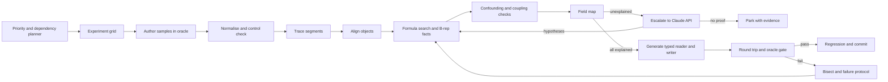

<!--
SPDX-License-Identifier: LicenseRef-PolyForm-Strict-1.0.0
SPDX-FileCopyrightText: Copyright (c) 2026 Parashell, Odin Glynn-Martin

This SPDX license identifier and copyright notice must not be
removed, altered, or obscured. Doing so is a material breach of
the PolyForm Strict License 1.0.0 and voids all licenses granted
to you under it immediately and permanently.
-->

# Automated CAD decoding pipeline

One scripted pipeline authors samples, decodes them, generates writers and
proves them in the vendor application, with no user queries. It calls the
Claude API only when a deterministic stage cannot explain something, and it
accepts nothing the API proposes until the same proofs pass. Anything still
unexplained is parked with its evidence, and the pipeline moves on.

The plan covers SOLIDWORKS and Fusion, in both directions. It is a design; none
of the new stages below exist yet. It builds on [the methodology](Methodology.md),
[the SOLIDWORKS findings](solidworks/README.md) and
the Fusion study (`re/Fusion/`, arriving with the Fusion branch).

## Fixed rules

| Rule                                   | What it means for the pipeline                                                                                                                                  | Source                                                                                                 |
| -------------------------------------- | --------------------------------------------------------------------------------------------------------------------------------------------------------------- | ------------------------------------------------------------------------------------------------------ |
| Lossless, loadable, usable, parametric | Only the vendor application decides a pass: it opens the file, and body count, volume, centre of mass and the feature tree match, and a dimension edit rebuilds | [`lossless-translation`](../.agents/skills/lossless-translation/SKILL.md)                              |
| No donor bytes                         | Writers emit every byte from a typed field, a formula or a proven constant. Oracle files are evidence, never templates                                          | [`no-donor-blocks`](../.agents/skills/no-donor-blocks/SKILL.md)                                        |
| CAD applications are oracles only      | SOLIDWORKS and Fusion run only in authoring and checking stages, never in the shipped reader or writer                                                          | [`no-cad-runtime`](../.agents/skills/no-cad-runtime/SKILL.md)                                          |
| Fail closed                            | An unsupported construct is rejected with a reason, never written as a partial file                                                                             | [`lossless-translation`](../.agents/skills/lossless-translation/SKILL.md)                              |
| No user queries                        | Every decision is a rule, a search, an API escalation or a park. Nothing waits on a person                                                                      | This plan                                                                                              |
| Git                                    | Commits verified stages to a working branch. Never pushes, never writes to `main`, never rewrites history                                                       | [`AGENTS.md`](../AGENTS.md), [`git-never-touch-main`](../.agents/skills/git-never-touch-main/SKILL.md) |

## Architecture

The work runs in three roles:

- **Orchestrator** (any machine): planning, normalising, alignment, formula
  search, code generation, the neutral model and API calls. Plain Python run
  with `uv`.
- **SOLIDWORKS runner** (Windows x64 machine or VM with snapshots): a
  drop-folder service for authoring through COM, tracing with `cdb` and
  checking. It builds on [`tooling/harness`](tooling/harness) (`Author.py`,
  `Measure.py`, `MeasureOne.py`) and [`tooling/windbg`](tooling/windbg)
  (`Runtrace.py`, `Segment.py`, `Renumber.py`).
- **Fusion runner** (the Mac with Fusion installed): runs the `Generate*.py`
  scripts and checks through the existing dispatcher described in
  the Fusion study workflow (`re/Fusion/Notes/StudyWorkflow.md`, arriving with the Fusion branch). Serial only.

Every stage reads and writes one run ledger (one JSON record per job, kept under
the ignored `tmp/` tree), so every run can resume and repeating a stage changes
nothing.

## Scripted stages

1. **Plan.** Score each feature family by the failing corpus documents it would
   unlock, weighted by source format. Respect a dependency graph, for example
   sketch profiles before revolves. Pick the highest-scoring family that is not
   blocked. Break ties by fewest open flags.
2. **Grid.** Read a family specification: parameters and their levels, such as
   plane × direction × end condition × feature index. Generate a full or
   orthogonal factorial grid, plus two control pairs and a held-back set of 20%
   of the samples.
3. **Author.** Submit the grid to the oracle runner. Take COM argument counts
   from `sldworks.tlb`, never guess them. Each sample saves its ground truth:
   the parameters, bodies, volume and centre of mass the API reports.
4. **Normalise.** Fix the transient document name to one width, renumber
   timestamps in order of first appearance, mask the session stamp, and inflate
   the Parasolid body and compare it as decoded B-rep. Gate: both control pairs
   become identical. Otherwise the noise model is incomplete (failure F3).
5. **Segment.** Trace each new sample with a breakpoint on
   `su_CArchive::ReadObject`, logging object spans and the map counter. Gate: a
   symbolic re-emit is byte-identical to the input.
6. **Align.** Diff the two object lists by class and size, like a text diff.
   Output: changed objects, inserted objects and shifted indices.
7. **Explain fields.** For each changed byte range, test a fixed formula
   library in order: authored parameter; unit scale (mm to m, degrees to
   radians); linear `a·x + b`; sum or product of two inputs; trigonometric
   functions; B-rep facts (bounds, volume, face and edge counts from
   [the Parasolid codec](../src/convert/geometry/Parasolid.py)); copies of other
   fields; enum tables; IDs and stamps. Accept a formula only if it fits exactly
   on every sample, in every grid slice and on the held-back set.
8. **Confounding and coupling.** Accept a meaning only if it holds in every
   slice of the grid. This catches the `moICE_c` trap recorded in
   [the corpus notes](solidworks/corpus/CorpusTwo.md). Fields that always match
   across streams form the coupling map: IDs, header copies and stamps.
9. **Field map.** Every byte of every changed object needs an owner: a typed
   field, a formula, a proven constant or a reference. Report coverage. With
   nothing unexplained, go to stage 10. Otherwise escalate.
10. **Generate.** Feed the field map to
    [`tooling/ProgramDecomposition`](tooling/ProgramDecomposition)
    (`ProgramBuilder`, `ProgramRenderer`, `ProgramVerifier`) to emit typed
    programs and the reader's neutral mapping. Format with the project
    formatter.
11. **Prove.** Run the round-trip tests and the oracle gate below.
12. **Keep.** Rerun every family's regression set. When it passes, commit (one
    commit per family), update the matching `re/` note and close the family.

## Escalation to the Claude API

The API generates hypotheses; it is never a source of truth. Only stage 9 or a
failure protocol calls it, and its output goes back into stage 7.

| Tier           | Trigger                                                                                  | Call                                         | Output                                                                        |
| -------------- | ---------------------------------------------------------------------------------------- | -------------------------------------------- | ----------------------------------------------------------------------------- |
| 1. Explain     | A field is still unexplained after the formula search                                    | One Messages API call with structured output | Candidate formulas, enum meanings, or a new formula family for the library    |
| 2. Investigate | An inserted object, tier 1 failing twice, or a gate failure the bisector cannot localise | A Tool Runner loop with a task budget        | The same schema, plus the experiments it ran                                  |
| 3. Park        | Tier 2 exhausts its budget, or three rounds of hypotheses all fail the proofs            | None                                         | A parked flag holding all evidence. The planner skips the family and moves on |

Request shape, checked against the Claude API guide on 2026-11-12:

- **Model and effort.** `claude-opus-5-5` with adaptive thinking, which is
  always on for this model. Set `output_config.effort` to `high` for tier 1 and
  `xhigh` for tier 2. Stream every call.
- **Structured output.** Use `output_config.format` with a JSON schema such as
  `{hypotheses: [{field, kind, expression, evidence, confidence}], experiments: [{family, parameters}]}`.
  Validate every response against the schema, with one retry on failure.
- **Tier 2 tools.** `author_samples`, `trace`, `align`, `decode_range`,
  `test_formula`, `ghidra_lookup` and `brep_facts`, all with strict schemas and
  `tool_choice` set to `auto`, because forced tool choice returns a 400 on this
  model. Each tool wraps a pipeline stage, so the model can do only what the
  scripts can do. Set a `task_budget` of 200,000 tokens per investigation
  (beta `task-budgets-2026-03-13`).
- **Prompt caching.** A frozen system prompt (format rules, repository
  constraints and a digest of the matching `re/` notes) behind a one-hour cache
  breakpoint, with the flag's evidence after it. Check that
  `cache_read_input_tokens` is non-zero.
- **Batches.** Send tier 1 flags that block nothing through the Message Batches
  API overnight, at half price.
- **Refusals.** Reverse-engineering prompts can trip safety classifiers. Enable
  server-side fallbacks (`fallbacks: "default"`, beta
  `server-side-fallback-2026-07-01`) and check `stop_reason` before reading
  content. A final refusal parks the flag with the reason `refusal`.
- **Limits.** Per-flag and per-night dollar caps, computed from the ledger's
  usage totals. The SDK retries rate limits and server errors. The credential
  comes from the environment or an `ant auth` profile and is never stored in
  the repository.

At $4 input and $20 output per million tokens, a tier 1 call with cached
context should cost roughly $0.05–0.30 and a tier 2 investigation roughly
$2–10. These are estimates until the ledger measures real runs.

## Neutral model work

The neutral model already exists in [`src/interchange`](../src/interchange):
[`FeatureStep`](../src/interchange/features/FeatureStep.py), 22
[`FeatureKind`](../src/interchange/enums/EnumFeatures.py) values, typed
definitions, `NativeFeature` and `Provenance`. The pipeline needs five
additions:

1. **Typed definitions** for the kinds that are only labels today: sweep, loft,
   draft, mirror, helix and offset. Each definition lists every setting any
   supported format offers; settings that some formats lack are optional.
2. **Neutral equality.** A comparison that ignores IDs, renames that keep order,
   and float noise below a tolerance, so two documents can be declared the same.
3. **Strict mode.** A reader option that turns every `NativeFeature` into a
   failure. It measures true neutral coverage instead of same-format
   pass-through.
4. **Writer capabilities.** Each writer declares the kinds, options and
   combinations it supports, extending
   [`DocumentCaps`](../src/interchange/document/models/DocumentCaps.py). The
   planner reads these declarations to see what remains.
5. **Provenance on every field.** Each neutral value keeps its source span, so
   the field map and the reader agree byte for byte and failures point at bytes.

## Round-trip tests

For every format F (SOLIDWORKS part, SOLIDWORKS assembly and Fusion) and every
corpus or authored file X:

1. **Read.** `N1 = read_F(X)` in strict mode. Fails if any `NativeFeature` or
   unowned byte remains.
2. **Write.** `X2 = write_F(N1)`.
3. **Fixed point.** `N2 = read_F(X2)`, then require neutral equality between
   `N1` and `N2`. This catches disagreement between reader and writer without
   the oracle.
4. **Normalised bytes (diagnostic only).** Normalise X and X2 and diff them by
   object. Not a pass criterion, but it locates failures.
5. **Oracle gate (the pass criterion).** X2 opens in the vendor application in a
   fresh process, with a healthy control measured before and after. Body count,
   volume and centre of mass match X within tolerance. The feature tree matches
   node by node. Editing a driving dimension rebuilds, and restoring it returns
   the original geometry.
6. **Cross-check.** Where a source file in another format has the same
   features, also run `read_A` then `write_F`. Report it separately; it never
   blocks the same-format test.

A file counts as supported only when steps 1, 2, 3 and 5 pass.

## Failure protocols

Every failure has a class, an automatic action and a stop condition. None waits
for a person.

| Class                | Example                                                       | Automatic action                                                                                                                                                             | Stop condition                                                                                                 |
| -------------------- | ------------------------------------------------------------- | ---------------------------------------------------------------------------------------------------------------------------------------------------------------------------- | -------------------------------------------------------------------------------------------------------------- |
| F1 Environment       | Oracle crash, RPC failure, failed control, licence error      | Restore the VM snapshot and rerun the batch with controls                                                                                                                    | Three restores in a row open a circuit breaker: oracle stages pause, offline stages keep running, retry hourly |
| F2 Authoring         | COM error, wrong argument count, setting the API cannot reach | Regenerate the call from the type library, then a tier 1 escalation for the recipe                                                                                           | An unreachable setting marks its grid cells impossible; the rest of the grid continues                         |
| F3 Noise             | A control pair still differs after normalising                | Add the differing span as a noise candidate and author a third control to confirm it                                                                                         | Still unconfirmed after two extra controls: park the family                                                    |
| F4 Segmentation      | Re-emit is not byte-identical                                 | Re-trace with stream-length filters and diff the spans against the last good trace                                                                                           | Two failures: tier 2                                                                                           |
| F5 Unexplained field | The formula search finds nothing                              | Tier 1, then tier 2                                                                                                                                                          | Tier 3 park                                                                                                    |
| F6 Confounding       | A meaning fails in one grid slice                             | Add the missing grid dimension and author those cells                                                                                                                        | The grid passes 512 samples: park                                                                              |
| F7 Fixed point       | `N1` and `N2` differ                                          | Diff the two neutral documents field by field and point at the owning program                                                                                                | Two failures: tier 2                                                                                           |
| F8 Oracle rejects    | The file will not open, or bodies or volume are wrong         | Bisect inside the research harness: swap streams, then objects, from the oracle sample into the candidate until it passes, to name the culprit. Diagnosis only, never output | Culprit found: back to stage 7 for that object. Not found: tier 2                                              |
| F9 Edit gate         | Opens, but a dimension edit does not rebuild                  | Compare parameter and equation links against the sample's                                                                                                                    | Two failures: tier 2                                                                                           |
| F10 Regression       | A family that passed now fails                                | Revert the pipeline's own last commit with a new revert commit and quarantine the change                                                                                     | A quarantined change is never merged automatically                                                             |
| F11 API              | Output fails the schema, a refusal, or a budget is hit        | One retry, then fallbacks, then park                                                                                                                                         | Once the nightly dollar cap is reached, escalations wait for the next night                                    |
| F12 Runtime input    | A real user file with an unsupported construct                | Fail closed with the feature and its byte span, and add the pattern to the corpus backlog                                                                                    | None                                                                                                           |

A parked flag keeps everything needed to resume it: samples, traces, alignments
and failed hypotheses. A later run resumes it automatically when a new formula
family, tool or neighbouring decode lands.

## Fully automated operation

Nothing asks a question at run time. Five items need one-time setup and cannot
be automated:

- A Windows x64 machine or cloud VM with a SOLIDWORKS licence, snapshots and the
  drop folder.
- An Anthropic API credential in the environment.
- A standing authorization file for live Fusion capture, which
  the Fusion study workflow (`re/Fusion/Notes/StudyWorkflow.md`, arriving with the Fusion branch) requires before any
  capture.
- The priority weights and the ship checklist, written once into configuration.
- The corpus, restored to a tracked or synced location.

After setup, a nightly scheduler runs plan, grid, author, decode, escalate,
generate, prove, regress and commit. A one-page morning report lists families
closed, flags opened and parked, API spend and oracle health.

## Read and write coverage

| Direction | Done when                                                                                                     | Measured by                                                                          |
| --------- | ------------------------------------------------------------------------------------------------------------- | ------------------------------------------------------------------------------------ |
| Read      | In strict mode, every byte of the file is owned by a typed field, a formula, a proven constant or a reference | Field-map coverage and the strict-mode pass rate on the corpus                       |
| Write     | Every byte is emitted from neutral fields, with zero opaque bytes, and the file passes the oracle gate        | The pass rate of round-trip step 5, and the opaque byte count from `ProgramVerifier` |
| Both      | The fixed point holds                                                                                         | The pass rate of round-trip step 3                                                   |

## Build order

1. Orchestrator skeleton: ledger, job runner, stage interfaces, morning report.
2. SOLIDWORKS drop-folder runner with snapshot restore and controls (F1).
3. Normaliser with the control-pair gate (stage 4, F3).
4. Automated tracing and object alignment (stages 5 and 6).
5. Formula library with B-rep facts from the Parasolid codec (stage 7).
6. Grid planner, confounding and coupling checks (stages 2 and 8).
7. Strict-mode reading and neutral equality (round-trip steps 1 to 3).
8. Field map to `ProgramDecomposition` code generation (stage 10).
9. Claude API escalation tiers 1 to 3, with caching, batches, fallbacks and
   caps.
10. Typed neutral definitions for sweep, loft, draft, mirror, helix and offset.
11. Fusion runner integration through the existing dispatcher.
12. Nightly scheduler and regression gate (F10).

The first pilot reruns a family that is already solved, SOLIDWORKS pad then pad,
from start to finish. It must reproduce the known typed program with zero
escalations before any new family starts.

## Open questions

- Does freezing the clock also freeze the Config-0 session stamp, or does the
  stamp need its own rule?
- How much of the 12–14 s per SOLIDWORKS check is startup? The answer decides
  whether a batch shares one process.
- What tolerance on volume and centre of mass counts as a match? Today's gates
  use exact analytic values.
