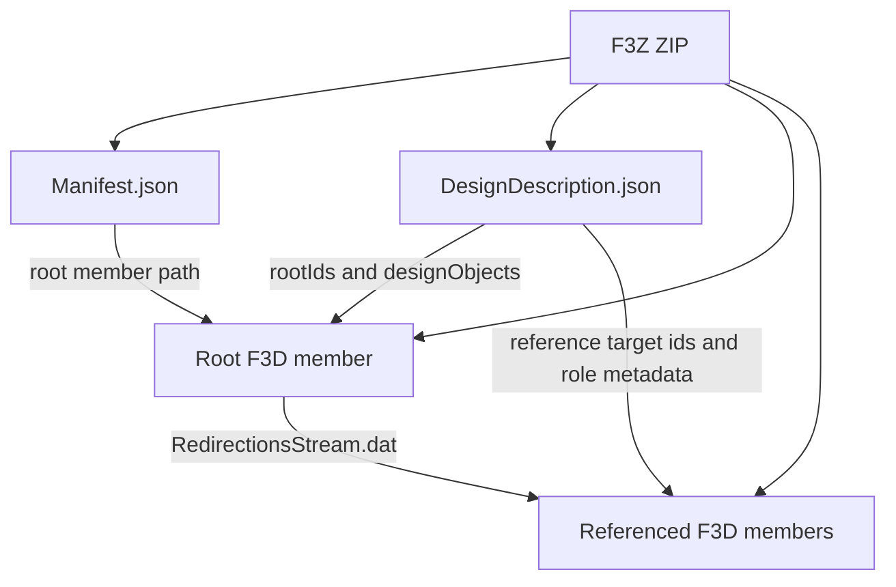

# Fusion multi-document bundle model

## Evidence and scope

The supplied corpus contains one `.f3z`: `re/Fusion/examples/.f3z/example1.f3z`.
Its SHA-256 is `e14866ac96457805a93e63fa269beb4dc8c69caa80c819de4a195db45ccc23c6`.
The archive has 9,063,269 bytes, eleven ZIP members, nine F3D documents, and two JSON envelopes.
Every outer member uses ZIP method 8. The bundle has no directory entries.
Inner F3D archives use their independent archive encoding, including method 93.

[BundleEvidence.json](BundleEvidence.json) records member digests, sizes, identities, and cross-document joins.
[InspectBundle.py](InspectBundle.py) generated that report through standard-library ZIP and JSON inspection.
It does not import production codecs or execute native CAD code.

The production implementation supports the qualified, closed version `0.1` envelope profile.
It has one design graph, one root, a directed acyclic document graph, and complete embedded members.
Multiple design graphs, external `designObjectRefs`, non-null `shareInfo`, zipped objects, and nonempty `rootFile` are rejected.
Unknown object fields are rejected. Metadata fields remain explicitly typed string pairs.

This layer describes and packages documents. It does not decode the member's parametric graph, geometry, drawing sheets, or simulation data.
Those remain responsibilities of the document codecs. Caller-provided complete serialized documents are explicit inputs to the writer.
Newly authored F3D documents can be packaged without any source F3Z archive or captured envelope bytes.

## Container hierarchy

`Manifest.json` is exactly `{"root":"<member path>"}`.
That path must match the object selected by the graph's sole `rootIds` value.
The observed root is `3cb733fc-f1dc-4b67-ae97-9c7b04d8aa2f.f3d`, object ID `1545802`, version `14`.
Eight XREF targets are object IDs `1545803` through `1545810`.

`DesignDescription.json` has three envelope fields:

| Field | Wire type | Meaning |
| --- | --- | --- |
| `name` | string | Format discriminator, `Autodesk Design Description` |
| `version` | string | Envelope schema version, `0.1` |
| `designDescription` | object | Design identity and graph collection |

The `designDescription` fields are:

| Field | Wire type | Production model |
| --- | --- | --- |
| `id` | string | `BundleModel.DesignId` |
| `name` | string | `BundleModel.DesignName` |
| `currentVersion` | decimal string | `BundleModel.CurrentVersion`, equal to the root object's version |
| `designGraphs` | array of graph objects | One `BundleModel.Graph` in the qualified profile |

The design-description ID is separate from the numeric document IDs.
The observed value is string `0`; it is not a local entity-record ID.
The descriptive name is `XRef File Design`, separate from the root document's display name.

## Graph and document records

| Graph field | Wire type | Meaning |
| --- | --- | --- |
| `creationDate` | string | Caller-supplied graph creation timestamp |
| `creatingService` | string | Caller-supplied exporting service identity; observed `wipdm` |
| `rootIds` | integer array | Exactly one root object in this profile |
| `designObjectRefs` | array | Empty for the qualified self-contained profile |
| `designObjects` | object array | Ordered document definitions |

Timestamp strings are preserved as strings. The observed timestamp syntax is `2026-08-01T17:22:20+0000`.
The codec does not invent timezone normalization or enforce an undocumented timestamp parser.

| Document field | Wire type | Meaning |
| --- | --- | --- |
| `id` | integer | Graph-local document identity; positive and unique |
| `version` | integer | Positive document version |
| `about` | string | Version URN; observed `urn:adsk.wipprod:fs.file:vf.<id>?version=<number>` |
| `lineage` | string | Version-independent lineage URN |
| `from` | string | Storage URN beginning `urn:adsk.objects:os.object:` |
| `relativePath` | string | Exact document member name in the outer ZIP |
| `downloadAs` | string | Equal to `relativePath` in the qualified profile |
| `friendlyName` | string | Friendly document name |
| `displayName` | string | Display document name |
| `zipped` | boolean | False in the qualified profile; this does not mean the F3D member lacks ZIP encoding |
| `rootFile` | string | Empty in the qualified profile |
| `contentType` | string | `f3d` or `f2d`; must match the member extension |
| `shareInfo` | null | No sharing descriptor in the qualified profile |
| `references` | array | Typed dependency groups |
| `metadata` | string-valued object | Export metadata, preserved by name and value |
| `createdAt` | string | Document creation timestamp |

The storage URN filename does not equal the exported member filename in this specimen.
Consequently, it is a distinct typed identity. Replacing it with `relativePath` would lose information.
The version URN and lineage URN also remain distinct. A version suffix does not define a storage location.

## Reference groups and cross-document joins

Each dependency group has `type`, `ids`, and `relationships`.
`type` is `XREF` or `DERIVED`.
`ids` contains distinct graph-local target IDs.
Each relationship has `id` and string-valued `metadata`.
The relationship target set must equal `ids`.
`metadata.neutronRole` is a UUID-shaped native role identity.
The codec preserves additional string metadata, including a `workflow` field when supplied.

The observed root contains eight XREF relationships. All leaf documents have empty reference arrays.
The root's `RedirectionsStream.dat` repeats the root and all eight target document identities.
Each leaf redirection stream repeats its own identity.
The report checks seventeen repeated records against their description objects:

1. `targetFileName` equals the target object's `relativePath`.
2. `file-version` equals its integer `version`.
3. `lineageUrn` equals its `lineage`.
4. `versionUrn` equals its `about`.

All seventeen identity joins agree.
All eight redirection references also agree on target member path, reference type, and `neutronRole`.
The observed redirection records contain a second property, `neutronData`, equal to `neutronRole`.
The bundle description does not serialize that second property.
The bundle codec does not infer or rewrite a document's internal redirection stream.

A `DERIVED` drawing root and `PushPullDerive` relationship are described in the upstream format specification.
The supplied F3Z contains neither. Their envelope tags are supported, but native acceptance remains unestablished here.
F2D payload decoding is outside this codec.

## Metadata is typed text, not a universal schema

Observed metadata values are all strings.
Examples include `rootFileName`, `description`, `isAutoSave`, `DesignModelRevisionID`, `docstruct`, and PCB synchronization fields.
`isAutoSave` is the string `false`, not a JSON boolean.
`docstruct`, `EIPContext`, and PCB synchronization values contain JSON encoded inside a string.
Their original string value is preserved. The bundle layer does not reinterpret these application-specific documents.
The PCB object's metadata omits `docstruct` and `DesignModelRevisionID`, so neither is mandatory.

## Production contracts and limits

`ReadBundle(DataValue, InflateZstd=None)` returns an immutable `FusionBundle`.
`EmitBundle(Value)` writes a deterministic ZIP through the existing `EmitAssetZip` boundary.
The writer emits fresh JSON from typed fields and fresh ZIP framing.
It receives complete member document bytes explicitly. It performs no filesystem lookup and invokes no CAD runtime.
It does not claim to convert those document payloads.

The envelope reader requires an exact ZIP-member set: two JSON files plus all indexed documents.
It rejects unused members, duplicate document identities, path aliases, dangling references, cycles, and unreachable documents.
It preserves document order, metadata order, relation order, and complete supplied document bytes.
It does not promise original outer compression, ZIP timestamps, or JSON whitespace.

| Limit | Bound |
| --- | --- |
| Input archive | 128 MiB |
| Declared expanded archive | 128 MiB through the shared ZIP index |
| Document member | 64 MiB |
| Documents | 4094, leaving two ZIP entries for JSON |
| Each JSON document | 4 MiB |
| JSON nodes | 100,000 |
| JSON depth | 32 |
| Individual string | 1 MiB |
| Aggregate JSON string bytes | 4 MiB |
| Numeric graph identities | Exact positive JSON integers no greater than 2^53−1 |

Duplicate JSON keys, invalid UTF-8, non-finite JSON constants, unknown fields, and unsupported packaging variants fail explicitly.
An empty or unsupported child-document payload is not interpreted by this envelope codec.
Use the appropriate document decoder for its independent validation.

## Native import boundary

The public `ImportManager.createFusionArchiveImportOptions` API supports only F3D.
Its documentation explicitly directs F3Z callers to `DataFolder.uploadFile`.
Uploads return a `DataFileFuture`; completion and failure are asynchronous.
The upload method cannot run inside a command event's transaction.
No upload or native mutation was performed during this bundle investigation.
Outer-envelope reconstruction is not evidence of native upload acceptance.

## Sources and attribution

- Supplied `re/Fusion/examples/.f3z/example1.f3z`, digest above.
- [Official archive import method](https://help.autodesk.com/cloudhelp/ENU/Fusion-360-API/files/core_ImportManager_createFusionArchiveImportOptions.htm).
- [Official asynchronous upload method](https://help.autodesk.com/cloudhelp/ENU/Fusion-360-API/files/core_DataFolder_uploadFile.htm).
- [cadmpeg F3D specification, section 1.5](../../External/cadmpeg/docs/formats/f3d.md), pinned commit `de2726870ff728352163f601ab4e60bbd54fbade`.

The cadmpeg specification is licensed CC BY 4.0; its implementation is Apache 2.0.
This report paraphrases the bundle hierarchy and distinguishes upstream observations from the supplied specimen.
Production serializers were written from the explicit data model without copying upstream implementation code.
