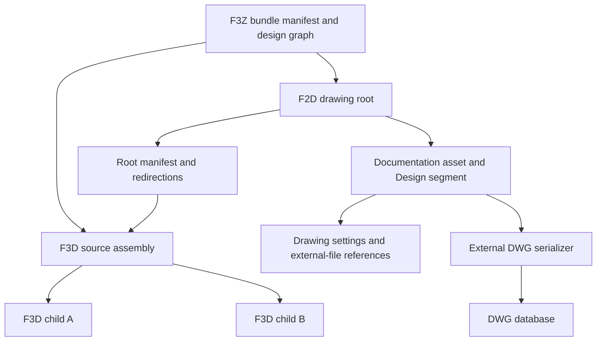

# Fusion Drawing Persistence: Qualified Structural Model

## Result and evidence boundary

An F2D is a distinct Fusion document container. The inspected drawing combines a small Neutron entity graph, document/model dependency records, and an embedded DWG that carries the drawing content. The current F3D container codec cannot become an F2D semantic codec by accepting another extension. Both the historical Neutron schema and the DWG database need explicit support.

This investigation fully frames the historical metadata stream and both manifests, resolves all 44 class names, and identifies the drawing-specific fields in three records. It does **not** decode the DWG database, every inherited entity field, or every historical manifest control word. No independent F2D writer or native acceptance is established.

Evidence is read-only: ZIP extraction in memory, scalar/string decoding, previously captured reflection identities, and upstream source inspection. Some member names and types below came from earlier binary inspection, which was removed; the text marks those claims. No Fusion operation, cloud upload, user cloud-project query, production codec invocation, or test ran. No Autodesk sample binary is vendored here.

| Artifact | Contents |
|---|---|
| [DrawingInventory.json](DrawingInventory.json) | Exact source paths and hashes, all archive members, manifest field offsets, complete metadata index, all class names and record spans, partial typed record values, bundle/reference joins, current registered drawing class catalog |
| [UpstreamEvidence.json](UpstreamEvidence.json) | Pinned upstream revision, source hashes, relevant line locations, documentation links |
| [InspectDrawing.py](InspectDrawing.py) | Raw public-resource ZIP/struct analysis; no production imports |

## Corpus and extension coverage

At this capture, filename-only inventory under `re/` and `examples/` found 851 F3D files and two F3Z files. This includes generated research controls and is not the deduplicated 712-archive source corpus. No standalone F2D, F2Z, F2T or F3T was present. Counts can increase while other agents author controls. The private bundle/cloud inventory was not opened.

The installed application provides seven copies of a public drawing example under `Contents/Resources/CloudWorkFlowsData/`. Their names begin with `20181122T163107`, `20190829T133803`, `20190829T134050`, `20190829T143738`, `20190829T144327`, `20190829T161332`, and `20190830T091721`, followed by `_Boxes Drawing-V1.f3z`. All seven files are byte-identical: 200,292 bytes, SHA-256 `4e67c7a5487c3c1d3f3c193571206e87a0fb67da7990bd23f6638759aefe734b`. This is **one unique drawing sample**, not seven independent examples.

The bundle has `Manifest.json`, `DesignDescription.json`, one F2D, and three F3D documents. The drawing member is `50feb5ba-d857-4c23-8eb7-bfe8db20bb4b.f2d`: 103,817 bytes, SHA-256 `33589d0ef64461fd366246f28786067305ade9c10c2e8d2869ba6909bdbbc483`.

Autodesk's current [archive export documentation](https://help.autodesk.com/cloudhelp/ENU/Fusion-Drawing/files/DWG-EXPORT-F2D.htm) specifies F3Z for downloaded drawing archives and F2T for drawing templates. No inspected source establishes F2Z as a separate Fusion format. Absence of a corpus file is not proof that a proposed extension has never existed.

The three companion F3D documents also use historical `Design1` streams without ACT or Browser segments. They have 203/180/203 primary records and 27/21/27 continuations. Consequently, the old segment organization is partly a software-generation difference; it must not be presented as an inherent modern F2D-versus-F3D distinction.

## Layers and reference joins

The F3Z `Manifest.json.root` points to the F2D, not the source model. Its design graph has drawing object 766487 with a `DERIVED` edge to assembly 766488; that assembly has two `XREF` edges to 766489 and 766490. The member path of each graph object resolves to exactly one archive file. `DERIVED` and `XREF` are different semantic relationships.

The drawing's `RedirectionsStream.dat` is JSON, schema version zero. It contains two design rows: the drawing and its direct source model. Each row has file version, target archive filename, display name, lineage URN and version URN. Its one reference row has `from`, `relativePath`, `type: DERIVED`, and typed `neutronRole`/`neutronData` properties. The source assembly's indirect children belong to its own reference graph; the drawing redirection table does not flatten all transitive dependencies.

The role string is a 36-character UUID followed by an underscore and a versioned-file URN. The same string occurs in the F3Z design description, drawing redirection row, drawing root-manifest reference, and drawing asset-manifest linked-asset row. A correct writer must create these joins from one semantic reference object. Independently renaming one location loses the join.

The reference properties include `URL`, `LineageUrn`, `linkedAssetGUID`, `toDocDisplayName`, and `linkClassification` (`OriginalDesign`). `linkedAssetGUID` matches the asset identifier in the source assembly's manifest. Document UUIDs, asset UUIDs, archive filenames, graph object IDs and service URNs are separate identity domains; matching one does not imply that the others are interchangeable.

The historical manifests also contain source, target and localized cache paths from the shipped sample's originating workstation. These are data, never execution or filesystem-access instructions. The inspected read-only parser does not dereference them. A future author must define local dependency resolution through package paths and validated reference objects rather than reproducing captured workstation paths.

## F2D archive members

All six directory entries are stored, ZIP method zero. All seven file entries use Deflate, method eight. This observation says nothing about current F3D load behavior; the accepted new F3D profile uses its separately qualified storage rules.

| Member beneath F2D root | Uncompressed bytes | Role |
|---|---:|---|
| `Manifest.dat` | 2,074 | Drawing document identity, historical version/migrator data, source-model link, active asset |
| `RedirectionsStream.dat` | 917 | Bundle-relative dependency resolution |
| `Documentation[Active]/Manifest.dat` | 668 | Drawing asset identity, linked asset, segment allocation |
| `Documentation[Active]/Design1/MetaStream.dat` | 5,030 | Historical class schemas and entity positions |
| `Documentation[Active]/Design1/BulkStream.dat` | 2,593 | 27 primary entities and two inherited continuations |
| `Documentation[Active]/Dwg.BlobParts/ExtFile.f8c7c9b0-d300-4ffa-939e-7bcd9443e44b.dwg` | 110,873 | Actual DWG database; semantics unresolved here |
| `Documentation[Active]/Previews/small.png` | 1,594 | Preview raster |

The explicit directories are the asset directory, `Design1`, `Dwg.BlobParts`, `Breps.BlobParts`, `ProteinAssets.BlobParts`, and `Previews`. The BRep and Protein directories contain no files. Empty directories are part of the observed archive, not proof that every one is required by every drawing version.

## Primitive notation

All integers below are little-endian. `A` is `u32 byteCount` followed by that many ASCII bytes. `W` is `u32 utf16CodeUnitCount` followed by UTF-16LE code units. UUID-looking values use `W` where specified; class identifiers use `A`. A count is not a byte size unless its name says so. Booleans in qualified entity fields are one byte. Real values in common inherited entities use the ordinary Neutron scalar codecs, but their historical class versions still need qualification.

## Exact metadata version-two framing

The following shape consumes all 5,030 bytes, with no undecoded metadata tail:

| Order | Field | Observed value or shape |
|---:|---|---|
| 1 | `A userName` | `Design` |
| 2 | `u32 segmentId` | 0 |
| 3 | `W currentVersion` | Zero UUID |
| 4 | `u32 legacySoftwareVersion` | `0x080006a7` |
| 5 | `u32 metadataVersion` | 2 |
| 6 | `A segmentType` | `Design` |
| 7 | `A addIn` | Empty |
| 8 | `u32 neutronType` | 1 |
| 9 | `u32 ancestryCount`, then `W[]` | Zero |
| 10 | `u32 classCount` | 44 |
| 11 | Class rows | `A identifier`, `A baseIdentifier`, `u32 classSchemaVersion`, `A addIn`, `u32 identityCount`, `u64 identities[]` |
| 12 | `u32 rootCount`, then `u64 roots[]` | Seven: 2,20,21,22,23,25,26 |
| 13 | `u32 primaryCount`, then `(u64 identity,u64 bulkOffset)[]` | 27 |
| 14 | `u32 continuationCount`, then the same pair shape | Two |
| 15 | `u64 nextEntityId` | 27; end of stream |

Class row position assigns wire codes 256 through 299. The bulk record starts with the decimal class code as `A`, then `u64 identity`. This three-digit code and identity consume 15 bytes. The remainder follows that class's versioned inherited/member serialization. Continuation records carry their own base-class code and repeat their entity identity; they are not additional distinct entities.

Primary entities are IDs zero through 26. Primary offsets increase in identity order. Continuations are entity 24 at byte 1,937 with `CommonBaseGroupEntity`, and entity 25 at byte 2,087 with `CommonDataAssetSettings`. They lie inside their owner's overall primary span, before the next primary starts. Entity zero is valid here; a blanket positive-ID restriction from the newly authored F3D policy would be wrong for this historical file.

The class identifier for `BRepSerializer` is the literal `40DCC3F41D-E94F-B3B1-3E95-9B6ABE572C`, which is not a conventional 8-4-4-4-12 UUID spelling. Treating every class identifier as a normalized UUID would reject this sample. Equality uses the registered identifier string, with explicitly defined compatibility rules, not invented normalization.

Earlier binary inspection read the legacy word as a packed software version: six major bits, six minor bits and twenty build bits, giving software 2.0.1703 for this sample. That reading is not confirmed by a black-box experiment. Current version-eight metadata instead writes sentinel 1234 and a separate packed u64. Current trailing flags/property maps are also absent from this version-two stream.

## Manifest version ten

`DrawingInventory.json` records every field's byte offset, width and decoded value. Full byte framing does not establish the semantic meaning of the explicitly unresolved fields below.

The root begins `A "3-2-0-0"`, `A "FusionDrawingDocType"`, `W ".f2d"`, then type name/description, document identifier and document current version. At bytes 285 and 289 are the legacy software word and manifest version ten. A module/version map contains `Application:2`. Next is a counted UUID vector with one entry equal to current version, one control byte equal to one, and one source-reference row.

The reference row contains five wide strings: role, empty unresolved string, source path, target path and localized target path. Four u32 values are `(3,4,1,0)`. Their exact enum/flag meanings have not been established. A counted string map then contains the five reference properties listed above. The manifest ends with active asset UUID, one asset row (`Documentation`, u32 zero, byte zero), and the actual document name `Boxes Drawing v0`. Current F3D's root label `NA_EXPORT` must not be imposed here.

The asset manifest is:

1. `W assetName`, `W assetId`, `W revisionId`, `A assetType`, `u32 manifestVersion`.
2. Counted `(A module,u32 version)` map: `Application:1`, `Server:30`.
3. `A assetKind` = `Neutron3DAssetType`, followed by one byte zero.
4. Counted triples `(W role,W linkedAssetId,W linkRevisionToken)`, one row. The third value equals both the drawing asset revision and the source assembly asset revision in this sample. That coincidence does not distinguish its semantic owner, so it remains a link revision token pending loader evidence.
5. One unresolved u32 value one, then allocation watermark two, then segment count one.
6. One row `(u32 id,A userName,A segmentType)` = `(0,"Design","Design")`, then end.

The drawing asset name is `Documentation`; its asset type is `FusionDrawingAssetType`. `Neutron3DAssetType` remains the underlying kind even though this is a drawing. A name-based heuristic that equates this kind with F3D would misclassify the sample. The active asset UUID matches between root and asset manifests. Segment zero is stored under `Design1`, following the separately observed storage suffix convention; no evidence here permits arbitrary alternate storage names.

## Entity model and confirmed drawing fields

Forty class declarations belong to common Component/Body/Geometry/CommonData/value types; four are drawing-specific. All 44 names resolve against existing captured registry identifiers, even though current schema versions differ. This supports reuse of the entity framework, not blind reuse of the latest field profiles.

| IDs | Class family and purpose |
|---|---|
| 0,1,2,20,21 | Component, component instances, component root collection, root instance and instance root collection |
| 3 | Overrides |
| 4,7 | Bodies collections |
| 5,8 | BRep serializers with no corresponding BRep payload in this sample |
| 6,9 | Passive ID generators |
| 10–19 | Sketches, work geometries, joint origins, assembly constraints/occurrences, contact sets, motion studies, parameter table, surface groups and selection groups |
| 22 | External DWG serializer |
| 23,24 | External-file reference root and tracked-entity collection |
| 25 | Drawing asset settings, followed by common settings continuation |
| 26 | Protein asset manager, with no Protein payload |

Entity 22, GUID `3B30D852-778A-4752-9EBD-A154875C911C`, is `ExtFileSerializer` version zero. Its root ID is `ExternalDWG`. Its own persisted field is `persistedFileName: W`, exactly the basename found under `Dwg.BlobParts`. The member name and wide-string type came from earlier binary inspection; the value is in the saved sample. This is a direct join, not a filename guessed from archive contents.

Entity 23, GUID `8F05428E-590E-4DE6-9CEF-B34EDA0D27B9`, is `FusionDocExternalFileRefs` version three. Its root ID is `FDExternalFileRefs`. Earlier binary inspection named its version-three fields `componentFilter`, a wide string, and `rTrackedEntitys`, a strong reference to `FusionDocTrackedEntities`. Lexical field order in this sample is empty `componentFilter`, then a local strong reference to entity 24. That reference is `u8(1),u64(24),u8(0),u8(0)`; the last qualifiers indicate the observed local form. This does not qualify arbitrary external reference encodings.

Entity 24, GUID `981E7978-171B-445C-9533-8401DB6665FE`, is `FusionDocTrackedEntities` version zero. Earlier binary inspection found no own members; this is not confirmed by a black-box experiment. Its common group fields live in a separate continuation and must be decoded as the recorded base profile.

Entity 25, GUID `35899357-B223-4909-AB50-841E9C212694`, is `FusionDocAssetSettings` version zero with root ID `AssetSettings`. Its ten own fields consume the complete primary payload after the root frame, in lexical name order:

| Persisted member | Wire type | Observed value |
|---|---|---|
| `FusionDocAngularDimensionPrecision` | i32 | 2 |
| `FusionDocAnnotationFormat` | W | ISO |
| `FusionDocAnnotationHeight` | W | 3.5 |
| `FusionDocDefaultSheetSize` | W | A3 |
| `FusionDocDrawingUnits` | W | mm |
| `FusionDocFont` | W | Arial |
| `FusionDocLinearDimensionPrecision` | i32 | 2 |
| `FusionDocTitleBlock` | W | ISO |
| `FusionDocUnitDisplay` | Boolean byte | false |
| `FusionDocViewProjectionDir` | W | 1st Angle |

The member names and wire types came from earlier binary inspection; the values decode cleanly from the saved sample with those types. The `3.5` annotation height is a string, not a binary double; precision values are signed i32, not arbitrary unnamed enums. The settings' common continuation declares `CommonDataAssetSettings` version 13 and remains a separate decoding obligation.

The known complete own-member reads above do not imply all 2,593 bulk bytes are semantically decoded. The inventory deliberately labels other records' remaining bytes unresolved and retains only their offsets/counts, not opaque bodies disguised as decoded values.

## Modern drawing classes and migration boundary

The current registry contains 59 `FusionDoc` class declarations, compared with four used by the sample. Existing reflection did not initialize their member schemas, so names and current versions alone do not establish wire layouts.

Examples include `FusionDocSheets` version 2, `FusionDocSheet` version 4, `FusionDocModelSources` version 3, `FusionDocModelSource` version 12, `FusionDocPartsList` version 3, sheet settings, drawing sketches, browser entries, and ECAD model-source/layer/silkscreen classes. The drawing external-reference root is now version 12; settings are version 5. Current initializer branches refer to `rSheets`, `rModelSources`, update-operation IDs, sketch-associativity maps, generic-model version and ECAD references. These fields are absent from the historical version-three root.

A prospective complete model therefore needs drawing document settings, sheet collections/settings, source model identity and component filters, views and projection/scale relationships, geometry/annotation associations, title blocks/borders, tables, and DWG object/handle identities. The current API's public drawing concepts can guide the semantic model, but API names cannot substitute for a persisted-field or DWG-class schema.

## Embedded DWG: confirmed framing, unresolved semantics

The embedded file starts `AC1027`. Its SHA-256 is `48383e339e4a0b250beb0732f1c6e95c396870cc3730a0cec561ce64319ac09c`. Pinned LibreDWG [version mapping](https://github.com/LibreDWG/libredwg/blob/1f30f47d25cbfa4d22a600d9fdfe1fdd4e19aa0a/src/common.c#L83) identifies this signature as the AutoCAD 2013 family. The sample's header bytes also match the release discriminator `0x1f` and maintenance marker `0x7d` listed there. The signature identifies the database version; it does not enumerate object classes or prove every object is understood.

The same project's [decoder dispatch](https://github.com/LibreDWG/libredwg/blob/1f30f47d25cbfa4d22a600d9fdfe1fdd4e19aa0a/src/decode.c#L230) sends versions from the 2010 family onward through its R2004-style section decoder. That gives a concrete read-research route: decrypt/parse the file header, section maps and compressed pages, then decode classes, handles, objects, header variables and string streams. A raw ASCII search of the compressed DWG cannot establish its class inventory.

LibreDWG is GPL-3.0-or-later, as its [README](https://github.com/LibreDWG/libredwg/blob/1f30f47d25cbfa4d22a600d9fdfe1fdd4e19aa0a/README) and [license](https://github.com/LibreDWG/libredwg/blob/1f30f47d25cbfa4d22a600d9fdfe1fdd4e19aa0a/COPYING) state. It is an upstream research/reference candidate, not an already-approved MIT code transplant. Its README qualifies writing to older versions through R2004 and labels support for unstable classes separately. No LibreDWG build or invocation was made here, and its source availability does not establish a lossless AC1027 writer or Fusion custom-object support.

The DWG is a separate archive member named by `persistedFileName`. This is a genuine external database inside the archive, not another Neutron entity stream.

No class/handle/object inventory of the DWG has yet been decoded. In particular, the number of sheets/views, dimensions, projected curves, hidden-line data, object-enabler classes, and model-associativity records is unknown. The historical F2D has no Neutron sheet or view entities; its four drawing-specific classes cannot account for this content on their own.

## Next implementable scope

1. **Historical drawing structural reader.** Add a separately qualified version-two metadata profile and version-ten drawing manifests. Reuse bounded archive reading and declarative entity decoding, but admit entity zero, historical class identifiers, continuations, and document/asset types explicitly. Decode the three proven own-member profiles plus the tracked-entity empty own set. Finish inherited profiles against the recorded versions before exposing them as semantic drawing data.
2. **Typed dependency model.** Unify F3Z graph rows, redirections, root references, linked assets and source-asset identities. Require every local package target to resolve, preserve `DERIVED` versus `XREF`, reject contradictory roles/versions/asset IDs, and keep service identity separate from archive paths. Resolve the four root-reference words and remaining manifest flags through their exact historical loader branches before claiming independent manifest authoring.
3. **Independent DWG structural inventory.** With a pinned upstream decoder or independently implemented section grammar, report all DWG classes, object handles, ownership, layouts, dictionaries, xdata and unknown-object counts. Identify ordinary supported entities versus Fusion/Mechanical extensions. This is analysis, not yet a complete conversion. Any unsupported object stays an explicit semantic failure; copying its bytes cannot qualify a lossless writer.
4. **Minimal drawing semantic profile.** Target one sheet, a title block, one model-derived orthographic view and one associative dimension. Decode and independently emit every required DWG object and join. A newly generated drawing must open, retain its source-model link, update after a model edit, preserve the dimension attachment, and survive save/reopen in Fusion. A PDF/image rendering or extracted 2D polyline export does not prove these relationships.
5. **Modern samples and expansion.** Obtain explicitly controlled current-build F2D/F2T examples for empty drawing, one view, projected view, dimension, section/detail, title block, multiple sheets and assembly table. Capture one-change deltas and initialized drawing schema declarations. This requires parent-controlled native work later; none is authorized or performed by this read-only task.

The immediate production deliverable can honestly be a typed historical drawing-container inspector with explicit unsupported DWG semantics. Full F2D read/write remains open until the DWG objects, inherited profiles, reference control fields, and native drawing acceptance are resolved.
